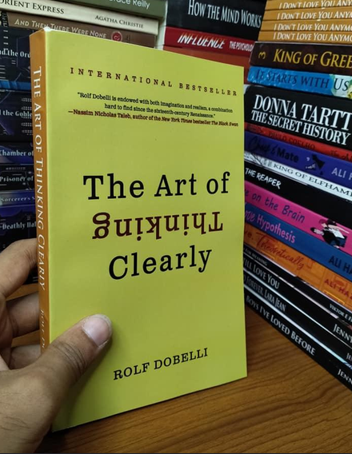
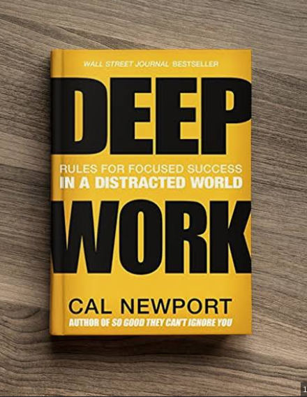
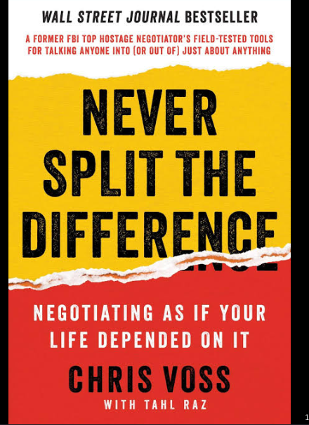
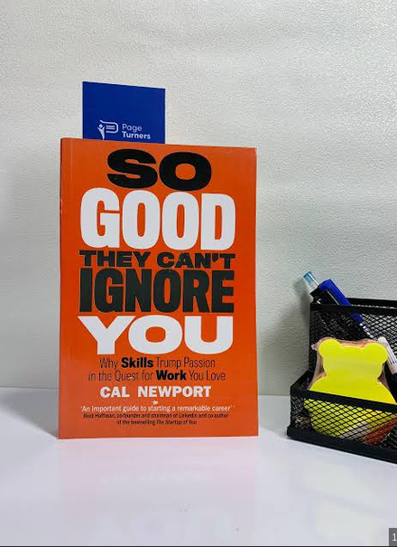
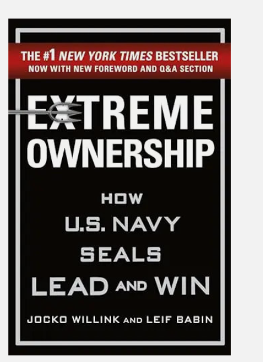
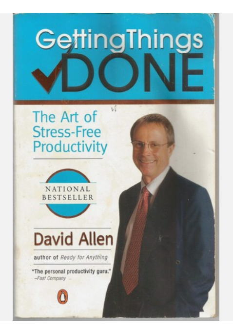
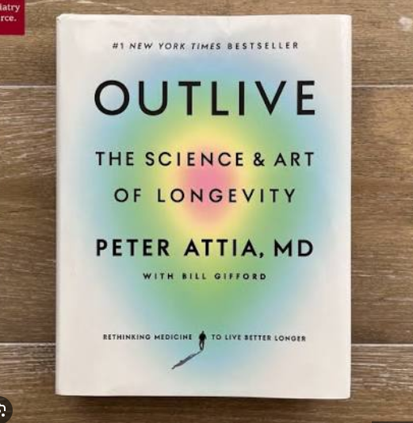
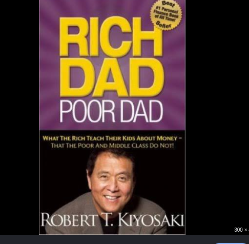
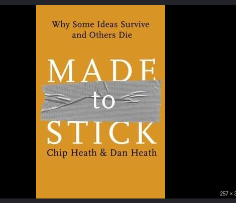
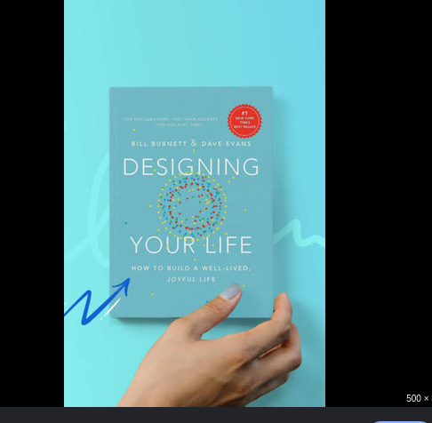

# Week 01 — Success Mindset (Mindset OS)

Part of the DevOps Micro Internship (DMI) with Agentic AI

---

## Task 1 — A Belief You Hold

### Question

What is something you believe to be true that most people around you would disagree with?

Write at least **50 words**. Be honest, specific, and use clear professional sentences.

### Your Answer

`"Life... Life... Life... What is life?"`
Life is but a vapor that appears for a little while and then vanishes away. Many people think the purpose of our existence is simply to fulfill our own desires by marrying, eating, reproducing, and accumulating wealth. However, the true purpose of our existence in this world goes far beyond merely living and leaving a legacy for others to admire. Rather, it is about acknowledging the Creator and Sustainer of life. If you conduct a survey and ask the elderly who have lived life to the absolute fullest about how they spent their time and years, the sincere ones will tell you that there is nothing truly lasting in this world. They will echo the truth that all is vanity upon vanity—meaning everything you have worked hard and labored for will eventually fade. Why, then, do we spend so much time toiling, gathering wealth, and neglecting our main purpose on Earth? If we truly understand that we are merely sojourners and pilgrims in this world, we will live accordingly. Our ultimate destination after death is determined by how closely we walk with our Creator and how deeply we revere Him in all our ways. Some believe there is no life after death, but that perspective misses the ultimate truth. If we cannot confidently answer where we are going after we die, then we must be deeply cautious of how we live today. God is real, which means life after death is real, and we must prepare our hearts and actions before our time is up.

---

## Task 2 — Three Objective Truths Discovered Through Experimentation

Write three objective truths you discovered through your own actions and results. For each truth, include one sentence for the truth and two to four lines of evidence from your life.

### Truth #1

Write each truth in this format:

**Truth:** (1 sentence)

**Evidence from my life:** (2–4 lines: what you tried + what happened)

---

## Truth #1

There is a clear difference between Schooling and being Educated.

**Evidence from My Life**

Add your answer here...

### Truth #2

**Truth**

Add your answer here...

**Evidence from My Life**

Add your answer here...

### Truth #3

**Truth**

Add your answer here...

**Evidence from My Life**

After graduating from The Federal Polytechnic, Ilaro, as the overall best student with a distinction in the School of Engineering, I made a startling discovery: I had built my life entirely around passing examinations, not around my true identity. I had failed to develop myself outside the classroom or figure out life. I hadn't built the habits necessary to navigate life's storms, achieve victory, and find success in my pursuits. True education is about building an identity and establishing core values that keep your passion burning until you reach your destination.

---

## Task 3 — What Does Your 2.0 Version Look Like?

### Truth
Less reading and more practical or implementation

**Reflection:**

When I started my cloud journey, I approached it like traditional schooling: I watched endless Udemy and YouTube tutorials without properly understanding what I was doing, and I failed to document any of my hands-on projects. Internally, I knew something was missing, but I couldn't fathom what it was. I found myself jumping from one video to another, searching for a way out. Thankfully, I came across the DMI program, which truly values collaboration, mentorship, and personal growth.

## Task 5 — Your One-Year Non-Fiction Reading Plan

List **10 non-fiction books** you plan to read during the next year. Include the title and author of each book. Books in any language are allowed.

Mentorship oversight cannot be joke with

### Evidence from my life

I have spent my time and resources learning Cloud and DevOps engineering entirely on my own. Without a mentor, I have had no one to guide me or turn to when stuck with doubt, frustration, imposter syndrome, or broken code. It is incredibly difficult to achieve tangible career progress without wasting valuable time and energy in isolation. Mentorship programs offer the vital support and guidance needed for successful career growth, saving us from repeating unnecessary mistakes.


## Task 6 — Your Life and Career Metrics

List the things you will measure regularly in your life and career. You only need to list the metric topics; do not include personal numbers.

Your list must include learning or skills, output or proof, health or energy, time or focus, and money or finance.

**Minimum 300 words.**

### Rules

* Write in past tense, like it already happened.
* Don't use "likes to / wants to / hopes to."
* Use specifics:

  * built
  * shipped
  * led
  * published
  * earned
  * relocated
  * contributed
* Include skills proof:

  * projects
  * portfolios
  * GitHub
  * blogs
  * certifications
  * job role
  * leadership
  * community contribution
* Add 1–3 images if you can (optional but powerful).

### Publish It Publicly On Any ONE

* LinkedIn
* Medium
* WordPress
* Blogspot
* Personal blog
* Portfolio page

Use the credit note that matches your track:

Add the following credit note at the end of your post **(If you are DMI Cohort 3 student)**:

> **P.S. This post is part of the DevOps Micro Internship (DMI) with Agentic AI — Cohort 3 — by [Pravin Mishra](https://www.linkedin.com/in/pravin-mishra-aws-trainer/). My graded progress is public: https://dmi.pravinmishra.com/s/YOUR-GITHUB-USERNAME.html · Start your DevOps journey: https://dmi.pravinmishra.com/?utm_source=student&utm_medium=ps-blog&utm_campaign=cohort3**

**Tag [Pravin Mishra](https://www.linkedin.com/in/pravin-mishra-aws-trainer/) in your LinkedIn post, then tag Lead Co-Mentor — [Anjana Muthunayake](https://www.linkedin.com/in/anjana-muthunayake/).**

Add the following credit note at the end of your post **(If you are DMI Self-paced track student)**:

> **P.S. This post is part of the DevOps Micro Internship (DMI) — Self-Paced Engineer Track — by [Pravin Mishra](https://www.linkedin.com/in/pravin-mishra-aws-trainer/). My graded progress is public: https://dmi.pravinmishra.com/s/YOUR-GITHUB-USERNAME.html · Start your DevOps journey: https://dmi.pravinmishra.com/?utm_source=student&utm_medium=ps-blog&utm_campaign=self-paced**

Add the following credit note at the end of your post **(If you are DMI Campus student)**:

> **P.S. This post is part of the DevOps Micro Internship (DMI) — Campus — by [Pravin Mishra](https://www.linkedin.com/in/pravin-mishra-aws-trainer/). My graded progress is public: https://dmi.pravinmishra.com/s/YOUR-GITHUB-USERNAME.html · Start your DevOps journey: https://dmi.pravinmishra.com/?utm_source=student&utm_medium=ps-blog&utm_campaign=campus**

**Tag [Pravin Mishra](https://www.linkedin.com/in/pravin-mishra-aws-trainer/) in your LinkedIn post, then tag Lead Co-Mentor — [Anjana Muthunayake](https://www.linkedin.com/in/anjana-muthunayake/).**

Hashtags:

#DMIByPravinMishra #AgenticAI #DevOps

## Your Article

🚀 My Version 2.0: From FUTA to DevOps Engineer

A few years ago, while still studying Electrical and Electronics Engineering at the Federal University of Technology, Akure (FUTA), Nigeria, I made a conscious choice to pivot away from traditional career paths and dive completely into Cloud and DevOps engineering. I knew transitioning into DevOps would be incredibly difficult, but because I wanted to build a better future for myself, I didn’t wait for the perfect moment. I committed fully, burned my bridges, and never looked back. There was no Plan B. That single decision changed my life and marked the beginning of my Version 2.0. As James Allen wrote, "What we are by thought, we rock and build." I filled my mind daily with a burning desire to grow, focusing heavily on building the habits and discipline needed to achieve my dream of becoming an engineer.

The real turning point started with the DevOps Micro Internship program led by Pravin Mishra. I invested countless hours stripping everything down to the basics and mastering Ubuntu & CentOS Linux, Git, GitHub, containerization, cloud providers (AWS & Azure), Infrastructure as Code (Terraform), observability, and automation.

Instead of just collecting course completion certificates, I focused heavily on building actual production-grade projects. My GitHub profile became the real proof of my progress long before my resume caught up. Some of the core infrastructure projects I have built and deployed include:

    Multi-Cloud Infrastructure Automation: Provisioning resources across AWS and Azure using Terraform with remote state management, and automating configurations via Ansible.

    Cloud-Native Microservices Platform: Modernizing and orchestrating multi-service applications using Docker, Kubernetes, Helm, Redis, PostgreSQL, and RabbitMQ behind an API Gateway.

    Enterprise CI/CD Pipelines with GitOps: Engineering end-to-end automated software delivery streams using GitHub Actions, Jenkins, Helm, and GitOps deployments with Argo CD.

    Production-Ready Kubernetes Infrastructure: Hardening cluster deployments using Ingress controllers, strict Network Policies, Horizontal Pod Autoscaling (HPA), and Istio service mesh.

    Observability & Incident Response: Setting up full-stack telemetry and monitoring architectures using Prometheus, Grafana, Loki, OpenTelemetry, Jaeger, and Alertmanager.

To back up all this practical grinding with deep structural knowledge, I pushed myself to earn top-tier industry credentials, including the AWS Certified Solutions Architect – Associate, Certified Kubernetes Administrator (CKA), HashiCorp Certified: Terraform Associate, and Red Hat Certified Engineer (RHCE). For me, it was never about adding flashy badges to my LinkedIn; it was about ensuring that when I design a cloud architecture, it is fundamentally secure, highly available, and cost-effective.

I’ve also come to realize that good engineering means nothing if you can’t communicate it effectively. That’s why I make it a priority to document my work thoroughly—writing clear project runbooks, detailed READMEs, and technical blog posts where I break down the real-world cloud networking challenges and Linux bugs I encounter along the way.

Looking back at the last five years, the biggest lesson I’ve learned is that being a great DevOps engineer isn't about memorizing a long list of tools. It’s about the mindset—having the discipline to break down messy problems, automate the mundane tasks, and build reliable delivery systems that engineering teams can completely trust.

### Public Link

`https://www.linkedin.com/posts/oluwatobiloba-adeje-2572b42a6_join-the-dmi-devops-micro-internship-share-7478414321530593280-smsL/?utm_source=share&utm_medium=member_desktop&rcm=ACoAAEm6D2MBiHlTtqXxAdNL2_2Taiskof8w_Lw`


---

# Assignment 4. Have you ever cut corners (unethical / dishonest / shortcut behavior — not necessarily illegal)? If yes, how did it make you feel?

### Important

You don't need to write the full story.

Focus on the feeling:

* guilt
* fear
* shame
* stress
* regret
* numbness
* etc.

This is about self-awareness, not judgment.

### Answer Format

**Yes / No**

If Yes:

**What emotion did you feel?** (minimum 50–100 words)

## Answer

**NO**

---

# Assignment 5. What are 10 non-fiction books you plan to read in the next 1 year?

### Rules

* Mention **Title + Author**
* Any language allowed
* No fiction novels

### Tip

Choose books that improve:

* mindset
* communication
* productivity
* health
* money
* career
* leadership

## Book List

1. **The Art of Thinking by Rolf Dobelli** 

2. **Deep Work by Cal Newport**

3. **Never Split the Difference by Chris Voss & Tahl Raz**

4. **So Good They Can't Ignore by Cal Nweport**

5. **Extreme Ownership by Jocko Willink & Leif Babin**

6. **Getting Things Done by David Allen**

7. **Outlive by Peter Attia & Bill Gifford**

8. **Rich Dad Pooor Dad by Robert T. Kiyosaki**

9.  **Made to Stick by Chip Health and Dan Heath**

10. **Designing Your Life by Bill Burnett & Dave Evans**


---

# Assignment 6. What are the things you will measure regularly in your life and career?

### Rules

List topics only. No need to share numbers.

### Must Include

* Learning / skill
* Output / proof
* Health / energy
* Time / focus
* Money / finance (personal or business)

### Example

* Learning hours per week
* Deep work sessions per week
* Projects shipped / documented
* Steps / workouts
* Sleep hours
* Spending tracker

## My Metrics

* Reading 20-30 pages per day
* Sleep 7-8 hours per night
* Deep work session per day (3-5 hours)
* Project milestones completed per week
* Learning hours (2-3 hours) per day
* Prayer and personal reflection per day
* Technical articles, portfolio update or Documentation written per week
* Exercise per day
* Saves at least 20% per income
* Spending tracker

---

## Task 7 — Brain Dump and Three-Month System Plan

### Step 1 — Brain Dump (Private)

Do a private brain dump in a notebook, notes app, or document. Include everything currently on your mind, such as tasks, bills, worries, goals, pending messages, ideas, and responsibilities.

**Did you create a brain dump?**

```text
Yes / No
```

### Did You Do It?

**Yes / No**

Answer:

**Yes**

---

## Step 2: Your 5-Month Routine + Focus Blocks

Create a simple plan you can realistically follow for the next 5 months.

### Weekly Routine

Example:

* Mon–Thu: 60 min deep work
* Sat: DMI session
* Sun: Weekly review

#### My Weekly Routine

- Monday --> Friday 3 hours deep work daily
- Saturday --> DMI sessions 8 hours
- Sunday --> Weekly review 2 hours
---

### Focus Blocks

#### When Will You Do DMI Work? (Days + Time)

- Monday --> Wednesday (9am - 12 pm)

#### How Many DMI Work Sessions Will I Complete Each Week?

- Five sessions per week 

#### My Distraction Rules

- Phone must be in do not disturb
- No using of any social media platform during working hours
- Always use the computer room
- No opening of irrelevant site that is not related to the field of study
- Keep the room illuminated

---

## Task 8 — Week 1 Reflection and Proof of Work

### Biggest Insight I Got About Myself This Week

I was able to guide my focus and think differently as an engineer.

### My Biggest Weakness or Loop I Noticed

I delayed the submission of my assignment through procrastination.

### One System I Will Implement From This Week (Exact Habit and Time)

Wake up by 5am daily.

### Proof of Work

`https://www.linkedin.com/posts/oluwatobiloba-adeje-2572b42a6_join-the-dmi-devops-micro-internship-share-7478421352786612227-k5MS/?utm_source=share&utm_medium=member_desktop&rcm=ACoAAEm6D2MBiHlTtqXxAdNL2_2Taiskof8w_Lw`

---

## Completion Checklist

* [ ] All eight tasks are completed.
* [ ] All written answers are honest, specific, and written in clear professional sentences.
* [ ] Task 1 has at least 50 words.
* [ ] Task 2 includes all three truths and evidence from my life.
* [ ] Task 3 includes a 300+ word article written in past tense.
* [ ] My Task 3 article is published on an approved public platform.
* [ ] I added the correct DMI credit note and replaced `YOUR-GITHUB-USERNAME`.
* [ ] I published a LinkedIn post sharing my Task 3 article.
* [ ] Task 5 has 10 non-fiction books with titles and authors.
* [ ] Task 6 includes learning, output, health, time, and finance metrics.
* [ ] I completed the private brain dump for Task 7.
* [ ] I added a realistic three-month routine, DMI focus blocks, and distraction rules.
* [ ] I completed the Week 1 reflection.
* [ ] I added both the LinkedIn post and public article URLs under Task 8.

---


## 📌 About DMI & CloudAdvisory

DevOps Micro Internship (DMI) is a project-based DevOps program run by Pravin Mishra (The CloudAdvisory) focused on real-world execution, systems thinking, and career readiness.

It helps learners build strong DevOps foundations with hands-on experience.


## 📌 Resources

- 🌐 **DMI Official Website:** https://dmi.pravinmishra.com?utm_source=github&utm_medium=readme  
- 🎓 **University:** https://university.pravinmishra.com?utm_source=github&utm_medium=readme  
- 💬 **Discord Community:** https://discord.pravinmishra.com?utm_source=github&utm_medium=readme  
- 📝 **Blog:** https://dmi.pravinmishra.com/blog?utm_source=github&utm_medium=readme  
- ▶️ **YouTube Playlist (DMI Cohort 3):** https://www.youtube.com/playlist?list=PLFeSNDtI4Cho  
- 🔗 **Pravin Mishra (LinkedIn):** https://www.linkedin.com/in/pravin-mishra-aws-trainer/  
- 🏢 **CloudAdvisory (LinkedIn):** https://www.linkedin.com/company/thecloudadvisory/

---

*This submission is part of DevOps Micro Internship (DMI) — Agentic AI Track*