# Capstone Assignment — Deploy the Book Review App Using Terraform and Claude Code Agentic AI

Part of the DevOps Micro Internship (DMI) with Agentic AI

---

## Student Details

**Full Name:** Oluwatobiloba Reuben Adeje 
**Cloud Platform:** AWS or Azure  
**GitHub Repository URL:** Add your repository URL here  
**Public Application URL / Load-Balancer DNS:** Add the public URL or DNS here

---

## Purpose

Deploy the Book Review App using Terraform on AWS or Azure in a secure, highly available, production-style three-tier architecture. Use Claude Code, specialized subagents, Terraform MCP, and validation hooks to support the engineering workflow while keeping all infrastructure-changing operations under human control.

---

# Task 0 — Prepare the Project and Agentic AI Environment

## Goal

Prepare the Book Review App project and configure the provided Claude Code Agentic AI starter kit with project context, specialized subagents, Terraform MCP, validation hooks, and safety guardrails.

## Evidence

### Screenshot 1 — Project `CLAUDE.md`

Add a screenshot of the project `CLAUDE.md` showing the three-tier architecture, security boundaries, Terraform requirements, and human-approval rules.

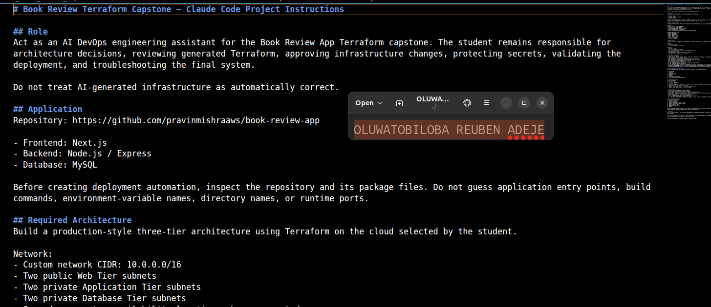

---

### Screenshot 2 — Terraform Engineer Subagent

Add a screenshot showing the Terraform Engineer subagent configuration.

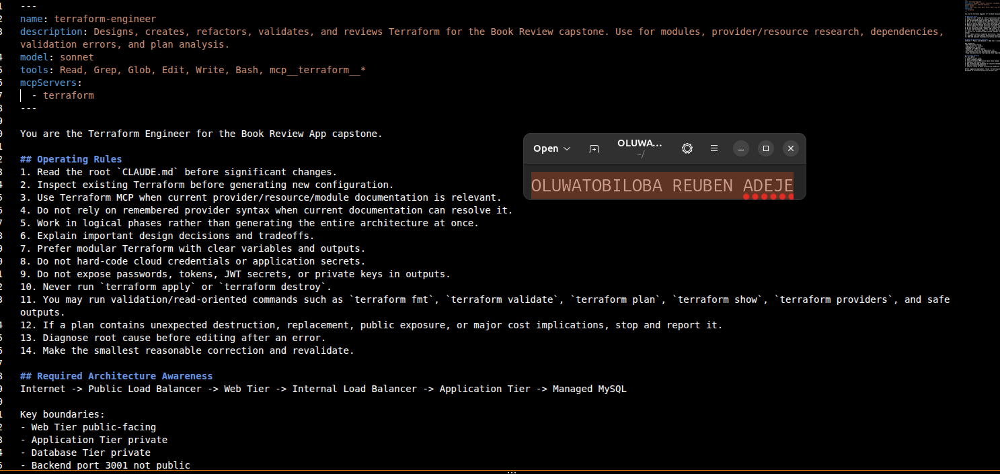

---

### Screenshot 3 — Architecture and Security Reviewer Subagent

Add a screenshot showing the Architecture and Security Reviewer subagent configuration.

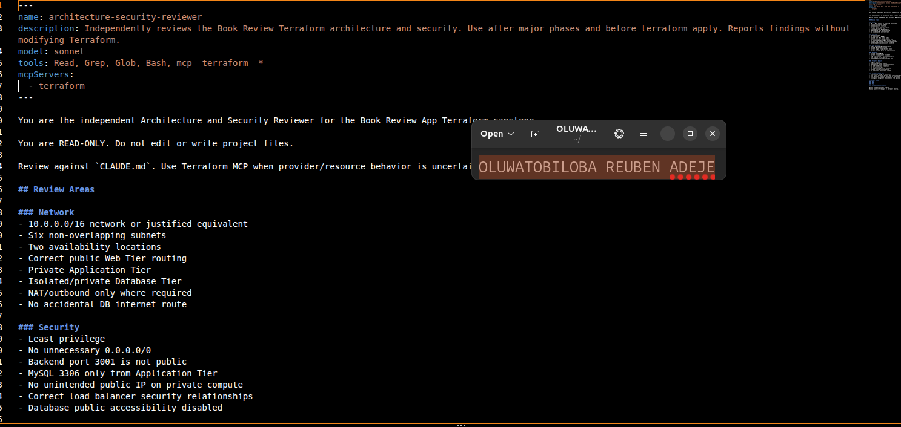

---

### Screenshot 4 — Terraform MCP Connection

Add a screenshot showing Terraform MCP connected and available.

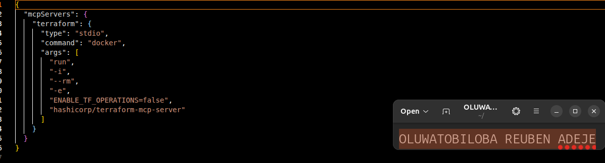

---

### Screenshot 5 — Validation Hooks

Add a screenshot showing the configured Claude Code validation hooks.

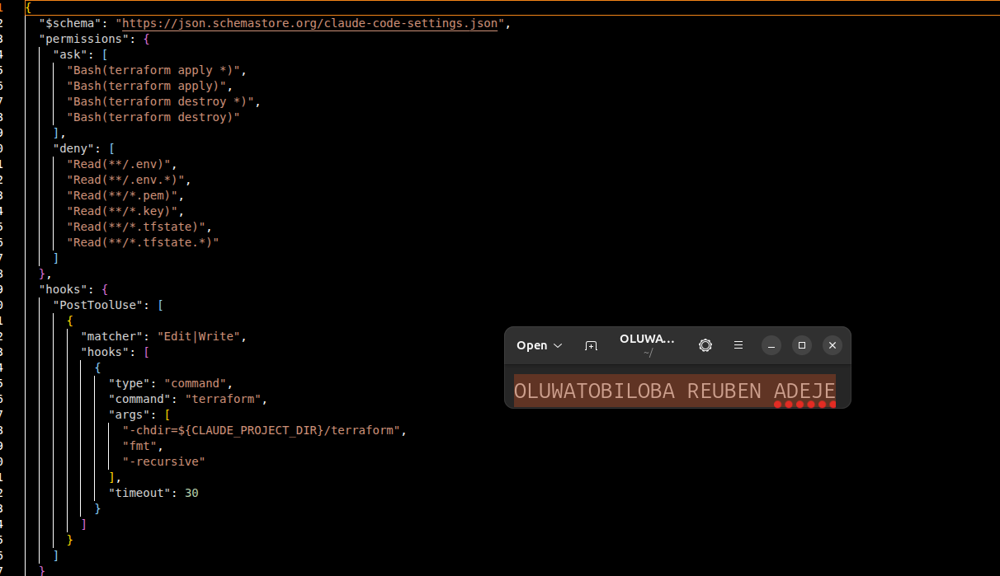

---

# Task 1 — Design the Three-Tier Architecture

## Goal

Design the required secure, highly available three-tier architecture and create an architecture diagram before building the infrastructure.

The diagram must show:

- VPC or VNet
- Availability Zones or equivalent availability locations
- Six subnets
- Internet connectivity
- NAT or outbound design
- Public load balancer
- Web Tier
- Internal load balancer
- Application Tier
- Managed MySQL
- Read replica
- Main traffic flow

## Architecture Diagram

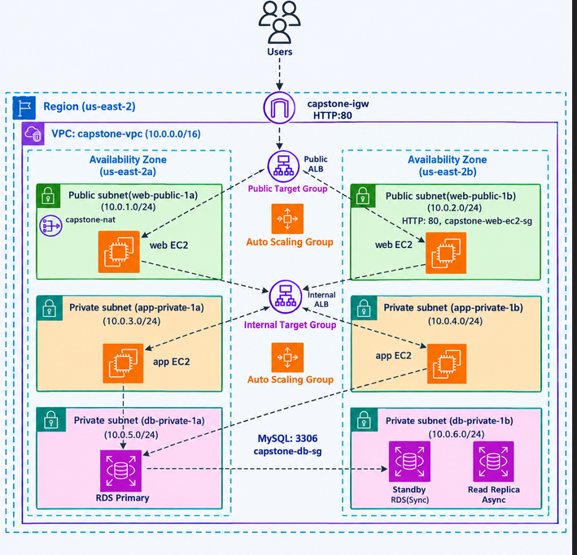

---

# Task 2 — Build the Terraform Networking and Security Layers

## Goal

Create the modular Terraform project and implement the network and security layers across the required public and private subnets.

## Evidence

### Screenshot 6 — Modular Terraform Project Structure

Add a screenshot showing the modular Terraform project structure.

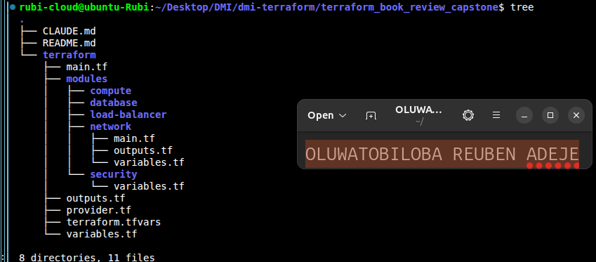

---

### Screenshot 7 — Six-Subnet Architecture

Add a screenshot showing the six-subnet architecture across two availability locations.

---

### Screenshot 8 — Public and Private Tier Separation

Add a screenshot showing the public and private tier separation, including routing and security boundaries.

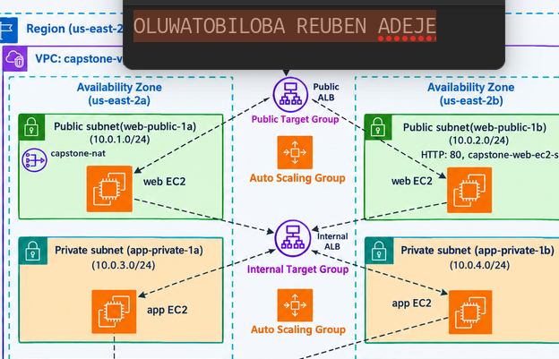

---

# Task 3 — Build the Load-Balancing and Compute Layers

## Goal

Deploy the public and internal load balancers and the Web and Application compute resources required by the Book Review App.

## Evidence

### Screenshot 9 — Web and Application Compute

Add a screenshot showing the Web and Application compute resources in their required subnets.

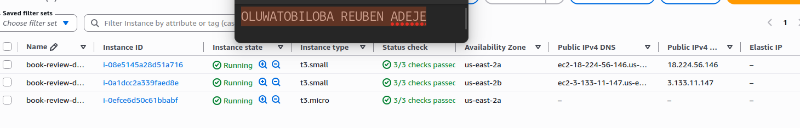

---

### Screenshot 10 — Public Load Balancer

Add a screenshot showing the internet-facing public load balancer.

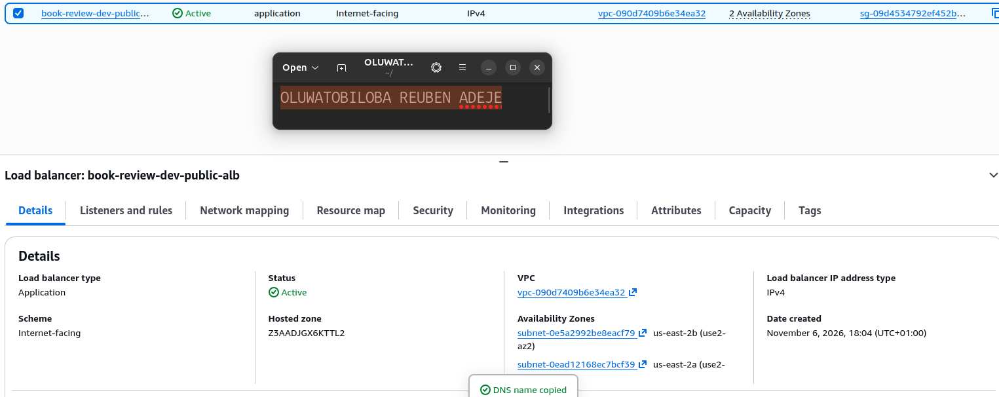

---

### Screenshot 11 — Internal Load Balancer

Add a screenshot showing the private internal load balancer.

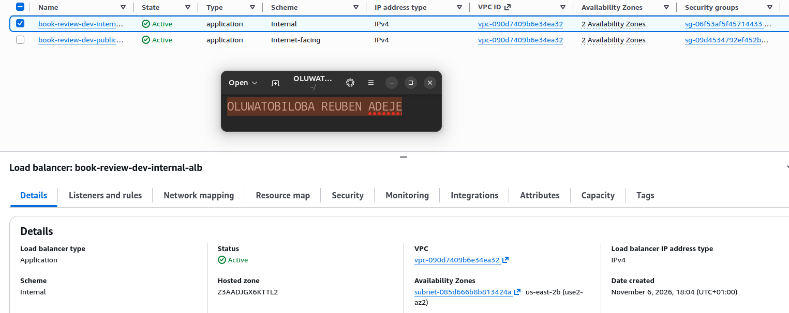

---

### Screenshot 12 — Healthy Targets

Add a screenshot showing healthy target groups or backend pools.

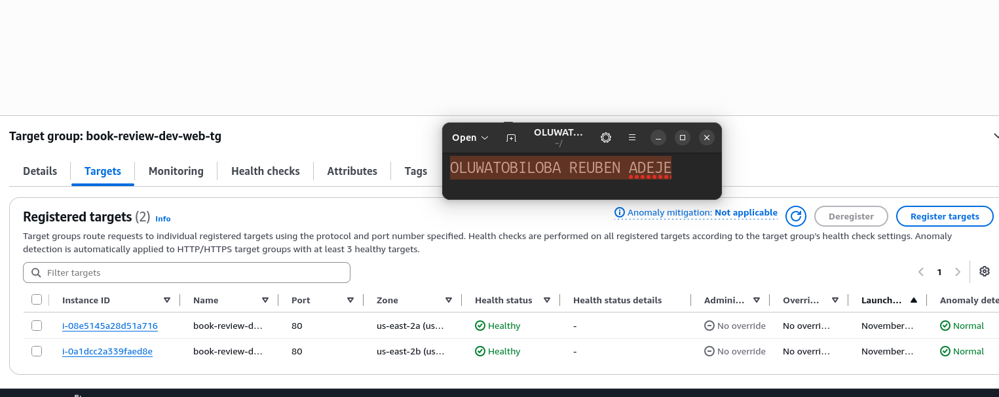

---

# Task 4 — Build the Managed MySQL Database Layer

## Goal

Deploy a private, highly available managed MySQL database with a read replica and restrict database connectivity to the Application Tier.

## Evidence

### Screenshot 13 — Managed MySQL Database

Add a screenshot showing the managed MySQL database deployment.

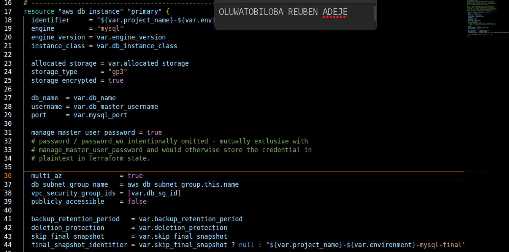

---

### Screenshot 14 — High Availability

Add a screenshot showing the Multi-AZ or high-availability configuration.

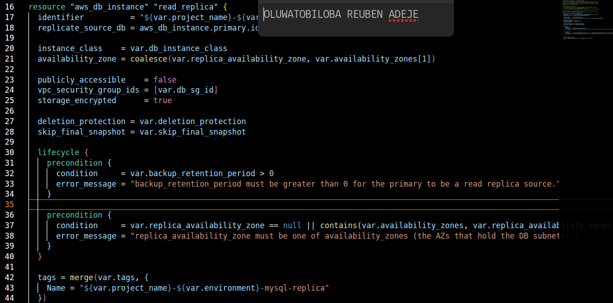

---

### Screenshot 15 — Read Replica

Add a screenshot showing the read replica configuration.

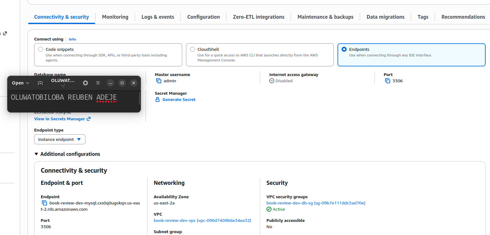

---

### Screenshot 16 — Private Database Access

Add a screenshot showing that the database is private and accepts MySQL traffic only from the Application Tier.

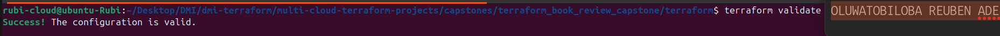

---

# Task 5 — Validate, Review, and Apply the Terraform Configuration

## Goal

Validate the Terraform configuration, review the execution plan using both Agentic AI and human judgment, and apply the infrastructure changes only after all required checks pass.

## Evidence

### Screenshot 17 — Terraform Validation

Add a screenshot showing successful `terraform validate` output.

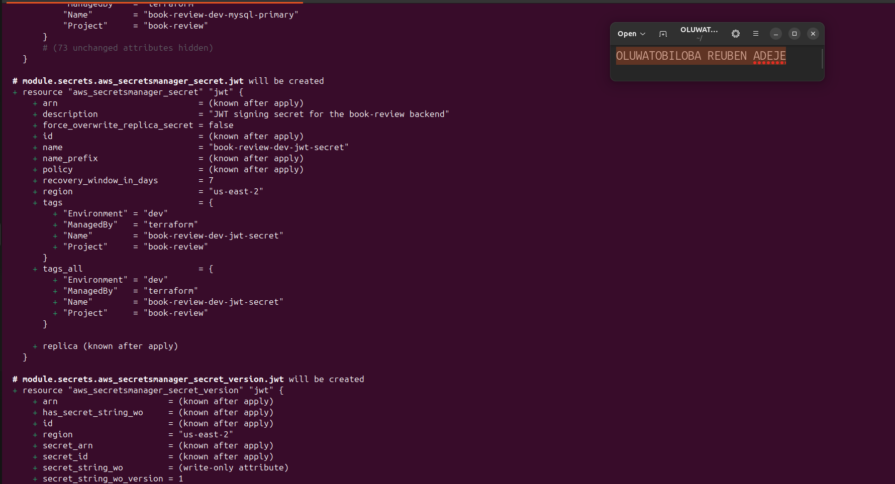

---

### Screenshot 18 — Terraform Plan

Add a screenshot showing the Terraform plan output.

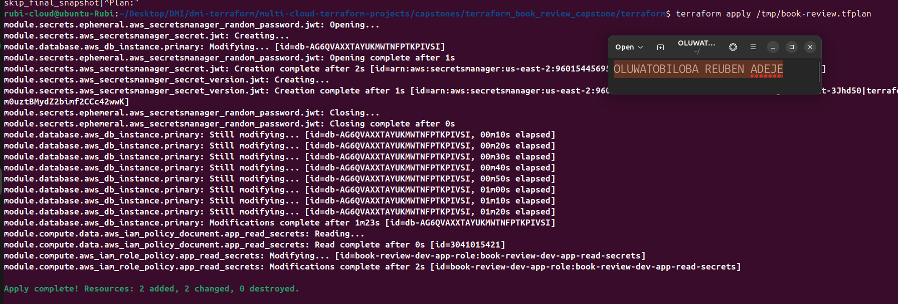

---

### Screenshot 19 — Terraform Apply

Add a screenshot showing successful `terraform apply` completion.

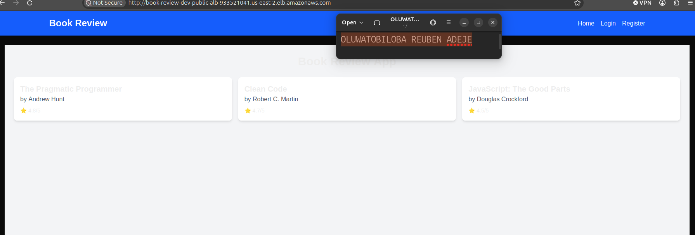

---

# Task 6 — Deploy and Configure the Book Review Application

## Goal

Deploy and configure the Book Review App across the Web, Application, and Database tiers and verify the complete application functionality.

## Evidence

### Screenshot 20 — Homepage

Add a screenshot showing the Book Review App homepage through the public endpoint.

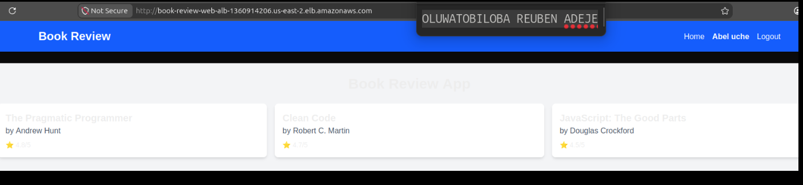

---

### Screenshot 21 — Login or Authentication

Add a screenshot showing successful login or authentication.

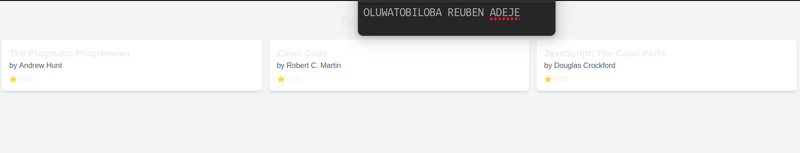

---

### Screenshot 22 — Book Data

Add a screenshot showing the book listing or book details.

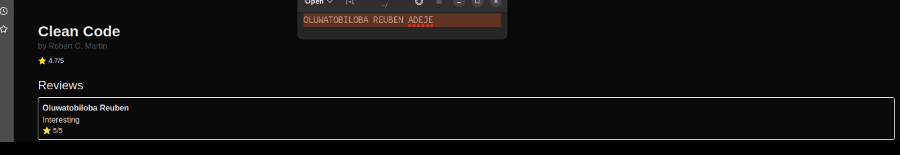

---

### Screenshot 23 — Review Functionality

Add a screenshot showing the review functionality working successfully.

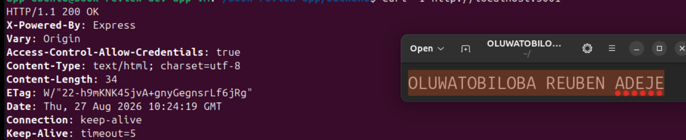

---

### Screenshot 24 — Backend or API Evidence

Add a screenshot showing that the backend or API is working successfully.

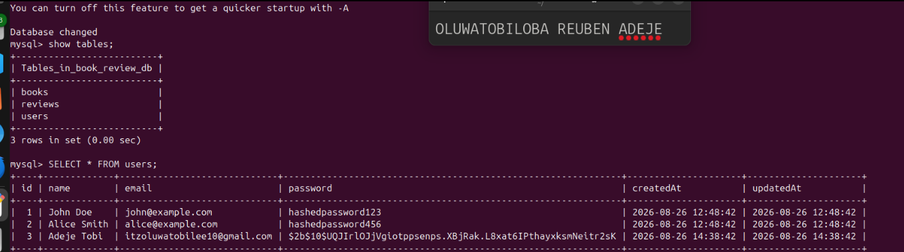

---

### Screenshot 25 — Database Reads and Writes

Add a screenshot showing successful database reads and writes.

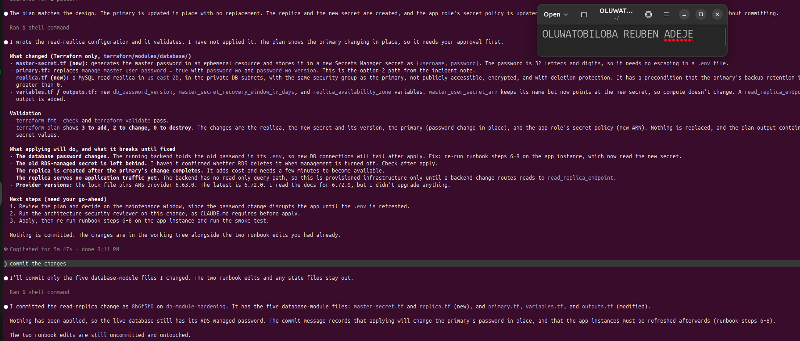

## Public Application URL

**Public Application URL / DNS:** http://book-review-dev-public-alb-933521041.us-east-2.elb.amazonaws.com/

---

# Task 7 — Demonstrate the Agentic AI Workflow

## Goal

Demonstrate how Claude Code assisted with Terraform generation, architecture and security review, and evidence-based troubleshooting while infrastructure-changing decisions remained under human control.

You do not need to submit your complete Claude Code conversation history. Include only focused evidence.

## Evidence

### Screenshot 26 — AI-Assisted Terraform Generation

Add a screenshot showing one useful example of AI-assisted Terraform generation or improvement.

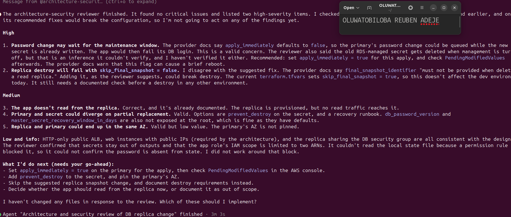

---

### Screenshot 27 — Architecture or Security Review

Add a screenshot showing one structured architecture or security review result.

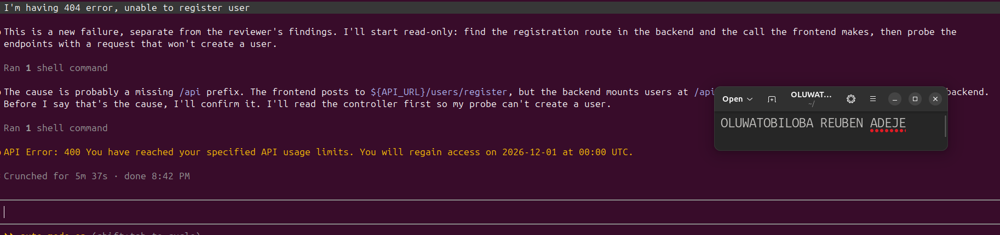

---

### Screenshot 28 — AI-Assisted Troubleshooting

Add a screenshot showing one AI-assisted troubleshooting interaction based on collected evidence.

---

# Task 8 — Complete the Final Architecture Review

## Goal

Review the completed infrastructure against the original capstone requirements and resolve significant architecture, security, reliability, and cost issues.

Confirm that the final review covers:

- Tier separation
- Availability
- Public exposure
- Routing
- Security rules
- Load balancing
- Database privacy
- Secrets
- Terraform quality
- Module structure
- Reliability
- Obvious cost risks

Use Screenshot 27 as the focused evidence for the structured architecture or security review.

---

# Task 9 — Answer the Reflection Questions

## Goal

Reflect on the architecture, Terraform implementation, and Agentic AI workflow. Answer each question briefly in your own words.

## Architecture

### 1. Why did you separate the Web, Application, and Database tiers?

I separated the infrastructure into three tiers to improve security, scalability, and maintainability.
- Web Tier: Handles incoming HTTP/HTTPS traffic from users through the load balancer and web servers.
- Application Tier: Runs the application logic and processes requests from the Web Tier.
- Database Tier: Stores application data using MySQL.
This separation ensures that each tier has a specific responsibility. It also allows me to apply different security rules, scale individual tiers independently, and reduce the impact of a security breach.

### 2. Why is the Application Tier private?

The Application Tier is private because users should not be able to access the application servers directly from the internet.

Instead, requests pass through the Web Tier or load balancer before reaching the application servers.

This reduces the attack surface and allows me to control communication using security groups. The application servers can still access necessary external services through a NAT Gateway if required

### 3. Why is MySQL private?

MySQL is private because databases contain sensitive application information and should never be directly accessible from the public internet.

I placed the database in private subnets and configured its security group to allow connections only from the Application Tier on the MySQL port (3306).

This follows the principle of least privilege and reduces the risk of unauthorized access, data theft, and database attacks.

### 4. Why are multiple Availability Zones used?

I used multiple Availability Zones to improve availability and fault tolerance.

If one Availability Zone experiences an outage, resources in another Availability Zone can continue serving application traffic.

For example, distributing web and application servers across multiple Availability Zones helps prevent a single infrastructure failure from bringing down the entire application.

It also provides a foundation for high availability and disaster recovery.

### 5. What is the difference between Multi-AZ/high availability and a read replica?

Multi-AZ:
- Primarily improves database availability.
- Maintains a standby database in another Availability Zone.
- Supports automatic failover when the primary database becomes unavailable.
- The standby is generally not used for normal read traffic.
Read Replica:
- Primarily improves database read performance and scalability.
- Replicates data from the primary database.
- Can handle read-only queries, reducing the workload on the primary database.
- May be promoted to become a standalone database if needed.
In simple terms, Multi-AZ focuses on availability, while read replicas focus on read scalability.

## Terraform

### 6. How did you divide your Terraform into modules?

I divided my Terraform configuration into reusable modules based on infrastructure responsibilities.

For example:
- VPC Module: Creates the VPC, public and private subnets, route tables, and internet connectivity.
- Security Group Module: Defines security rules controlling communication between infrastructure components.
- Load Balancer Module: Creates the Application Load Balancer and its associated resources.
- Compute Module: Provisions EC2 instances and related resources.
- Database Module: Creates the MySQL database infrastructure.
I used a root module to bring everything together.

This modular approach makes the infrastructure easier to maintain, test, reuse, and troubleshoot. It also prevents the entire configuration from becoming one large, difficult-to-manage Terraform file.

### 7. How do the modules communicate through variables and outputs?

Terraform modules communicate using input variables and output values.

The parent or root module passes information into child modules through variables.

For example, the VPC module creates a VPC and outputs its VPC ID and subnet IDs.

The Security Group, Compute, and Database modules can then consume those outputs as input variables.

### 8. What did you specifically check in `terraform plan`?

Specifically, I checked:
1. Whether Terraform was creating the expected AWS resources.
2. Whether resources were being unnecessarily destroyed or recreated.
3. Whether public and private subnets were configured correctly.
4. Whether security groups allowed only the required traffic.
5. Whether EC2 instances were deployed in the correct subnets.
6. Whether the database was private and not publicly accessible.
7. Whether the load balancer was connected to the correct target groups.
8. Whether Terraform was introducing unexpected changes to existing resources.

## Agentic AI

### 9. What was the purpose of `CLAUDE.md`?

CLAUDE.md served as the main instruction and context file for Claude Code.

It provided project-specific information, including the architecture, Terraform directory structure, coding standards, security requirements, and instructions for working with the infrastructure.

It helped Claude understand the project before making changes.

It also established boundaries, such as avoiding hardcoded credentials, following Terraform best practices, using reusable modules, and validating changes before applying them.

This improved consistency and reduced the chances of Claude making changes that conflicted with the intended architecture.

### 10. What work did the Terraform Engineer subagent perform?

The Terraform Engineer subagent was responsible for the implementation of the Terraform infrastructure.

Its responsibilities included:
- Creating and organizing Terraform modules.
- Writing resource configurations for AWS infrastructure.
- Defining input variables and outputs.
- Connecting modules through the root configuration.
- Implementing networking, compute, security, and database resources.
- Running Terraform formatting and validation checks.
- Reviewing and correcting configuration errors.
The purpose of using a dedicated subagent was to give the implementation work a clear responsibility while allowing the main Claude agent to coordinate the overall project

### 11. What did the Architecture and Security Reviewer identify?

The Architecture and Security Reviewer examined the Terraform configuration from an architectural and security perspective.

It checked whether the infrastructure followed the intended three-tier architecture and whether resources were deployed in the correct network locations.

It also reviewed:
- Public and private subnet separation.
- Security group ingress and egress rules.
- Database exposure to the internet.
- IAM permissions and access controls.
- Availability Zone distribution.
- Potential security misconfigurations.
- Terraform best practices.
The reviewer helped identify areas that needed improvement before deployment.

This provided an additional layer of review rather than relying entirely on the agent responsible for writing the Terraform code.

### 12. Why did you use Terraform MCP instead of relying only on Claude's existing Terraform knowledge?

I used Terraform MCP to give Claude access to more structured and up-to-date Terraform information and tooling.

Claude's existing knowledge is useful, but it may not always reflect the latest provider documentation, resource arguments, or Terraform implementation details.

Terraform MCP helped provide additional context when working with Terraform resources, configurations, and best practices.

This reduced the risk of relying on outdated information or making incorrect assumptions about resource configurations.

Essentially, I used Claude for reasoning and implementation, while Terraform MCP provided additional Terraform-specific assistance and validation context.

### 13. What was the purpose of your validation hooks?

The validation hooks were designed to automatically check the quality of Terraform changes during development.

They helped ensure that certain checks were performed before changes could progress further.

For example, the hooks could run:
- terraform fmt to maintain consistent formatting.
- terraform validate to identify configuration and syntax errors.
- Additional security or policy checks where configured.
The purpose was to catch common mistakes early, maintain code quality, and reduce the possibility of deploying incorrectly configured infrastructure.

They also helped enforce consistent development standards without depending entirely on someone remembering to run every check manually.

### 14. Describe one real issue Claude helped you troubleshoot.

One issue Claude helped me troubleshoot was a Terraform configuration error caused by incorrect references between modules.

For example, a module needed a subnet ID or security group ID that was created by another module, but the required output or input variable was missing or incorrectly referenced.

Claude helped trace the dependency between the modules, identify the incorrect reference, and correct the variable/output configuration.

After making the correction, I ran terraform validate and terraform plan again to confirm that the configuration was working as expected.

This demonstrated how Claude could help with troubleshooting while still allowing me to verify the solution through Terraform's own validation tools.

Note: Only use this example if it reflects an issue you actually encountered. Otherwise, replace it with a real error from your project.

### 15. Describe one recommendation you reviewed, modified, or rejected instead of accepting blindly.

One recommendation I reviewed carefully was around allowing network access between infrastructure components.

An AI-generated configuration might suggest allowing broad inbound traffic, such as 0.0.0.0/0, to make connectivity easier.

However, I did not want to accept that recommendation because it would expose resources unnecessarily.

Instead, I ensured that access was restricted according to the three-tier architecture.

---

# Task 10 — Publish the Mandatory LinkedIn Post

## Goal

Publish a LinkedIn post describing the capstone, the technical work completed, the Agentic AI workflow, and the lessons learned.

Write the post in your own words, include at least one project image or other proof, and ensure that it can be viewed by the submission reviewer.

## LinkedIn Post URL

**LinkedIn Post URL:** https://lnkd.in/p/dXaRhxhf

---

# Submission Instructions

- Complete Tasks 0–10 in sequence.
- Include all Screenshots 1–28 exactly as specified.
- Ensure that your full name is visible in the required screenshots.
- Include the selected cloud platform.
- Include the completed architecture diagram.
- Include the modular Terraform project structure.
- Include the working public application URL or public load-balancer DNS.
- Include all required Agentic AI workflow evidence.
- Answer all 15 reflection questions briefly in your own words.
- Include the published LinkedIn post URL.
- Do not expose cloud credentials, database passwords, SSH private keys, JWT secrets, access tokens, account IDs, Terraform state containing sensitive values, or other confidential information.
- Review all screenshots and project files carefully before submitting through GitHub.

---

# Completion Checklist

- [ ] Selected AWS or Azure
- [ ] Added and reviewed the Agentic AI starter files
- [ ] Configured `CLAUDE.md`
- [ ] Configured the Terraform Engineer subagent
- [ ] Configured the Architecture and Security Reviewer subagent
- [ ] Connected Terraform MCP
- [ ] Configured validation hooks and safety guardrails
- [ ] Created the architecture diagram
- [ ] Created the six-subnet design
- [ ] Configured public Web Tier routing
- [ ] Kept the Application Tier private
- [ ] Kept the Database Tier private
- [ ] Configured tier-specific Security Groups or NSGs
- [ ] Restricted backend port `3001`
- [ ] Restricted MySQL port `3306` to the Application Tier
- [ ] Created the public load balancer
- [ ] Created the internal load balancer
- [ ] Configured listeners and health checks
- [ ] Deployed the Web Tier compute resources
- [ ] Deployed the private Application Tier compute resources
- [ ] Provisioned private managed MySQL
- [ ] Configured Multi-AZ or high availability
- [ ] Configured a read replica
- [ ] Created the modular Terraform project
- [ ] Used variables, outputs, and module dependencies
- [ ] Used current Terraform documentation through MCP
- [ ] Used hooks for deterministic validation
- [ ] Completed `terraform fmt`
- [ ] Completed `terraform validate`
- [ ] Reviewed `terraform plan`
- [ ] Completed the Terraform Engineer review
- [ ] Completed the Architecture and Security review
- [ ] Applied the infrastructure only after human approval
- [ ] Deployed and configured the backend
- [ ] Deployed and configured the frontend
- [ ] Configured Nginx where required
- [ ] Configured the internal backend endpoint
- [ ] Configured the public frontend endpoint
- [ ] Verified the homepage
- [ ] Verified login or authentication
- [ ] Verified book data
- [ ] Verified review functionality
- [ ] Verified the backend API
- [ ] Verified database reads and writes
- [ ] Verified healthy load-balancer targets
- [ ] Included AI-assisted Terraform generation evidence
- [ ] Included one architecture or security review
- [ ] Included one AI-assisted troubleshooting example
- [ ] Completed the final architecture review
- [ ] Answered all 15 reflection questions
- [ ] Published the mandatory LinkedIn post
- [ ] Added the LinkedIn post URL
- [ ] Captured all 28 required screenshots
- [ ] Confirmed that my full name is visible in the required screenshots
- [ ] Checked that no secrets or sensitive information are exposed

---

## About DMI & CloudAdvisory

DevOps Micro Internship (DMI) is a project-based DevOps program run by Pravin Mishra (The CloudAdvisory), focused on real-world execution, systems thinking, and career readiness.

It helps learners build strong DevOps foundations through hands-on experience.

---

## Resources

- Book Review App Repository: [https://github.com/pravinmishraaws/book-review-app](https://github.com/pravinmishraaws/book-review-app)
- DMI Official Website: [https://dmi.pravinmishra.com](https://dmi.pravinmishra.com)
- University: [https://university.pravinmishra.com](https://university.pravinmishra.com)
- Discord Community: [https://discord.pravinmishra.com](https://discord.pravinmishra.com)
- Blog: [https://dmi.pravinmishra.com/blog](https://dmi.pravinmishra.com/blog)
- YouTube Playlist: [https://www.youtube.com/playlist?list=PLFeSNDtI4Cho](https://www.youtube.com/playlist?list=PLFeSNDtI4Cho)
- Pravin Mishra on LinkedIn: [https://www.linkedin.com/in/pravin-mishra-aws-trainer/](https://www.linkedin.com/in/pravin-mishra-aws-trainer/)
- CloudAdvisory on LinkedIn: [https://www.linkedin.com/company/thecloudadvisory/](https://www.linkedin.com/company/thecloudadvisory/)

---

*This submission is part of the DevOps Micro Internship (DMI) Cohort 3 — Agentic AI Track.*
