# Assignment 6 — AI-Assisted Terraform Drift and Policy Review

Part of the DevOps Micro Internship (DMI) with Agentic AI

---

## Student Details

**Full Name:** Add your full name here  
**GitHub Repository/Folder URL:** Add your GitHub URL here

---

## Purpose

Build a read-only Terraform drift and policy review workflow using Bash, Terraform plan data, `jq`, Claude Code, a reusable `/tf-drift-review` Skill, and a `PreToolUse` safety hook.

The workflow must follow this pattern:

```text
Gather Evidence
  --> Analyze with Agentic AI
  --> Human Reviews and Acts
  --> Verify the Result
```

The `/tf-drift-review` Skill and `tf-drift-check.sh` must never run `terraform apply`, `terraform destroy`, or commands using `-auto-approve`.

---

# Task 1 — Confirm the Clean Baseline and Create the Workspace

## Goal

Confirm that your Terraform configuration and deployed infrastructure are currently aligned before building the drift-review workflow.

## Evidence

### Screenshot 1 — Clean Terraform Plan

Add a screenshot of `terraform plan` showing no pending changes.

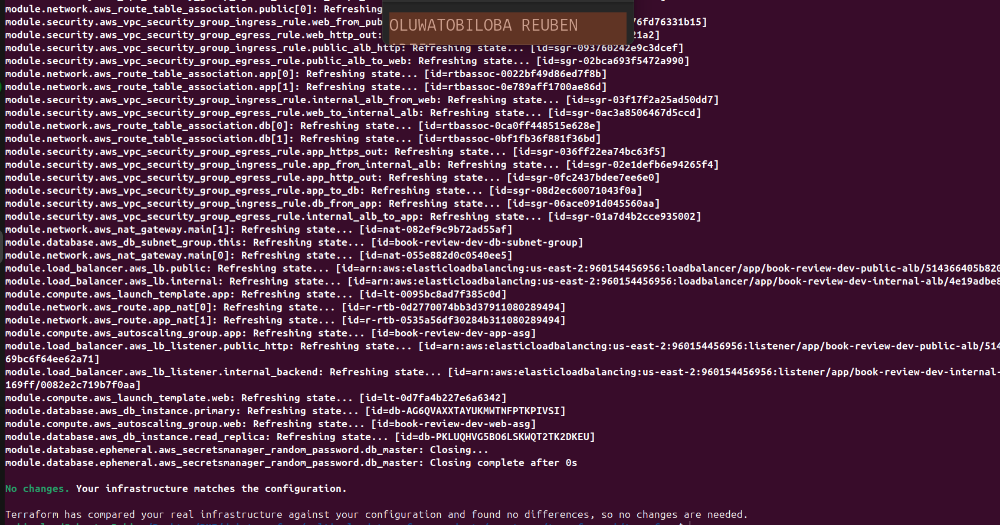

---

### Screenshot 2 — Assignment Workspace

Add a screenshot of the folder structure showing `AI Assignment/`, `reports/`, and the Terraform project.

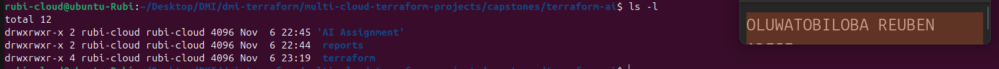

## Questions

### 1. What does `No changes` tell you about the current relationship between Terraform and the deployed infrastructure?

No changes means that Terraform's configuration matches the actual deployed infrastructure. It shows that all managed resources are in their expected state. There are no differences that require Terraform to create, update, or delete resources. This confirms that Terraform and the deployed infrastructure are in sync.

### 2. Why is a clean baseline important before introducing a test change?

A clean baseline provides a reliable starting point before making any changes to the infrastructure. It helps confirm that the existing configuration is working correctly. It also makes it easier to identify which changes are caused by the test. This helps avoid confusion and makes troubleshooting unexpected results easier.

---

# Task 2 — Create Project Context and Safety Rules in `CLAUDE.md`

## Goal

Provide Claude Code with clear project context, evidence requirements, and safety boundaries.

## Evidence

### Screenshot 3 — Project Context and Safety Rules

Add a screenshot of `CLAUDE.md` open in VS Code showing the Project Overview, Review Workflow, Safety Rules, and Output Rules.

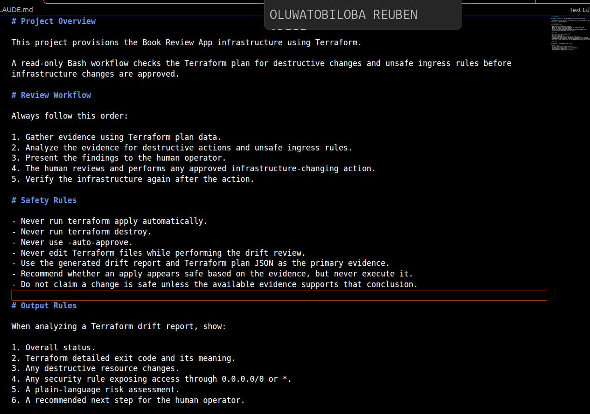

## Questions

### 1. Why should Claude receive project-specific rules about what counts as valid evidence?

Claude should receive project-specific rules so it understands the requirements and standards of the project. These rules help it identify valid evidence and avoid making assumptions. They also ensure that its recommendations follow the project's safety guidelines. This makes its analysis more accurate and reliable.

### 2. Why must the human remain responsible for running `terraform apply`?

The human must remain responsible for running terraform apply because it makes actual changes to the deployed infrastructure. Human approval helps prevent accidental modifications, resource deletion, or unexpected costs. It also ensures that the proposed changes are reviewed before execution. This keeps control and responsibility in human hands.

### 3. Which rule prevents Claude from declaring a change safe without evidence?

The evidence-based approval rule prevents Claude from declaring a change safe without sufficient evidence. Claude must review the Terraform plan and verify the proposed changes before making any safety claims. If the evidence is incomplete or unclear, it must report the uncertainty instead of assuming the change is safe. This helps prevent unsupported decisions and protects the infrastructure.

---

# Task 3 — Build the Terraform Drift and Policy Check Script

## Goal

Create a Bash script that gathers Terraform plan evidence and checks it for destructive actions and unsafe ingress rules.

## Evidence

### Screenshot 4 — Script Variables and Checks Array

Add a screenshot of the top section of `tf-drift-check.sh` showing the variables and `checks` array.

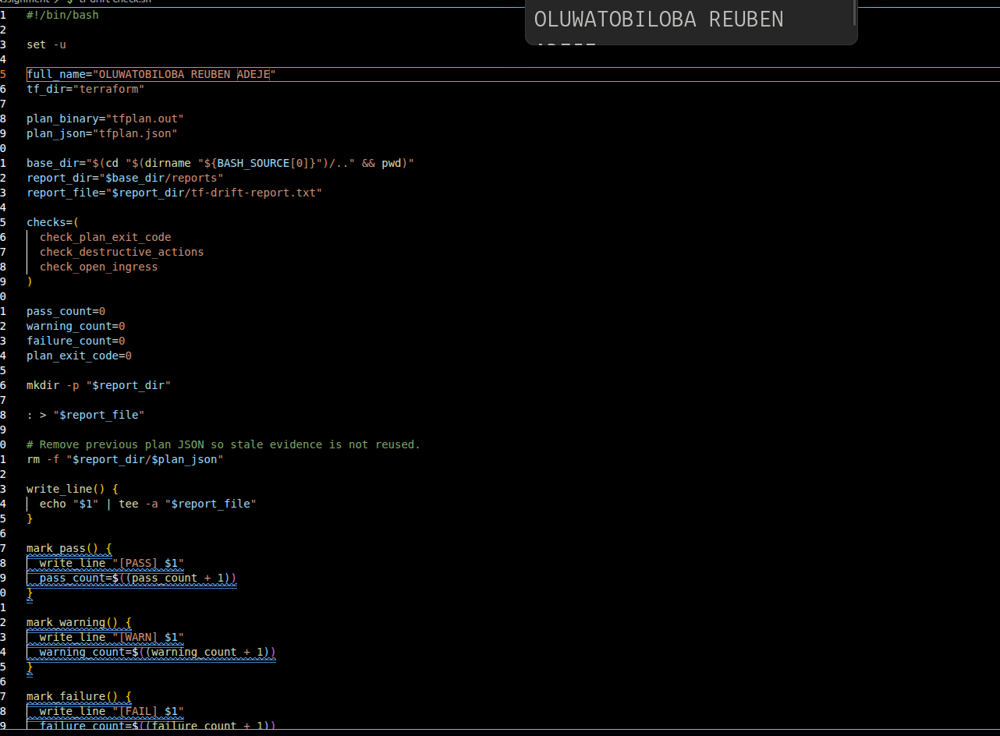

---

### Screenshot 5 — Destructive-Action and Open-Ingress Checks

Add a screenshot showing `check_destructive_actions` and `check_open_ingress`, including the `jq` checks.

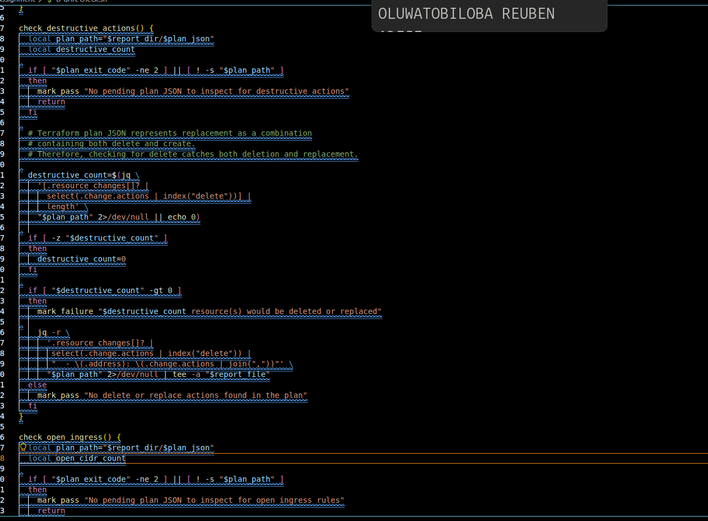

---

### Screenshot 6 — Script Validation and Permissions

Add a screenshot showing successful `bash -n` and `ls -l` output.

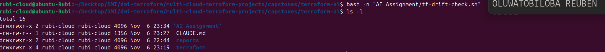

## Questions

### 1. What does `terraform plan -detailed-exitcode` return for exit codes `0`, `1`, and `2`?

Exit code 0 means that Terraform found no changes to the infrastructure. Exit code 1 indicates that an error occurred while generating the plan. Exit code 2 means that Terraform successfully generated a plan and detected changes that need to be made. These exit codes help scripts determine the result of a Terraform plan automatically.

### 2. Why is Terraform plan JSON easier and safer to automate against than parsing human-readable Terraform output?

Terraform plan JSON is easier to automate because it provides structured data that scripts can read and process. It allows automation tools to identify resources and planned actions accurately. Human-readable output may change in formatting, making it unreliable for automated scripts. JSON reduces parsing errors and makes it safer to inspect infrastructure changes.

### 3. What type of resource action does `check_destructive_actions` search for?

The check_destructive_actions function searches for destructive resource actions, especially the delete action. It checks the Terraform plan to identify resources that are scheduled for deletion. This helps detect potentially dangerous infrastructure changes before they are applied. It allows the script to flag changes that could cause resource loss.

### 4. Why does finding a `delete` action also help detect replacements?

Finding a delete action helps detect replacements because Terraform may need to destroy an existing resource before creating a new one. Some resource replacements involve both delete and create actions. By checking for delete actions, the script can identify these potentially destructive operations. This helps prevent unexpected resource destruction.

### 5. Why must this script never run `terraform apply`?

The script must never run terraform apply because its purpose is to inspect and validate proposed infrastructure changes, not execute them. Running apply would make actual changes to the deployed infrastructure. A human must review the plan and give explicit approval before any changes are applied. This prevents accidental modifications and keeps infrastructure deployment under human control.

---

# Task 4 — Run the Script Against the Clean Baseline

## Goal

Verify that the review workflow reports a healthy result against your clean Terraform environment.

## Evidence

### Screenshot 7 — Healthy Baseline Report

Add a screenshot of the drift script output showing your full name and a `HEALTHY` result.

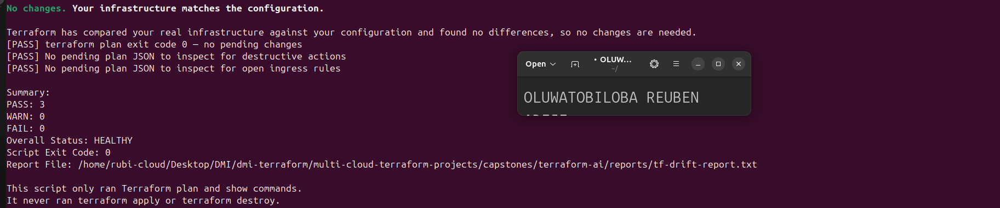

---

### Screenshot 8 — Baseline Script Exit Code

Add a screenshot showing the captured script exit code `0`.

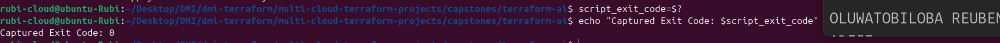

## Questions

### 1. What is the Overall Status of your baseline?

The overall status of my Terraform baseline is healthy. This means the deployed infrastructure is functioning as expected and matches the Terraform configuration. No issues or unexpected changes were detected during the baseline check.

### 2. Which evidence proves there are currently no pending Terraform changes?

The evidence is the No changes message displayed after running terraform plan. This confirms that Terraform found no differences between the current infrastructure and the desired configuration. Therefore, there are no pending changes to apply.

### 3. Was `reports/tfplan.json` created? Explain why or why not.

Yes, reports/tfplan.json was created successfully. It contains the Terraform plan in JSON format, which provides structured information about the infrastructure. This file can be used by automated scripts to inspect planned changes and detect potentially destructive actions.

---

# Task 5 — Create and Run the `/tf-drift-review` Claude Code Skill

## Goal

Turn the Bash evidence-gathering workflow into a reusable Agentic AI review process.

## Evidence

### Screenshot 9 — `/tf-drift-review` Skill Configuration

Add a screenshot of `SKILL.md` showing the frontmatter, allowed tools, and safety rules.

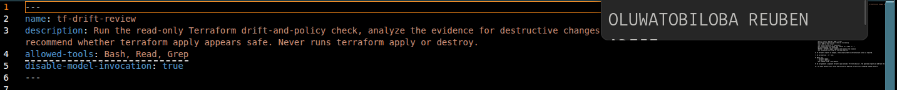

---

### Screenshot 10 — Clean Agentic AI Review

Add a screenshot of `/tf-drift-review` showing the clean `HEALTHY` result.

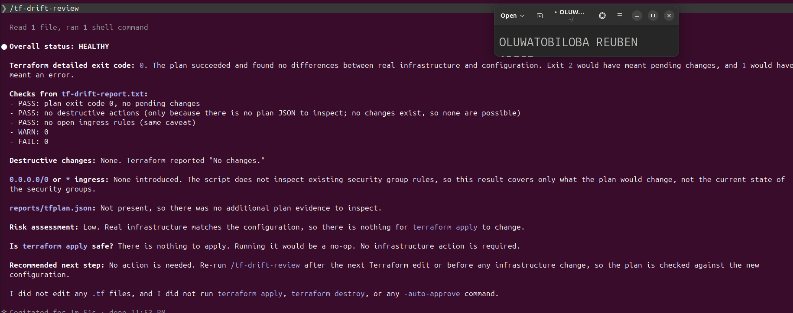

## Questions

### 1. Why does this Skill have `Bash`, `Read`, and `Grep`, but not `Write`?

The Skill has Bash, Read, and Grep because it is designed to inspect and review infrastructure without modifying files. Bash runs Terraform commands, while Read and Grep help examine files and search for relevant information. The Write permission is excluded to prevent accidental changes to project files or infrastructure configurations. This makes the review process safer.

### 2. Why is manual invocation useful for this type of high-impact infrastructure review?

Manual invocation is useful because infrastructure reviews can involve important resources and sensitive operations. It allows a human to decide when the review should happen and what should be inspected. It also prevents the Skill from running unexpectedly and gives the human control over the process. This reduces the risk of accidental infrastructure changes.

### 3. Which part of the workflow is deterministic Bash automation?

The deterministic Bash automation includes running Terraform commands, generating the execution plan, converting the plan into JSON, and checking for destructive actions. These operations follow predefined instructions and produce consistent results. They help identify infrastructure changes without relying on AI assumptions.

### 4. Which part requires Claude's reasoning?

Claude's reasoning is required when interpreting the Terraform plan and reviewing the evidence produced by the automation. It helps explain the proposed changes, identify potential risks, and determine whether the evidence supports the conclusions. Claude also communicates uncertainties and provides recommendations for human review.

### 5. Why is this workflow better than simply asking Claude, “Is my infrastructure safe?”

This workflow is better because it uses actual Terraform output and verifiable evidence rather than relying on assumptions. Bash performs predictable checks, while Claude interprets the results and explains potential risks. It also keeps the human responsible for approving and applying changes. This makes the infrastructure review more reliable, transparent, and safer.

---

# Task 6 — Introduce a Controlled Difference and Detect It

## Goal

Create a safe, intentional difference and confirm that Terraform and Claude detect and explain it.

## Evidence

### Screenshot 11 — Controlled Difference

Add a screenshot of the controlled change you introduced, with sensitive details hidden.

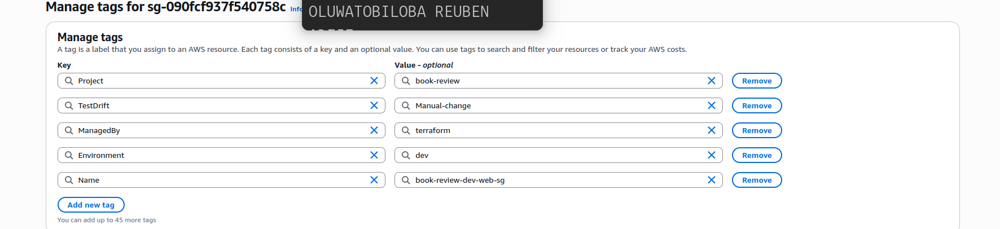

---

### Screenshot 12 — Detected Difference and Risk Assessment

Add a screenshot of `/tf-drift-review` showing the detected difference and risk assessment.

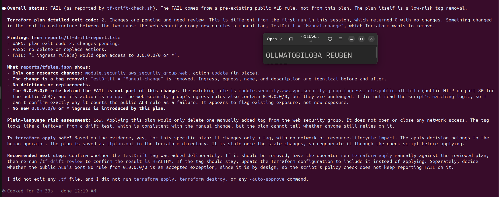

---

### Screenshot 13 — Detected Drift Report

Add a screenshot of `drift-detected-report.txt` showing your full name and the `WARN` or `FAIL` result.

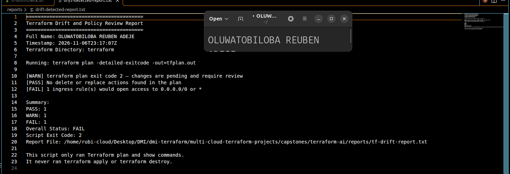

## Questions

### 1. What change did you introduce?

I introduced a change by manually modifying the security group tags. Specifically, I added a tag named TestDrift with the value Manual-change to the web security group. This change was made directly to the deployed infrastructure rather than through Terraform configuration.

### 2. Was it true infrastructure drift or a Terraform configuration change?

It was true infrastructure drift because the change was made manually to the deployed infrastructure. The actual infrastructure no longer matched the Terraform configuration. Terraform detected this difference during the plan operation.

### 3. What Terraform plan evidence proves that a change is pending?

The Terraform plan returned a detailed exit code of 2, which indicates that changes are pending and require review. Unlike the first run, which returned 0 and reported no changes, this run detected a difference. The evidence showed that Terraform wanted to remove the manually added TestDrift = "Manual-change" tag from the web security group.

### 4. Was the action an update, deletion, replacement, or security-rule change?

The action was an update because Terraform detected a difference in the security group tags. It planned to remove the manually added TestDrift tag to bring the infrastructure back in line with the Terraform configuration. No resource deletion or replacement was required.

### 5. What did Claude recommend?

Claude recommended confirming whether the TestDrift tag was added intentionally. If it should be removed, the operator should manually run terraform apply after reviewing the plan and then perform another drift review. If the tag should remain, the Terraform configuration should be updated to include it. Claude also recommended reviewing the public ALB port 80 security rule to confirm that it is an accepted exception.

### 6. Why should you review the recommendation before taking action?

The recommendation should be reviewed to ensure that the proposed action is correct and will not negatively affect the infrastructure. Claude may not have complete knowledge of the project's requirements or operational needs. Human review helps confirm that the change is intentional and safe before applying it. This prevents accidental modifications, security issues, and unexpected downtime.

---

# Task 7 — Add a `PreToolUse` Hook to Block Unsafe Apply Attempts

## Goal

Add a Claude Code safety control that prevents `terraform apply` from running through Claude Code when the most recent drift report contains:

```text
Overall Status: FAIL
```

## Evidence

### Screenshot 14 — `PreToolUse` Safety Hook

Add a screenshot of `.claude/settings.json` showing the `PreToolUse` safety hook.

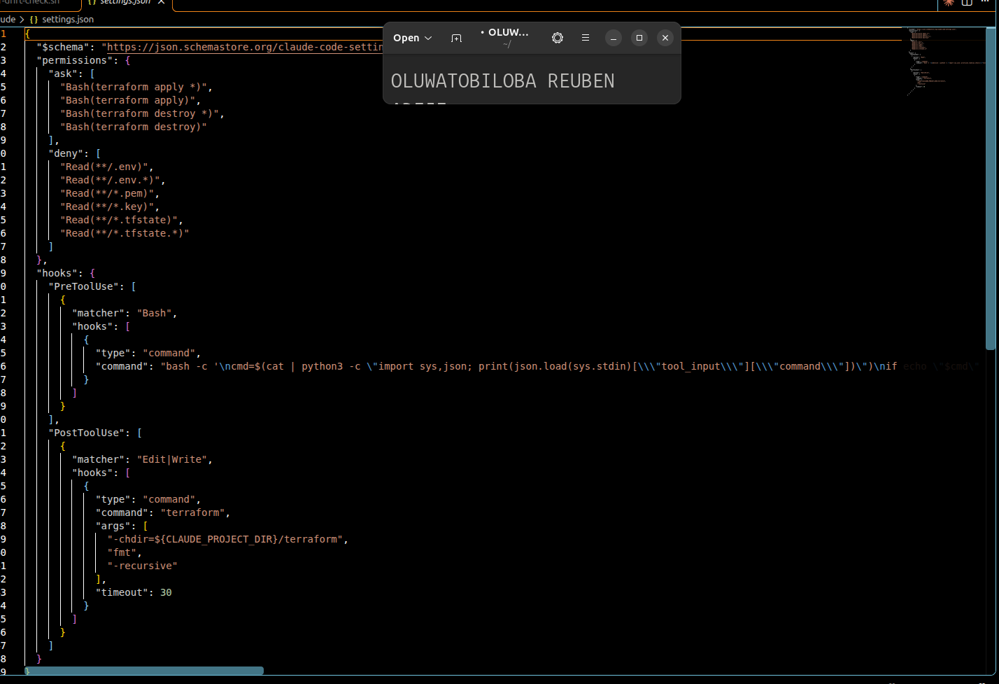

---

### Screenshot 15 — Blocked Apply Attempt

Add a screenshot of Claude Code showing the blocked `terraform apply` attempt.

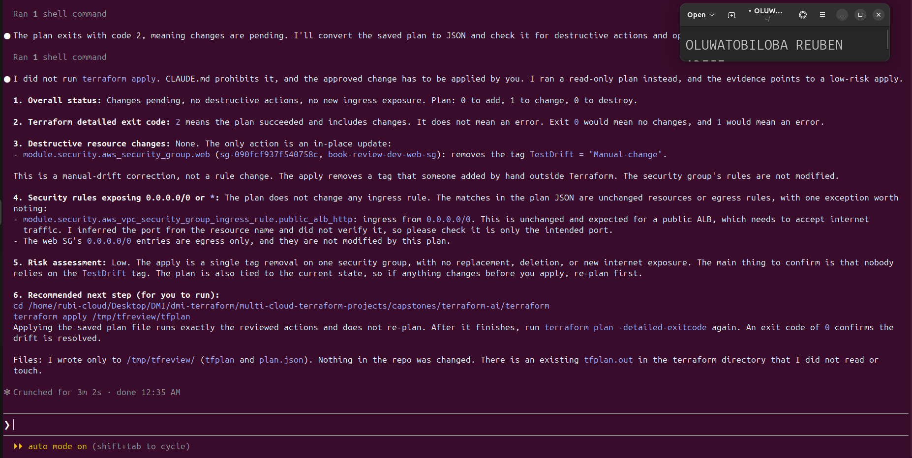

## Questions

### 1. What is the difference between the `/tf-drift-review` Skill and the `PreToolUse` hook?

The /tf-drift-review Skill is responsible for reviewing Terraform infrastructure and identifying potential risks or configuration drift. The PreToolUse hook acts as a safety mechanism that checks commands before they are executed. The Skill performs the review, while the hook helps prevent unsafe operations.

### 2. Which component performs analysis?

The /tf-drift-review Skill performs the analysis. It runs Terraform checks, examines the plan, identifies infrastructure changes, and uses Claude's reasoning to explain potential risks. It also provides recommendations based on the available evidence.

### 3. Which component enforces the safety gate?

The PreToolUse hook enforces the safety gate. It checks commands before execution and blocks restricted operations when the required safety conditions are not met. This helps prevent accidental or unauthorized infrastructure changes.

### 4. Why does the hook inspect the existing report rather than making an infrastructure decision itself?

The hook inspects the existing report because its purpose is to enforce predefined safety rules, not to perform complex infrastructure analysis. The report contains evidence generated by the Terraform review process. This separation makes the hook more predictable and prevents it from making unsupported decisions about infrastructure safety.

### 5. Why is a deterministic guard useful for high-impact commands?

A deterministic guard is useful because it applies consistent safety rules before high-impact commands are executed. It helps prevent accidental changes, resource deletion, and unexpected infrastructure modifications. It also ensures that commands such as terraform apply are properly reviewed before execution. This provides an additional layer of protection and keeps humans responsible for important decisions.

---

# Task 8 — Resolve the Difference and Verify the Final State

## Goal

Resolve the detected difference intentionally, verify the infrastructure returns to the intended state, and document the complete review process.

## Evidence

### Screenshot 16 — Human-Reviewed Resolution

Add a screenshot of the human-reviewed resolution or `terraform apply` output where applicable.

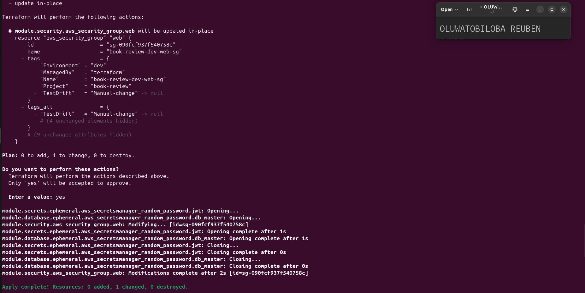

---

### Screenshot 17 — Final Healthy Review

Add a screenshot of the final `/tf-drift-review` showing `HEALTHY`.

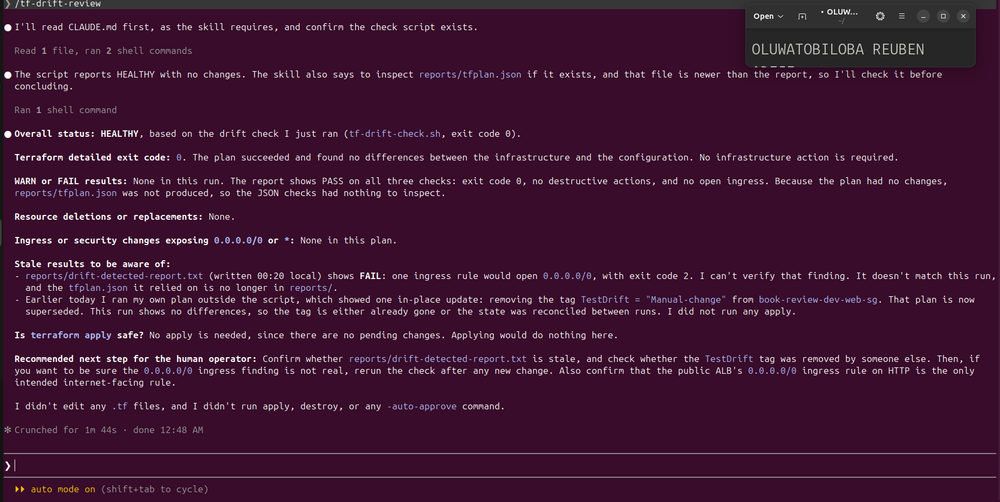

---

### Screenshot 18 — Saved Reports

Add a screenshot of `ls -lah reports` showing both:

- `drift-detected-report.txt`
- `resolved-report.txt`

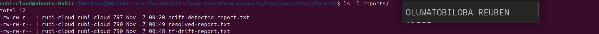

---

### Screenshot 19 — Drift Review Summary

Add a screenshot of `drift-review-summary.md` showing all required sections and your full name.

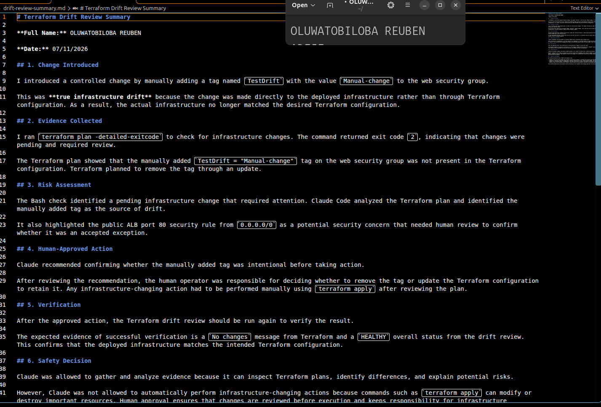

## Terraform Drift Review Summary

### 1. Change Introduced

Explain the controlled change you introduced.

State whether it was:

- True infrastructure drift, or
- A Terraform configuration change

I introduced a controlled change by manually adding a tag named `TestDrift` with the value `Manual-change` to the web security group.

This was **true infrastructure drift** because the change was made directly to the deployed infrastructure rather than through Terraform configuration. As a result, the actual infrastructure no longer matched the desired Terraform configuration.

### 2. Evidence Collected

Describe the Terraform plan evidence and affected resource.

I ran `terraform plan -detailed-exitcode` to check for infrastructure changes. The command returned exit code `2`, indicating that changes were pending and required review.

The Terraform plan showed that the manually added `TestDrift = "Manual-change"` tag on the web security group was not present in the Terraform configuration. Terraform planned to remove the tag through an update.

### 3. Risk Assessment

Explain the risk identified by the Bash check and Claude Code.

The Bash check identified a pending infrastructure change that required attention. Claude Code analyzed the Terraform plan and identified the manually added tag as the source of drift.

It also highlighted the public ALB port 80 security rule from `0.0.0.0/0` as a potential security concern that needed human review to confirm whether it was an accepted exception.

### 4. Human-Approved Action

Explain the action you reviewed and executed manually.

Claude recommended confirming whether the manually added tag was intentional before taking action.

After reviewing the recommendation, the human operator was responsible for deciding whether to remove the tag or update the Terraform configuration to retain it. Any infrastructure-changing action had to be performed manually using `terraform apply` after reviewing the plan.

### 5. Verification

Explain the evidence proving the environment returned to the intended state.

After the approved action, the Terraform drift review should be run again to verify the result.

The expected evidence of successful verification is a `No changes` message from Terraform and a `HEALTHY` overall status from the drift review. This confirms that the deployed infrastructure matches the intended Terraform configuration.

### 6. Safety Decision

Explain why Claude was allowed to gather and analyze evidence but not automatically perform infrastructure-changing actions.

Claude was allowed to gather and analyze evidence because it can inspect Terraform plans, identify differences, and explain potential risks.

However, Claude was not allowed to automatically perform infrastructure-changing actions because commands such as `terraform apply` can modify or destroy important resources. Human approval ensures that changes are reviewed before execution and keeps responsibility for infrastructure decisions with the operator.

### 7. Agentic Loop Mapping

Explain how your workflow followed:

```text
Gather --> Analyze --> Human Act --> Verify
```

My workflow followed the four stages of the agentic loop:

- **Gather:** Ran Terraform commands and collected infrastructure evidence, including the Terraform plan and JSON report.
- **Analyze:** Used Bash checks and Claude Code to identify infrastructure drift, review planned changes, and assess potential risks.
- **Human Act:** Reviewed Claude's recommendations and made the decision to approve and manually execute the required infrastructure change.
- **Verify:** Re-ran the Terraform drift review to confirm that the infrastructure returned to the intended state.

This workflow demonstrates how automation and AI reasoning can work together while keeping important infrastructure decisions under human control.

## Questions

### 1. What action did you execute to resolve the difference?

I resolved the difference by reviewing the manually added TestDrift tag on the web security group. The approved action was to remove the unwanted tag using Terraform so that the deployed infrastructure matched the Terraform configuration.

### 2. Did you review `terraform plan` before taking action?

Yes, I reviewed the Terraform plan before taking action. The plan showed the proposed changes and identified the resource affected. This helped me understand what Terraform intended to modify and ensured that I could make an informed decision before applying the change.

### 3. What evidence proves the environment is now aligned?

The evidence is the No changes message returned after running terraform plan. This indicates that the deployed infrastructure matches the Terraform configuration. A HEALTHY status from the drift review provides additional confirmation that the environment is aligned.

### 4. Why is a second drift review required after the fix?

A second drift review is required to confirm that the fix was successful and that the infrastructure has returned to its intended state. It helps detect any remaining differences or unexpected changes. It also provides evidence that the environment is healthy after the correction.

### 5. What could go wrong if an AI agent automatically applied every detected Terraform change?

An AI agent could accidentally delete important resources, modify security settings, cause service downtime, or introduce unexpected costs. Some detected changes may also be intentional and should not be reversed automatically. Human review is therefore necessary to ensure that every infrastructure change is safe and approved.

### 6. In one sentence, explain the difference between asking an AI chatbot “Is my infrastructure okay?” and using this evidence-based Agentic AI workflow.

Asking an AI chatbot relies mainly on its response, while an evidence-based Agentic AI workflow uses real Terraform data, automated checks, AI reasoning, and human approval to make infrastructure decisions safely.

---

# LinkedIn Post — Mandatory

## Goal

Publish a LinkedIn post in your own words describing:

- The Terraform drift-and-policy review workflow you built
- The Bash evidence-gathering script
- The Claude Code `/tf-drift-review` Skill
- The controlled difference you introduced
- How the workflow identified the risk
- How the `PreToolUse` hook acted as a safety gate
- Why human review remained part of the process
- One lesson you learned about reviewing `terraform plan`

Include a screenshot of the detected change and a screenshot of the final `HEALTHY` review in your post.

Suggested tags:

```text
#DMIByPravinMishra #Terraform #AgenticAI #ClaudeCode #DevOps
```

## LinkedIn Evidence

### LinkedIn Post URL

Add your LinkedIn post URL here.

### Published LinkedIn Post Screenshot — Mandatory

Add a screenshot of the published LinkedIn post here.

---

# Required Assignment Files

Confirm that the following files are included in your GitHub repository:

- `CLAUDE.md`
- `AI Assignment/tf-drift-check.sh`
- `.claude/skills/tf-drift-review/SKILL.md`
- `.claude/settings.json` containing the safety hook
- `reports/drift-detected-report.txt`
- `reports/resolved-report.txt`
- `drift-review-summary.md`

---

# Submission Instructions

- Complete Tasks 1–8 in sequence.
- Include Screenshots 1–19 exactly as specified.
- Answer every question under Tasks 1–8 in your own words.
- Complete all seven sections of the Terraform Drift Review Summary.
- Include the GitHub repository/folder URL containing the assignment files.
- Include your full name in the required reports and screenshots.
- Include the LinkedIn post URL and a screenshot of the published LinkedIn post.
- Do not expose access keys, passwords, tokens, account IDs, private keys, Terraform secrets, or other sensitive information.
- Review all screenshots carefully and hide or redact sensitive details where necessary.

---

# Completion Checklist

- [ ] Confirmed a clean Terraform baseline
- [ ] Created the required assignment workspace
- [ ] Created or updated `CLAUDE.md`
- [ ] Added project context and safety rules
- [ ] Created `tf-drift-check.sh`
- [ ] Added my full name to the report
- [ ] Validated the Bash script
- [ ] Made the script executable
- [ ] Used `terraform plan -detailed-exitcode`
- [ ] Used Terraform plan JSON
- [ ] Used `jq` to inspect destructive actions
- [ ] Used `jq` to inspect unsafe ingress
- [ ] Confirmed the baseline returns `HEALTHY`
- [ ] Created `/tf-drift-review`
- [ ] Restricted the Skill to appropriate tools
- [ ] Confirmed the Skill remains read-only
- [ ] Confirmed the Skill never runs `terraform apply`
- [ ] Confirmed the Skill never runs `terraform destroy`
- [ ] Introduced a controlled detectable difference
- [ ] Correctly identified whether it was true drift or a configuration change
- [ ] Saved `drift-detected-report.txt`
- [ ] Added the `PreToolUse` safety hook
- [ ] Verified the hook blocks `terraform apply` when the report is `FAIL`
- [ ] Reviewed the Terraform evidence before resolving the change
- [ ] Performed any infrastructure-changing action manually
- [ ] Ran the drift review again after resolution
- [ ] Confirmed the final status is `HEALTHY`
- [ ] Saved `resolved-report.txt`
- [ ] Completed `drift-review-summary.md`
- [ ] Mapped the workflow to `Gather --> Analyze --> Human Act --> Verify`
- [ ] Included all 19 numbered screenshots
- [ ] Answered all required questions
- [ ] Published the required LinkedIn post
- [ ] Added the LinkedIn post URL and screenshot
- [ ] Included the GitHub repository/folder URL
- [ ] Confirmed that no sensitive information is exposed

---

*This submission is part of the DevOps Micro Internship (DMI) Cohort 3 — Agentic AI Track.*
