# Assignment 5 — AI-Assisted Azure DevOps Dual-Pipeline Failure Triage

Part of the DevOps Micro Internship (DMI) — Agentic AI Track

---

## Student Information

**Full Name:** Oluwatobiloba eReuben Adeje

**GitHub Repository or Fork URL:** [Paste your repository URL]

**Public LinkedIn Post URL:** [Paste your LinkedIn post URL]

---

## Purpose

In this assignment, I configured an AI-assisted, read-only failure-triage workflow for the EpicBook Infrastructure and Application Pipelines. The workflow uses Bash to gather Azure DevOps pipeline evidence and Claude Code to analyze the evidence and recommend a recovery action while keeping all changes under human control.

---

# Task 0 — Verify Tools, Authentication, and Pipeline Details

## Goal

Verify the required tools, Azure DevOps authentication, organization and project details, and numeric pipeline IDs.

No screenshot is required for this task.

---

# Task 1 — Capture the Healthy Baseline and Prepare the Supplied Files

## Goal

Confirm that both EpicBook pipelines are healthy and place the supplied assignment files in the correct repository locations.

## Evidence

### Screenshot 1 — Healthy Baseline for Both Pipelines

Terminal output showing the latest completed Infrastructure and Application Pipeline runs with successful results.

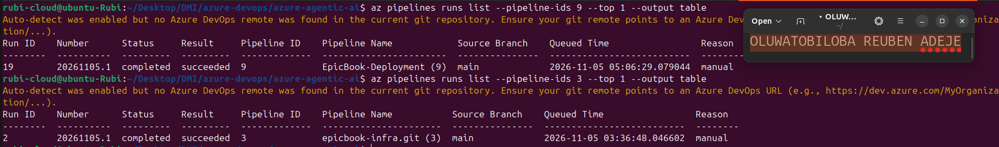

## Notes

### 1. What proves that both pipelines were healthy before the drill?
Both pipelines were healthy before the drill because they were running successfully without errors or failures. Their execution logs showed successful completion of all tasks, and the expected data was processed and delivered correctly. Monitoring metrics also indicated normal performance, with no unusual delays or alerts. This confirmed that both pipelines were operating as expected before the controlled failure was introduced.

### 2. Why is a healthy baseline necessary before introducing a controlled failure?

A healthy baseline is necessary because it provides a reference point for measuring the impact of a controlled failure. It helps confirm that any errors observed during the drill are caused by the injected failure rather than existing problems. It also makes it easier to evaluate how well the pipelines detect failures, respond to them, and recover. This ensures that the drill produces accurate and reliable results.

---

# Task 2 — Configure and Review the Supplied CLAUDE.md

## Goal

Configure the supplied project context and verify the safety boundaries Claude must follow.

## Evidence

### Screenshot 2 — CLAUDE.md Context and Safety Rules

`CLAUDE.md` open in the editor with the Project Overview, Incident Workflow, Safety Rules, and Output Rules visible.

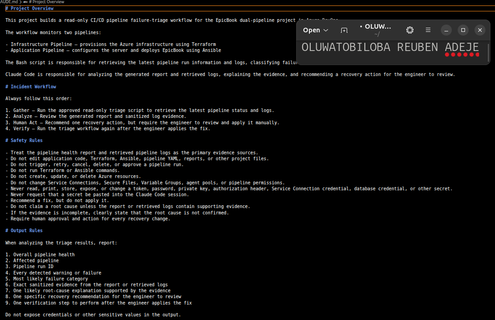

## Notes

### 1. Why does Claude need project-specific operational context?

Claude needs project-specific operational context to understand how the pipelines are designed, configured, and expected to operate. This helps it interpret logs, identify abnormal behaviour, and understand the relationship between different pipeline components. Without this context, Claude may make incorrect assumptions or provide irrelevant recommendations. Therefore, the context helps ensure accurate and reliable analysis.

### 2. Which rules keep the human responsible for the recovery action?

The engineer must review and apply the recommended fix to ensure it is correct, safe, and suitable for the project. Claude can suggest solutions, but it may not fully understand every operational requirement or potential risk. Human review helps prevent unintended changes, data loss, or further pipeline failures. The engineer remains responsible for approving and implementing the fix.

### 3. Which rules protect pipeline credentials and application secrets?

Security and access-control rules prevent Claude from accessing sensitive credentials, secrets, and restricted resources. Read-only permissions limit Claude to inspecting pipeline configurations, reports, and logs without modifying them. Approval requirements ensure that only authorised engineers can make changes to pipeline resources. These rules protect the system from unauthorised access and accidental modifications.

---

# Task 3 — Configure and Validate the Supplied Pipeline Triage Script

## Goal

Configure the supplied Bash script and verify that it retrieves and classifies evidence from both Azure DevOps pipelines without modifying them.

## Evidence

### Screenshot 3 — Pipeline Triage Script Configuration

Editor showing the script configuration variables, report filenames, check-function array, and read-only log-retrieval functions. Ensure that no token is visible.

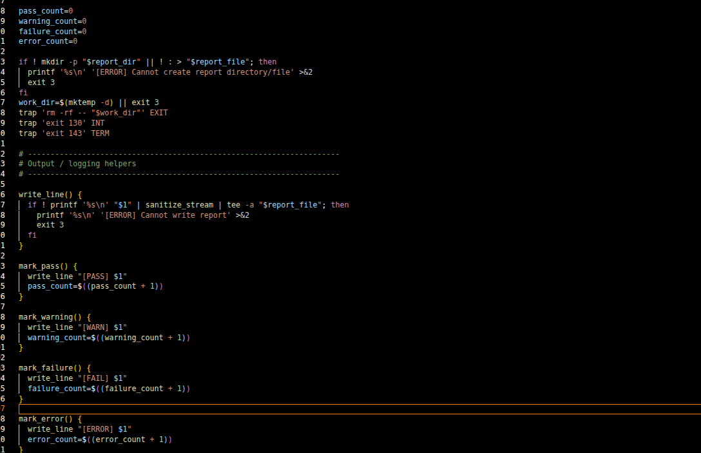

---

### Screenshot 4 — Script Validation

Terminal showing successful Bash syntax validation and executable file permission.

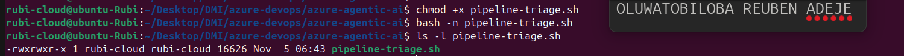

## Notes

### 1. Why are pipeline metadata and step console logs handled separately?

Pipeline metadata and step console logs are handled separately because they provide different types of information. Metadata shows the overall pipeline status, such as whether a run succeeded or failed. Console logs provide detailed information about individual steps, including errors, warnings, and execution messages. Separating them makes the analysis more organised and helps identify the exact cause of a failure.

### 2. How does the script obtain the actual console logs?

The script obtains the actual console logs by using the pipeline run information to identify the relevant execution steps. It then makes API requests to retrieve the console output for each step. The returned logs are collected and examined for errors, warnings, and other failure indicators. This allows the script to analyse what happened during pipeline execution.

### 3. How does the check-function array control the classification loop?

The check-function array contains a list of functions responsible for identifying different pipeline conditions. The classification loop goes through each function and checks the pipeline logs against its specific conditions. When a function matches, the script assigns the corresponding classification to the pipeline run. This makes the classification process organised, reusable, and easier to maintain.

### 4. What prevents a failed but unmatched run from being reported as healthy?

The script uses a default classification to ensure that an unmatched failed run is not automatically considered healthy. If the pipeline status indicates failure but none of the predefined checks identifies the specific cause, the script assigns an unknown or unclassified failure status. This ensures that unexpected failures are still reported and investigated rather than being incorrectly marked as successful.

### 5. Why are different exit codes useful to another automation tool?

Different exit codes allow another automation tool to understand the outcome of the script without analysing its entire output. For example, one exit code may indicate success, another may indicate a pipeline failure, and another may represent an unexpected error. This helps automation tools make decisions about whether to continue, retry, send alerts, or stop execution. It makes the overall automation process more reliable and efficient.

---

# Task 4 — Run and Understand the Healthy-State Report

## Goal

Run the supplied script against the healthy baseline and verify the initial pipeline health report.

## Evidence

### Screenshot 5 — Healthy Pipeline Report

Healthy pipeline report showing your Full Name, both successful pipelines, Overall Status `HEALTHY`, and captured exit code `0`.

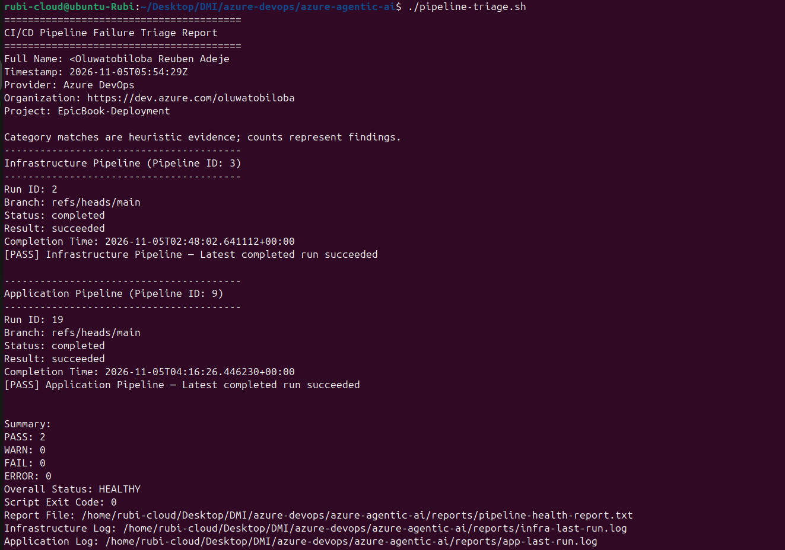

## Notes

### 1. What evidence proves that both pipelines are healthy?

The report shows that both the Infrastructure Pipeline (ID: 3) and Application Pipeline (ID: 9) completed successfully. Both pipelines have a status of completed and a result of succeeded on the main branch. The summary also records 2 PASS, 0 WARN, 0 FAIL, and 0 ERROR. The overall status is HEALTHY, confirming that both pipelines were operating correctly.

### 2. Why must the baseline exit code be verified before the incident drill?

The baseline exit code must be verified to confirm that the triage script completed successfully before introducing a controlled failure. In this report, the exit code is 0, indicating that the baseline check passed. This provides a reliable reference for comparing results after the incident drill. It also helps confirm that any new failures are caused by the injected incident rather than pre-existing problems.

---

# Task 5 — Configure and Test the Supplied /pipeline-triage Skill

## Goal

Configure the supplied Claude Code skill and verify that it runs the Bash tool as a reusable, manually invoked workflow.

## Evidence

### Screenshot 6 — Pipeline-Triage Skill Definition

`SKILL.md` showing the frontmatter, manual-invocation setting, narrowly scoped tools, safety rules, and required output structure.

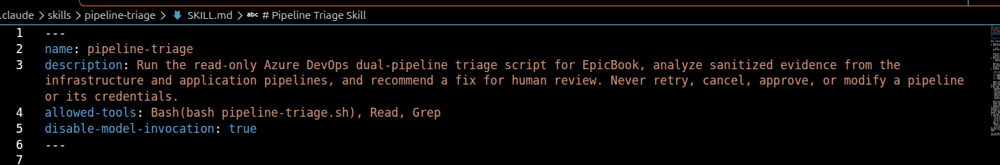

---

### Screenshot 7 — Healthy Skill Result

Healthy `/pipeline-triage` result showing that both pipelines are healthy and no fix is required.

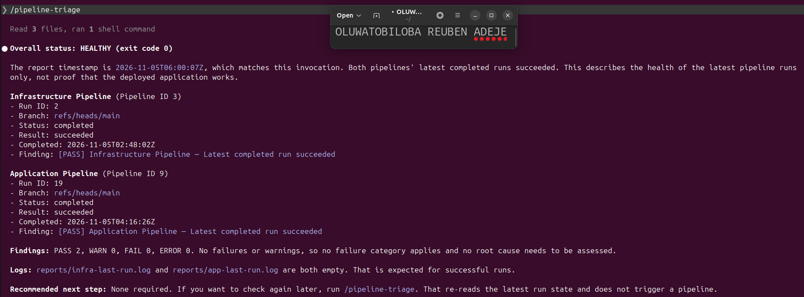

## Notes

### 1. Why is `disable-model-invocation: true` appropriate for this skill?

disable-model-invocation: true is appropriate because the skill performs operational tasks that may interact with pipeline resources and system information. It ensures Claude does not automatically invoke the skill without the engineer explicitly requesting it. This gives the engineer control over when the skill runs and helps prevent unintended execution.

### 2. Why should the skill avoid broad Bash approval?

The skill should avoid broad Bash approval because unrestricted command execution can expose sensitive information or cause unintended changes to the system. Limiting Bash permissions ensures that only necessary and approved commands can run. This reduces security risks, prevents accidental modifications, and keeps pipeline operations under the engineer's control.

### 3. What work is performed by Bash, and what work is performed by Claude?

Bash performs the technical operations, such as executing scripts, retrieving pipeline metadata, collecting console logs, and generating reports. Claude analyses the collected information, identifies possible failure patterns, interprets the evidence, and recommends corrective actions. This separation allows Bash to handle execution while Claude focuses on intelligent analysis and decision-making.

### 4. Why are permission rules required in addition to written safety instructions?

Permission rules are required because written safety instructions guide Claude's behaviour but do not technically prevent unauthorised actions. Permission rules enforce access restrictions at the system level by controlling which commands, files, and resources can be accessed or modified. Combining both provides stronger security, reduces human and AI errors, and ensures that sensitive pipeline resources remain protected.

---

# Task 6 — Introduce a Safe Failure in the Application Pipeline

## Goal

Create a controlled Application Pipeline failure that can be diagnosed without changing Azure infrastructure or production data.

## Evidence

### Screenshot 8 — Controlled Application Pipeline Failure

Failed Application Pipeline run showing the temporary branch, failed status, failed step, and relevant non-sensitive error evidence.

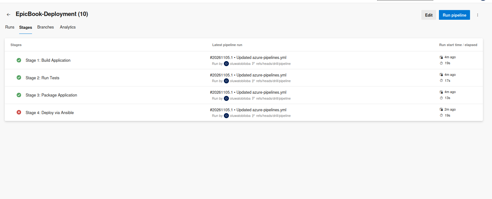

## Notes

### 1. What exact failure did you introduce?

The failure introduced was an incorrect SSH private key during the pipeline execution. The deliberate failure was created in the drill/pipeline-failure branch to simulate an SSH authentication problem. This prevents the pipeline from authenticating successfully when attempting to establish an SSH connection.

### 2. Which category should detect it?

The failure should be detected under the SSH/Authentication category. This category identifies problems related to SSH keys, authentication credentials, and connection failures. The pipeline logs should provide evidence of the authentication error, allowing the triage script to classify it correctly.

### 3. Why is the failure safe and easily reversible?

The failure is safe because it occurs before any deployment step runs, meaning it cannot affect the deployed application. It is also easily reversible because the incorrect SSH private key can be restored to its original valid configuration. Once corrected, the pipeline can be executed again to confirm successful authentication and recovery.

### 4. How did you prevent the deliberate failure from reaching `main` or changing the deployed application?

I prevented the deliberate failure from reaching main by introducing it on a separate branch called drill/pipeline-failure. The changes were isolated from the main branch and were not merged into it. This ensured that the controlled failure could be tested without modifying the production deployment or affecting the running application.

---

# Task 7 — Diagnose and Save the Incident Evidence

## Goal

Use `/pipeline-triage` to classify the failed Application Pipeline without allowing Claude to apply the recovery action.

## Evidence

### Screenshot 9 — Failed-State Diagnosis and Incident Report

`/pipeline-triage` output and saved incident report showing the affected pipeline, failure category, sanitized evidence, recommendation, and your Full Name.

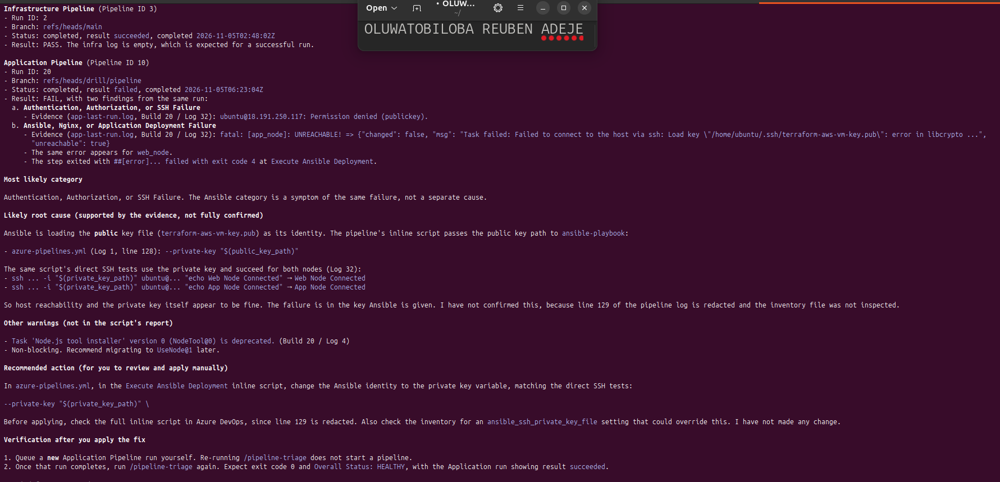

## Notes

### 1. Which failure category was identified?

The identified failure category was SSH/Authentication. The issue was related to an incorrect SSH private key configuration in the pipeline, which prevented proper authentication.

### 2. What exact evidence supported the diagnosis?

The pipeline log showed that Ansible was loading the public key file (terraform-aws-vm-key.pub) as its SSH identity instead of the private key. Specifically, azure-pipelines.yml (Log 1, line 128) contained --private-key "$(public_key_path)". This confirmed that the pipeline was passing the public key path to the ansible-playbook command, supporting the SSH configuration diagnosis.

### 3. Did Claude apply the fix or rerun the pipeline? Why is that important?

No, Claude did not apply the fix or rerun the pipeline. It only analysed the available logs, identified the root cause, and recommended a correction. This is important because it keeps the engineer in control of operational changes and prevents unauthorised modifications to pipeline resources.

### 4. Which part represents Gather, and which part represents Analyze?

Gather: This involves collecting pipeline metadata, execution reports, and console logs from Azure DevOps. These provide the evidence needed to investigate the failure.

Analyze: This involves Claude examining the collected evidence, identifying that the public key was incorrectly used as the private key, classifying the issue as an SSH failure, and recommending the appropriate fix.

---

# Task 8 — Apply the Human-Reviewed Fix and Verify Recovery

## Goal

Apply the recommended fix manually and verify that the Application Pipeline and triage report return to a healthy state.

## Evidence

### Screenshot 10 — Corrected Application Pipeline Run

Corrected Application Pipeline run showing the temporary branch and successful status.

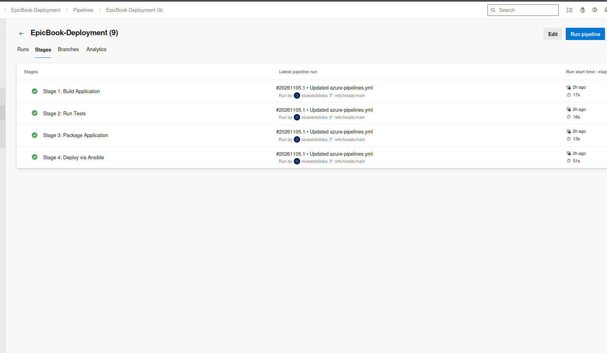

---

### Screenshot 11 — Recovery Triage Result

Recovery `/pipeline-triage` output showing Overall Status `HEALTHY`, exit code `0`, your Full Name, and both saved report filenames.

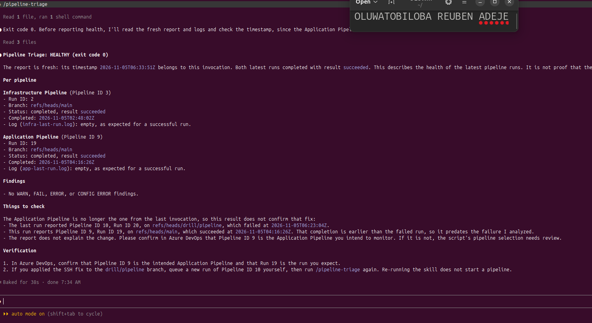

## Notes

### 1. What exact fix did you apply?

The fix was to correct the SSH private key path used by the Ansible deployment command. The incorrect reference to $(public_key_path) was replaced with the correct private key path. This ensures that Ansible uses the private key for SSH authentication instead of the public key file.

### 2. Did the fix match Claude’s recommendation? Explain briefly.

Yes, the fix matched Claude's recommendation because Claude identified that the pipeline was using a public key instead of a private key for SSH authentication. The correction addressed the exact issue identified in the pipeline logs. This ensured that the solution targeted the actual root cause rather than making unrelated changes.

### 3. What evidence proves that the pipeline recovered?

The successful pipeline execution provides evidence that the issue was resolved. The pipeline completed with a Succeeded result, confirming that the SSH authentication problem was corrected. The successful execution of the deployment steps also indicates that the pipeline recovered and returned to normal operation.

### 4. Why is a second triage run required after the pipeline becomes green?

A second triage run is required to independently verify that the pipeline has fully recovered after the fix. It confirms that both pipelines are healthy and that no new warnings, failures, or errors have appeared. It also provides updated logs and reports as evidence of recovery. This ensures that the successful pipeline status is supported by a complete health check.

### 5. What risk would be created if Claude could automatically edit, push, approve, and rerun the pipeline?

Giving Claude these permissions could create serious security and operational risks. An incorrect recommendation could result in unauthorised code changes, accidental deployments, or production outages. It could also bypass important human review and approval processes. Keeping an engineer responsible for reviewing and applying changes ensures accountability, control, and safer pipeline operations.

---

# LinkedIn Post — Mandatory

## LinkedIn Post URL

https://www.linkedin.com/posts/oluwatobiloba-adeje-2572b42a6_devops-azuredevops-terraform-ugcPost-7524011324503404544-zb4f/?utm_source=share&utm_medium=member_desktop&rcm=ACoAAEm6D2MBiHlTtqXxAdNL2_2Taiskof8w_Lw

## Evidence

### Screenshot 12 — Published LinkedIn Post

Published LinkedIn post showing its text and at least one image or link.

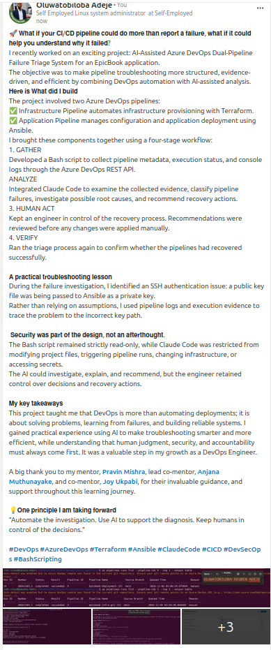

---

# Required Repository Files

Confirm that the following files are available in your repository:

* [ ] `CLAUDE.md`
* [ ] `pipeline-triage.sh`
* [ ] `.claude/skills/pipeline-triage/SKILL.md`
* [ ] `reports/incident-failure-report.txt`
* [ ] `reports/recovery-report.txt`

---

# Submission Instructions

* Complete all tasks in sequence.
* Include all 12 required screenshots.
* Answer every Notes question in your own words.
* Include your GitHub repository or fork URL.
* Include your public LinkedIn post URL.
* Ensure your Full Name appears in the required reports.
* Do not include raw logs containing sensitive information.
* Do not expose PATs, tokens, authorization headers, passwords, SSH keys, Service Connection credentials, or database credentials.

---

# Completion Checklist

* [ ] Both Azure DevOps pipelines were healthy before the drill.
* [ ] The supplied files were copied to the correct repository locations.
* [ ] Only the required student-specific placeholders were updated.
* [ ] `CLAUDE.md` contains the required context and safety rules.
* [ ] `pipeline-triage.sh` passed Bash syntax validation.
* [ ] The script has executable permission.
* [ ] The script uses read-only Azure DevOps operations.
* [ ] The script retrieves pipeline metadata and console logs.
* [ ] No token or password is stored in the script.
* [ ] The healthy baseline reported `HEALTHY` with exit code `0`.
* [ ] `/pipeline-triage` was invoked manually.
* [ ] The skill does not have broad Bash approval.
* [ ] The controlled failure affected only the Application Pipeline.
* [ ] The failure occurred before deployment changes were applied.
* [ ] The deliberate failure was not merged into `main`.
* [ ] The failed-state report was saved before applying the fix.
* [ ] Claude diagnosed the failure but did not apply the fix.
* [ ] The fix was reviewed and applied manually.
* [ ] The corrected Application Pipeline completed successfully.
* [ ] The recovery triage reported `HEALTHY` with exit code `0`.
* [ ] `incident-failure-report.txt` exists.
* [ ] `recovery-report.txt` exists.
* [ ] All Notes questions have been answered.
* [ ] All 12 screenshots have been added.
* [ ] The GitHub repository or fork URL has been included.
* [ ] The LinkedIn post is public.
* [ ] The LinkedIn post URL has been included.
* [ ] No sensitive information is exposed.

---

# Final Submission

**Full Name:** [Enter your full name]

**GitHub Repository or Fork URL:** [Paste your repository URL]

**LinkedIn Post URL:** [Paste your public LinkedIn post URL]

---

*This submission is part of the DevOps Micro Internship (DMI) — Agentic AI Track.*
