# Assignment 4 — Auto-Scaling & Auto-Healing: Let Kubernetes React for You

Part of the DevOps Micro Internship (DMI) with Agentic AI

---

## Purpose

Create Deployments, test Pod auto-healing, configure CPU requests and limits, verify Metrics Server, and create a Horizontal Pod Autoscaler.

Optionally generate CPU load to observe how the HPA responds.

---

# Task 0 — Check the Existing Cluster Resources

## Goal

Confirm that you are connected to your learning cluster and inspect existing Deployments and HPAs.

### Evidence

No screenshots required.

---

# Task 1 — Set Up Your Lab Directory

## Goal

Create and enter a dedicated directory for the auto-scaling lab.

### Evidence

#### Screenshot 1 — Terminal showing that you are working inside `~/k8s-labs/autoscaling`

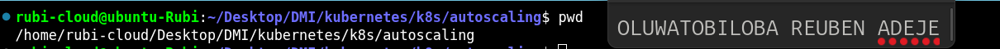

---

### Notes

**1. What is the difference between auto-healing and auto-scaling?**

Auto-healing automatically detects and replaces or restarts unhealthy Pods to maintain application availability. Auto-scaling automatically increases or decreases the number of Pods based on workload demand. Auto-healing is triggered by failures or health checks, whereas auto-scaling is triggered by resource utilization or other metrics.

---

**2. Which Kubernetes feature will you use for CPU-based auto-scaling?**

Kubernetes uses the Horizontal Pod Autoscaler (HPA) for CPU-based auto-scaling. HPA automatically increases or decreases the number of Pod replicas based on CPU utilization. When CPU utilization exceeds the configured target, HPA can increase the number of Pods to handle the workload. When CPU utilization decreases, HPA can reduce the number of Pods. HPA typically requires the Metrics Server and configured CPU resource requests to monitor CPU utilization.

---

# Task 2 — Test Auto-Healing with a Deployment

## Goal

Create a Deployment with two replicas, delete one Pod, and observe Kubernetes create a replacement Pod.

### Evidence

#### Screenshot 2 — Completed `autohealing-deployment.yaml` manifest

---

#### Screenshot 3 — Output of `kubectl get pods` showing two running Pods before deletion

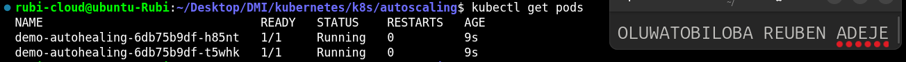

---

#### Screenshot 4 — Output of the `kubectl delete pod` command

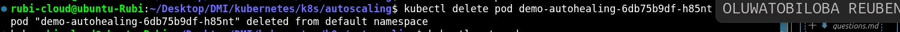

---

#### Screenshot 5 — Output of `kubectl get pods` showing the replacement Pod and two running Pods

---

### Notes

**1. What happened after you deleted one Pod?**

After I deleted one Pod, Kubernetes automatically created a new Pod to maintain the desired number of replicas.

---

**2. What Kubernetes resource maintains the desired replica count for this Deployment?**

The ReplicaSet maintains the desired replica count for the Deployment by ensuring that the required number of Pods are running.

---

**3. What proves that auto-healing worked?**

Auto-healing worked because Kubernetes automatically created a replacement Pod after the original Pod was deleted, maintaining the desired replica count.

---

# Task 3 — Create a Deployment for HPA

## Goal

Create a Deployment with CPU resource requests and limits so that HPA can calculate CPU utilization.

### Evidence

#### Screenshot 6 — Completed `hpa-deployment.yaml` manifest showing CPU requests and limits

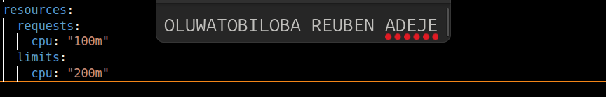

---

#### Screenshot 7 — Output showing `nginx-deployment` and its running Pods

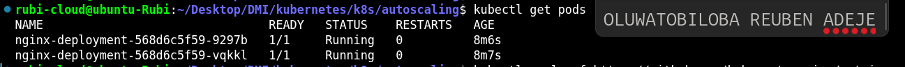

---

### Notes

**1. What does `cpu: "100m"` mean?**

100m means 100 millicores, which is equal to 0.1 CPU core. It represents one-tenth of a CPU core.
---

**2. What is the difference between a CPU request and a CPU limit?**

A CPU request specifies the amount of CPU resources Kubernetes reserves for a container when scheduling it. A CPU limit specifies the maximum CPU resources the container can use.

---

**3. Why does CPU-based HPA require CPU requests?**

CPU-based HPA uses CPU requests to calculate CPU utilization as a percentage. Without CPU requests defined for the relevant containers, HPA cannot properly calculate CPU utilization and make scaling decisions based on that metric.

---

# Task 4 — Enable and Verify Metrics Server

## Goal

Ensure the cluster can collect resource metrics for the HPA.

### Evidence

#### Screenshot 8 — Output showing Metrics Server running, or `kubectl top pods` displaying Pod metrics

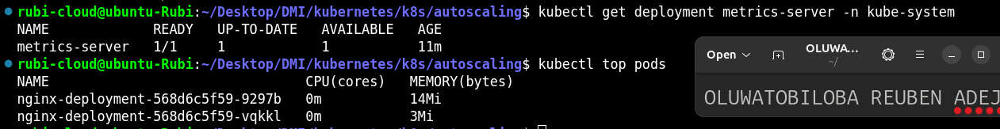

---

### Notes

**1. Why does HPA need Metrics Server?**

HPA needs Metrics Server to collect CPU and memory usage metrics from Kubernetes Pods and make scaling decisions based on resource utilization.

---

**2. What issue can occur if Metrics Server is not working?**

If Metrics Server is not working, HPA may fail to retrieve CPU and memory metrics, preventing it from scaling Pods correctly based on resource utilization.

---

**3. What does `kubectl top pods` help you check?**

The kubectl top pods command displays the current CPU and memory usage of Pods in a Kubernetes cluster, helping you monitor resource consumption.

---

# Task 5 — Create a Horizontal Pod Autoscaler

## Goal

Create an HPA that keeps at least two Pods running and can scale up to five Pods when average CPU utilization exceeds 50%.

### Evidence

#### Screenshot 9 — The imperative command output OR completed `hpa-nginx.yaml` manifest

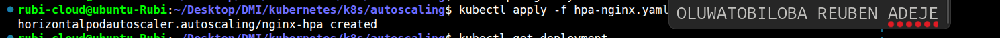

---

#### Screenshot 10 — Output of `kubectl get hpa` and the relevant `kubectl describe hpa` command

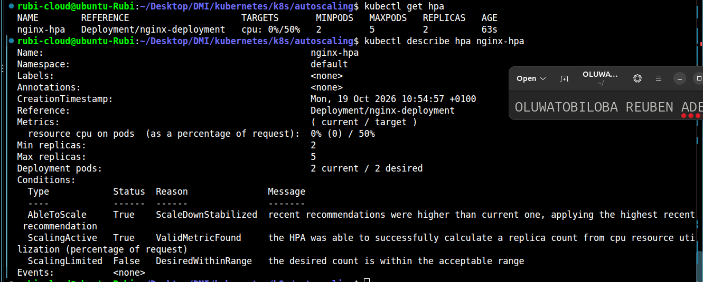

---

### Notes

**1. What does `minReplicas: 2` mean?**

It means HPA will maintain at least 2 Pod replicas for the Deployment, even when CPU utilization is low.

---

**2. What does `maxReplicas: 5` mean?**

It means HPA can scale the Deployment up to a maximum of 5 Pod replicas when resource demand increases.

---

**3. What does `averageUtilization: 50` mean?**

It means HPA targets an average CPU utilization of 50% of the CPU requests across the Pods and adjusts the replica count based on the observed utilization.

---

**4. Why should only one HPA manage a Deployment at a time?**

Only one HPA should manage a Deployment because multiple HPAs targeting the same Deployment can conflict by trying to adjust the replica count independently, resulting in unpredictable scaling behavior.

---

# Task 6 — Optional: Generate CPU Load and Observe Scaling

## Goal

Generate CPU load in one NGINX Pod and observe how HPA responds.

### Evidence

If you skip this task, write “Not completed — optional” and leave the remaining Task 6 placeholders blank.

Task status: Add your status here.

#### Screenshot 11 — Terminal showing the CPU-load command running inside the selected Pod

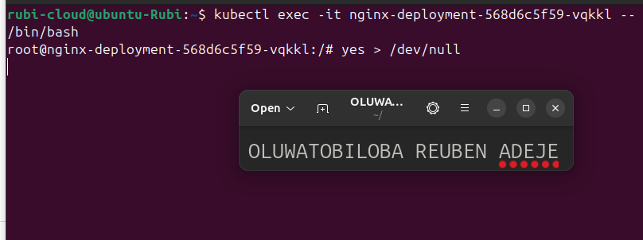

---

#### Screenshot 12 — Output of `kubectl get hpa` and `kubectl get pods` while HPA evaluates or changes the replica count

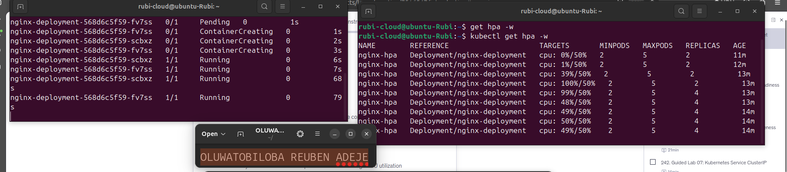

---

### Notes

Complete these answers only if you perform the optional test.

**1. Did the HPA change the number of Pods? Explain what you observed.**

The HPA increased the number of Pods when CPU utilization exceeded the configured target of 50%. It created additional Pods to handle the increased workload, up to the maximum of five replicas.

---

**2. If scaling did not happen, what are two possible reasons?**

Not applicable, scaling occur

---

**3. Why is automatic scale-down useful after traffic decreases?**

Automatic scale-down reduces the number of Pods when traffic and CPU utilization decrease. This helps save CPU and memory resources, reduces infrastructure costs, and maintains efficient resource utilization.

---

# LinkedIn Requirement

### Evidence

#### Screenshot 13 — Published LinkedIn post showing your name, the required explanation, and the attached Kubernetes screenshot

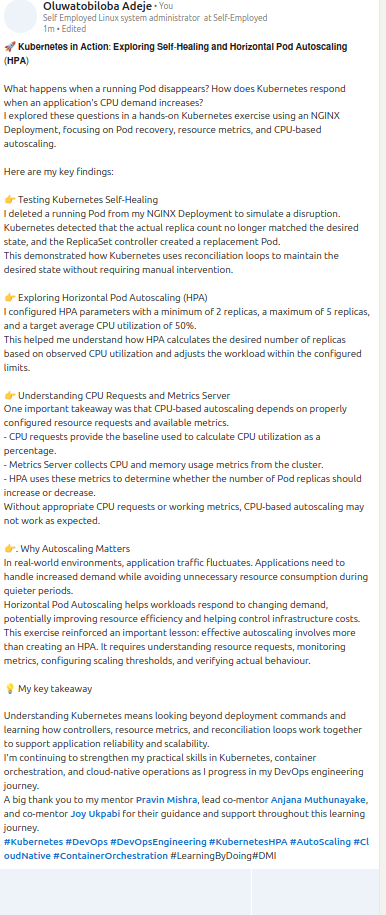

#### Linkedin Post Link

https://www.linkedin.com/posts/oluwatobiloba-adeje-2572b42a6_kubernetes-devops-devopsengineering-ugcPost-7522261203331571712-oVH1/?highlightedUpdateUrn=urn%3Ali%3Aactivity%3A7522261206460526592&highlightedUpdateType=SOCIAL_SHARE&origin=SOCIAL_SHARE&utm_source=share&utm_medium=member_desktop&rcm=ACoAAEm6D2MBiHlTtqXxAdNL2_2Taiskof8w_Lw

---

# Submission Instructions

- Include required Screenshots 1–10 and Screenshot 13.
- Include Screenshots 11–12 only if you complete Task 6.
- Full Name must be visible in required screenshots.
- Ensure screenshots are clear and readable.
- Include the completed `autohealing-deployment.yaml` and `hpa-deployment.yaml` files.
- Include `hpa-nginx.yaml` if you selected the declarative HPA method.
- Complete the Notes sections for Tasks 1–5 in your own words.
- Complete Task 6 notes only if you perform the optional test.
- Do not expose passwords, tokens, private keys, kubeconfig files, or account IDs.

---

# Completion Checklist

- [x] Checked the active context and existing cluster resources
- [x] Created the autoscaling working directory (Screenshot 1)
- [x] Created `autohealing-deployment.yaml` (Screenshot 2)
- [x] Confirmed two auto-healing Pods were running (Screenshot 3)
- [x] Deleted one managed Pod (Screenshot 4)
- [x] Confirmed that the Pod was automatically replaced (Screenshot 5)
- [x] Created `hpa-deployment.yaml` with CPU requests and limits (Screenshot 6)
- [x] Verified `nginx-deployment` and its running Pods (Screenshot 7)
- [x] Verified Metrics Server and confirmed Pod metrics are available (Screenshot 8)
- [x] Created one HPA using the selected method (Screenshot 9)
- [x] Verified minimum replicas of 2, maximum replicas of 5, and a CPU target of 50% (Screenshot 10)
- [x] Completed Notes for Tasks 1–5
- [x] Completed Task 6 evidence and notes, or marked it “Not completed — optional”
- [x] Stopped the CPU-load command and exited the container shell, if Task 6 was completed
- [x] Published the LinkedIn post with the required explanation and attached screenshot (Screenshot 13)
- [x] Included the required manifest files
- [x] No sensitive data exposed

---

## 📌 About DMI & CloudAdvisory

DevOps Micro Internship (DMI) is a project-based DevOps program run by Pravin Mishra (The CloudAdvisory) focused on real-world execution, systems thinking, and career readiness.

It helps learners build strong DevOps foundations with hands-on experience.

---

## 📌 Resources

- 🌐 DMI Official Website: https://dmi.pravinmishra.com?utm_source=github&utm_medium=readme  
- 🎓 University: https://university.pravinmishra.com?utm_source=github&utm_medium=readme  
- 💬 Discord Community: https://discord.pravinmishra.com?utm_source=github&utm_medium=readme  
- 📝 Blog: https://dmi.pravinmishra.com/blog?utm_source=github&utm_medium=readme  
- ▶️ YouTube Playlist: https://www.youtube.com/playlist?list=PLFeSNDtI4Cho  
- 🔗 Pravin Mishra (LinkedIn): https://www.linkedin.com/in/pravin-mishra-aws-trainer/  
- 🏢 CloudAdvisory (LinkedIn): https://www.linkedin.com/company/thecloudadvisory/

---

*This submission is part of DevOps Micro Internship (DMI) — Agentic AI Track.*
