# Assignment 5 — Kubernetes Health Probes (Readiness)

Part of the DevOps Micro Internship (DMI) with Agentic AI

---

## Purpose

In this assignment, you will configure and test a Kubernetes readiness probe. You will create a baseline NGINX Deployment, add an HTTP readiness probe, intentionally break it, observe a stalled rollout, and restore the working configuration.

You will also demonstrate how readiness probes protect rolling updates.

---

# Task 0 — Prepare the Lab Environment

## Goal

Confirm that you are connected to your learning cluster and remove the previous assignment’s HPA and NGINX Deployment before starting this lab.

No screenshot or written notes are required for this pre-check.

---

# Task 1 — Set Up Your Lab Directory

## Goal

Create and enter a dedicated directory for the readiness-probe lab.

### Evidence

#### Screenshot 1 — Terminal showing that you are working inside `~/k8s-labs/health-probes-readiness`

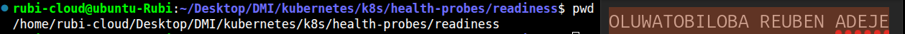

---

### Notes

**1. What is the purpose of a readiness probe?**

A readiness probe checks whether a container is ready to accept traffic.
It helps Kubernetes determine if an application can handle incoming requests.

**2. Why is a Pod being Running not always enough to confirm it can serve traffic?**

A Pod in the Running state means its containers have started.
However, the application inside the container may still be initializing.
It may be waiting for a database connection or another required service.
The application might also be running but unable to process requests correctly.
A readiness probe checks whether the application is ready to handle traffic.
Therefore, Running does not necessarily mean the Pod is Ready.

---

# Task 2 — Create a Baseline Deployment Without Probes

## Goal

Create a baseline NGINX Deployment with two replicas and no readiness probe.

### Evidence

#### Screenshot 2 — Completed `00-nginx-deploy-baseline.yaml` manifest

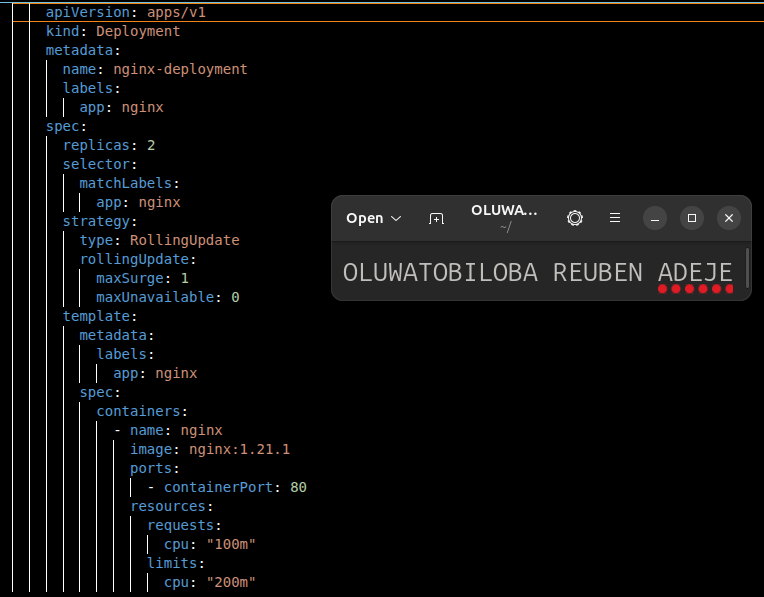

---

#### Screenshot 3 — Output showing a successful rollout and two running NGINX Pods

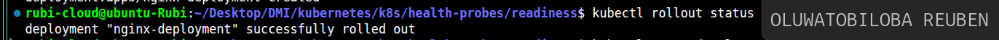

---

#### Screenshot 4 — Relevant output from `kubectl describe deployment nginx-deployment`

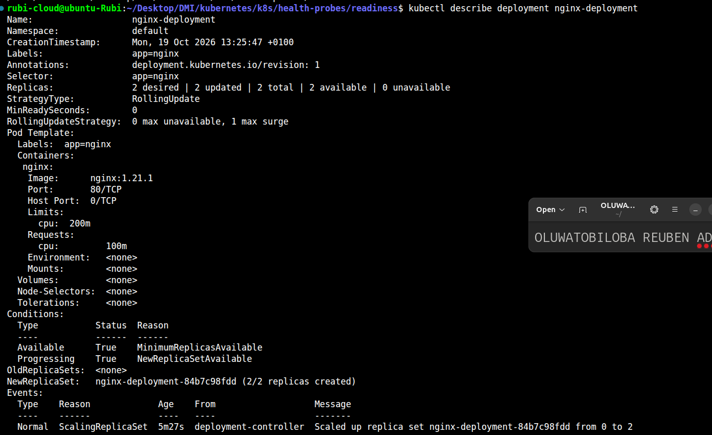

---

### Notes

**1. How many replicas does this Deployment maintain?**

The number of replicasthe deployment maintain is 2.
It field specifies the desired number of Pod instances Kubernetes should maintain.

**2. What does `maxUnavailable: 0` mean during a rolling update?**

The setting maxUnavailable: 0 means no desired replicas can be unavailable during a rolling update.
Kubernetes attempts to keep all desired replicas available while updating the application.
It creates new Pods before removing old ones.
The new Pods must become ready before old Pods can be removed without reducing availability.
This helps minimize service disruption during application updates.

**3. Is a readiness probe configured in this baseline Deployment?**

NO readiness probe is configured in this baseline deployment

---

# Task 3 — Add a Readiness Probe

## Goal

Add an HTTP readiness probe so Kubernetes checks whether each NGINX container is ready to accept requests.

### Evidence

#### Screenshot 5 — Completed `01-nginx-deploy-readiness.yaml` manifest showing the readiness probe

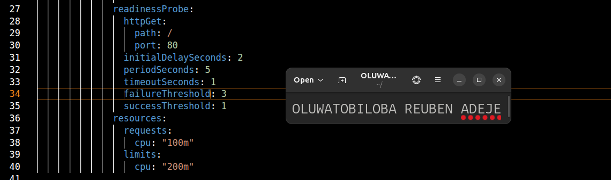

---

#### Screenshot 6 — Output of the successful rollout and ready Pods

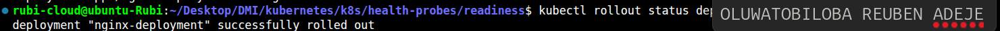

---

#### Screenshot 7 — Pod description showing readiness conditions and readiness probe details

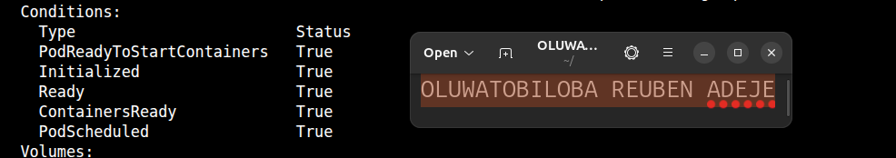

---

### Notes

**1. What path and port does the readiness probe check?**

The readiness probe checks a specific HTTP path on a specified port. The path the rediness probe check is / on port 80. Kubernetes sends an HTTP request to this path and port to check the application's readiness. If the request succeeds, the probe passes.

**2. What does `initialDelaySeconds: 2` do?**

The setting initialDelaySeconds: 2 tells Kubernetes to wait two seconds after the container starts before performing the first readiness probe. This gives the application a short time to initialize. After the initial delay, Kubernetes begins checking whether the application is ready. This helps avoid checking the application immediately after startup. It does not guarantee that the application will be ready after two seconds.

**3. What does `periodSeconds: 5` do?**

The setting periodSeconds: 5 tells Kubernetes to perform a readiness check every five seconds. Kubernetes continues checking the application at this interval while the container runs. If a probe succeeds, the Pod can be marked ready, provided its other readiness conditions are satisfied. If a probe fails, the Pod may be marked not ready and removed from the Service's available endpoints. Regular checks allow Kubernetes to detect when the application becomes ready or stops being ready.

**4. What must happen before Kubernetes considers this Pod ready?**

The application must start successfully and respond appropriately to the readiness probe. The HTTP request to the configured path and port must return a successful status code, typically in the 200–399 range. Kubernetes uses the probe result to determine whether the container is ready to receive traffic. If the probe fails, the Pod remains not ready. Once the probe succeeds and other readiness conditions are satisfied, Kubernetes can mark the Pod as ready.

---

# Task 4 — Break and Restore Readiness

## Goal

Intentionally fail the readiness probe, observe the NotReady behavior, and then restore the working probe configuration.

### Evidence

#### Screenshot 8 — `02-nginx-readiness-broken.yaml` showing `/does-not-exist`

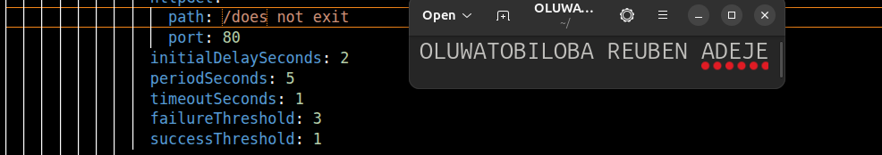

---

#### Screenshot 9 — Output showing the rollout timeout or incomplete rollout

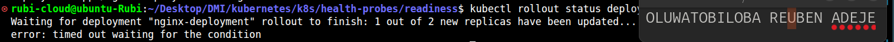

---

#### Screenshot 10 — Pod details showing `Ready: False` or readiness-probe failure events

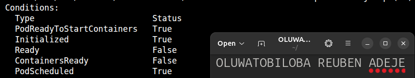

---

#### Screenshot 11 — Output showing successful rollout and ready Pods after the fix

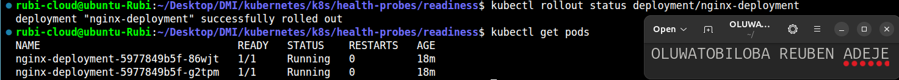

---

### Notes

**1. Why did the readiness probe fail?**

The readiness probe failed because it was configured to check the invalid path /does-not-exist. The Nginx server could not find this path and returned an HTTP 404 error. Kubernetes interpreted the unsuccessful response as a failed readiness check. As a result, the new Pods could not pass the readiness probe

**2. What happened to the Pod readiness status?**

The new Pods remained in the NotReady state because their readiness probes continued to fail. Kubernetes marked the Pod condition Ready as False. Although the containers were running, the Pods were not considered ready to receive traffic. The readiness-probe failure events provided evidence of the problem.

**3. Why did the rollout fail to complete?**

The Deployment rollout failed to complete because the new Pods could not become ready. Kubernetes waited for the replacement Pods to pass their readiness probes before completing the rolling update. Since the probes repeatedly failed, the new Pods remained unavailable. The rollout therefore did not complete within the specified timeout. 

**4. How did you restore the Deployment successfully?**

I restored the Deployment by correcting the readiness probe path from /does-not-exist to / in the YAML configuration. I then applied the corrected configuration to the Kubernetes cluster. Kubernetes performed new readiness checks, and the Nginx Pods successfully returned HTTP responses. The Pods became Ready, allowing the Deployment rollout to proceed. Finally, I verified that the rollout completed successfully and the expected replicas were ready.

---

# Task 5 — See How Readiness Protects Rolling Updates

## Goal

Observe how readiness prevents a bad new Pod from replacing healthy Pods during a rolling update.

### Evidence

#### Screenshot 12 — Successful update command and rollout status

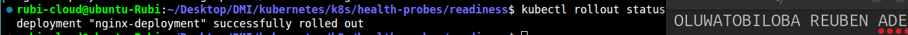

---

#### Screenshot 13 — ReplicaSets and Pods after the successful rolling update

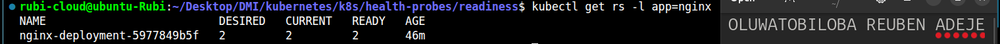

---

#### Screenshot 14 — Completed `04-readiness-broken-patch.yaml`

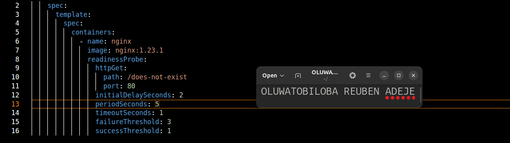

---

#### Screenshot 15 — Output showing the expected stalled rollout or timeout

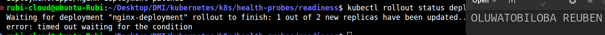

---

#### Screenshot 16 — Deployment or Pod output showing the effect of the broken readiness probe

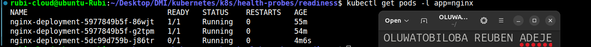

---

#### Screenshot 17 — Successful rollout status after restoring the fixed configuration

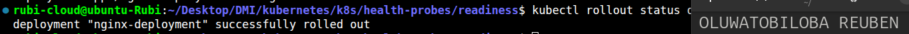

---

### Notes

**1. What happened during the successful rolling update?**

During the successful rolling update, I updated the NGINX image to a different valid version. Kubernetes created new Pods using the updated image and checked their readiness. Once the new Pods became Ready, Kubernetes gradually terminated the old Pods. The application remained available throughout the update because the new Pods passed their readiness checks. Finally, the rollout completed successfully with the desired number of replicas running.

**2. Why did Kubernetes create a new ReplicaSet?**

Kubernetes created a new ReplicaSet because the Deployment's Pod template changed when the NGINX image was updated. A ReplicaSet manages Pods that use a specific Pod template. The new ReplicaSet created Pods using the updated image, while the old ReplicaSet continued managing the existing Pods. Kubernetes gradually increased the number of new Pods and reduced the number of old Pods. This allowed the Deployment to transition to the new version in a controlled manner.

**3. Why were the new Pods unable to replace the existing healthy Pods after readiness was broken?**

The new Pods could not become Ready because the readiness probe was configured with the invalid path /does-not-exist. NGINX returned an HTTP 404 error, causing the readiness checks to fail. Kubernetes therefore considered the new Pods unavailable for serving traffic. Because the new Pods were not ready, Kubernetes could not safely remove the existing healthy Pods to complete the rollout. The Deployment remained in progress or timed out while waiting for the new Pods to become ready. Restoring the correct readiness path allowed the new Pods to pass their checks.

**4. How does `maxUnavailable: 0` protect availability during this rollout?**

The setting maxUnavailable: 0 ensures that Kubernetes does not intentionally reduce the number of available replicas below the desired replica count during a rolling update. Kubernetes must make replacement Pods available before removing existing available Pods. When the readiness probe fails, the new Pods remain NotReady and cannot count as available replicas. Kubernetes therefore keeps the existing healthy Pods running while waiting for the new Pods to become ready. This helps maintain application availability during the rollout. However, it does not prevent service disruption caused by unrelated failures affecting the existing Pods.

---

# Task 6 — Share Your Readiness-Probe Learning on LinkedIn

## Goal

Share what you learned about Kubernetes readiness probes and how they protect rolling updates.

### Evidence

#### Screenshot 18 — Published LinkedIn post

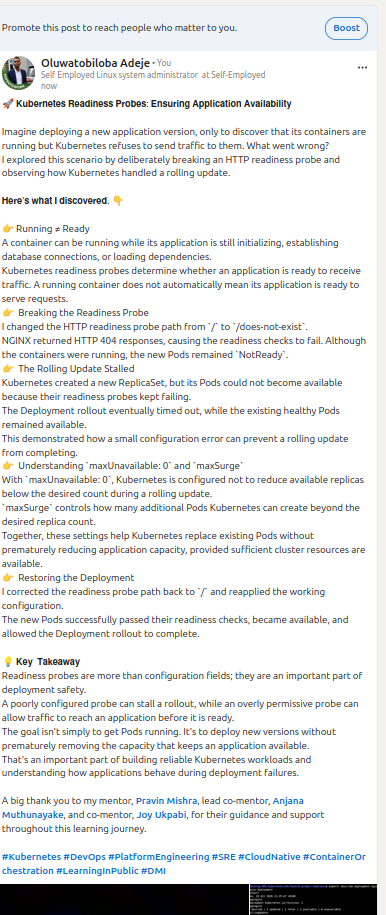

#### Linkedin post link

https://www.linkedin.com/posts/oluwatobiloba-adeje-2572b42a6_kubernetes-devops-platformengineering-ugcPost-7522267864385601537-Wfd2/?highlightedUpdateUrn=urn%3Ali%3Aactivity%3A7522267867682283521&highlightedUpdateType=SOCIAL_SHARE&origin=SOCIAL_SHARE&utm_source=share&utm_medium=member_desktop&rcm=ACoAAEm6D2MBiHlTtqXxAdNL2_2Taiskof8w_Lw

---

# Submission Instructions

- Add all required screenshots numbered 1–18.
- Ensure your full name is visible in required screenshots.
- Use clear, readable screenshots showing the relevant manifest or output.
- Include the completed baseline and readiness-probe manifests in your repository.
- Answer all Notes questions for Tasks 1–5 in your own words.
- Include evidence of the intentional readiness failure and successful recovery.
- Do not expose tokens, passwords, kubeconfig files, account IDs, or other sensitive information.

---

# Completion Checklist

- [ ] Learning cluster confirmed and previous assignment resources removed where applicable
- [ ] Readiness-probe lab directory created (Screenshot 1)
- [ ] Baseline Deployment created successfully (Screenshot 2)
- [ ] Two baseline Pods running and successful rollout verified (Screenshot 3)
- [ ] Baseline Deployment details reviewed (Screenshot 4)
- [ ] Readiness probe added successfully (Screenshot 5)
- [ ] Successful readiness rollout verified (Screenshot 6)
- [ ] Pod readiness conditions and probe details inspected (Screenshot 7)
- [ ] Broken readiness configuration created (Screenshot 8)
- [ ] Stalled rollout or timeout observed (Screenshot 9)
- [ ] NotReady status or readiness-probe failure events captured (Screenshot 10)
- [ ] Working readiness configuration restored (Screenshot 11)
- [ ] Successful image update completed (Screenshot 12)
- [ ] ReplicaSets and Pods inspected after the update (Screenshot 13)
- [ ] Broken-readiness patch created (Screenshot 14)
- [ ] Stalled rollout observed after the patch (Screenshot 15)
- [ ] Effect of broken readiness captured (Screenshot 16)
- [ ] Final recovery completed (Screenshot 17)
- [ ] LinkedIn post published (Screenshot 18)
- [ ] Notes for Tasks 1–5 completed
- [ ] Required manifests included
- [ ] All screenshots are clear and readable
- [ ] No sensitive data exposed

---

## 📌 About DMI & CloudAdvisory

DevOps Micro Internship (DMI) is a project-based DevOps program run by Pravin Mishra (The CloudAdvisory) focused on real-world execution, systems thinking, and career readiness.

It helps learners build strong DevOps foundations with hands-on experience.

---

## 📌 Resources

- 🌐 DMI Official Website: https://dmi.pravinmishra.com?utm_source=github&utm_medium=readme  
- 🎓 University: https://university.pravinmishra.com?utm_source=github&utm_medium=readme  
- 💬 Discord Community: https://discord.pravinmishra.com?utm_source=github&utm_medium=readme  
- 📝 Blog: https://dmi.pravinmishra.com/blog?utm_source=github&utm_medium=readme  
- ▶️ YouTube Playlist: https://www.youtube.com/playlist?list=PLFeSNDtI4Cho  
- 🔗 Pravin Mishra (LinkedIn): https://www.linkedin.com/in/pravin-mishra-aws-trainer/  
- 🏢 CloudAdvisory (LinkedIn): https://www.linkedin.com/company/thecloudadvisory/

---

*This submission is part of DevOps Micro Internship (DMI) — Agentic AI Track.*
