# Assignment 6 — Kubernetes Health Probes (Liveness)

Part of the DevOps Micro Internship (DMI) with Agentic AI

---

## Purpose

In this assignment, you will configure and test a Kubernetes liveness probe. You will create a baseline NGINX Deployment, add an HTTP liveness probe, intentionally make it fail, observe container restarts, and restore the working configuration.

---

# Task 0 — Prepare the Lab Environment

## Goal

Confirm that you are connected to your learning cluster and remove the previous HPA and NGINX Deployment before starting this lab.

No screenshot or written notes are required for this pre-check.

---

# Task 1 — Set Up Your Lab Directory

## Goal

Create and enter a dedicated directory for the liveness-probe lab.

### Evidence

#### Screenshot 1 — Terminal showing that you are working inside `~/k8s-labs/health-probes-liveness`

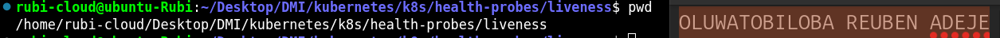

---

### Notes

**1. What problem does a liveness probe solve?**

A liveness probe checks whether an application running inside a container is functioning correctly.
It helps detect problems such as an application becoming stuck or unresponsive.
If the application fails the liveness probe repeatedly, Kubernetes restarts the container.
This helps the application recover from certain failures automatically.
It reduces the need for manual intervention to restart unhealthy containers.
Overall, a liveness probe helps maintain application health and reliability.

**2. What is the key difference between a readiness probe and a liveness probe?**

 A readiness probe checks whether an application is ready to receive traffic.
A liveness probe checks whether an application is still functioning properly.
If a readiness probe fails, Kubernetes stops sending traffic to the Pod until it becomes ready.
If a liveness probe fails repeatedly, Kubernetes restarts the container.
Readiness probes help prevent traffic from reaching applications that are not ready to serve requests.
In short, readiness determines when to send traffic, while liveness determines when to restart a container.

---

# Task 2 — Create a Baseline Deployment Without Probes

## Goal

Create a baseline NGINX Deployment with two replicas and no health probes.

### Evidence

#### Screenshot 2 — Completed `00-nginx-deploy-baseline.yaml` manifest

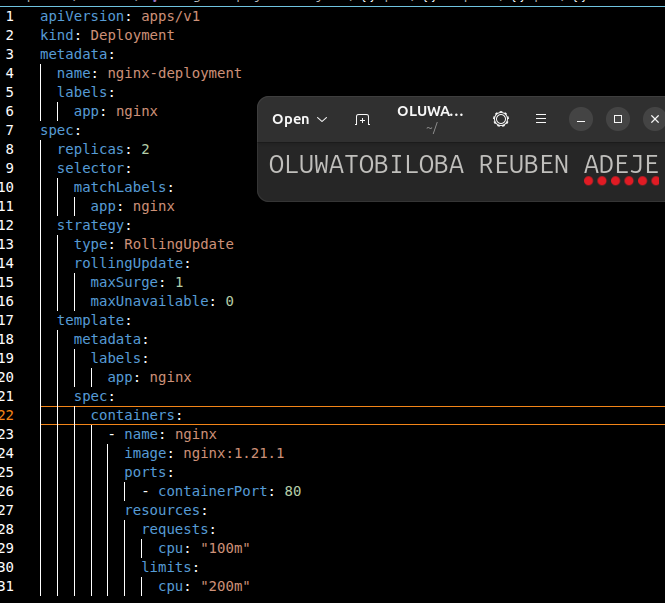

---

#### Screenshot 3 — Output showing a successful rollout and two running NGINX Pods

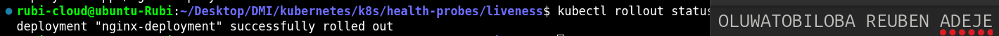

---

#### Screenshot 4 — Relevant output from `kubectl describe deployment nginx-deployment`

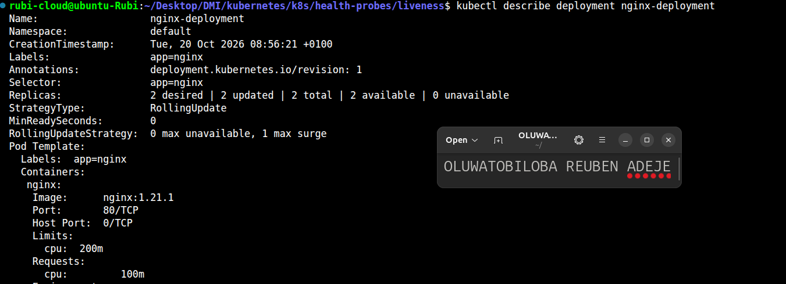

---

### Notes

**1. How many replicas does this Deployment maintain?**

The deployment maintain two replicas

**2. Are any health probes configured in the baseline Deployment?**

No health probes is configured in the baseline deployment

**3. Why is a baseline useful before adding a liveness probe?**

 A baseline is useful because it provides a starting point for comparison before adding a liveness probe. It helps us understand how the Deployment behaves without health probes. We can observe the application's normal behavior and identify any existing issues. After adding a liveness probe, we can compare the results to see how Kubernetes detects and handles unhealthy containers. This helps us verify that the liveness probe works as expected.

---

# Task 3 — Add a Liveness Probe

## Goal

Add an HTTP liveness probe so Kubernetes can periodically check whether the NGINX container is still responsive.

### Evidence

#### Screenshot 5 — Completed `01-nginx-deploy-liveness.yaml` manifest showing the liveness probe

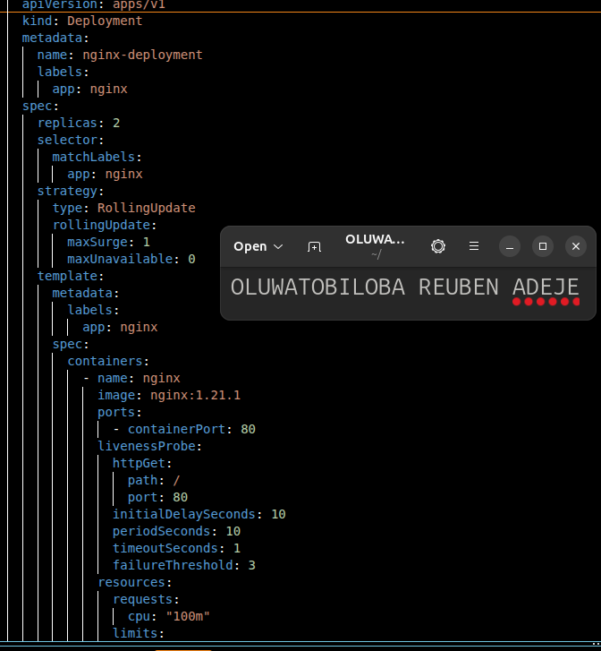

---

#### Screenshot 6 — Output showing successful rollout and running Pods

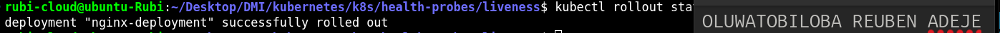

---

#### Screenshot 7 — Pod description showing liveness-probe details

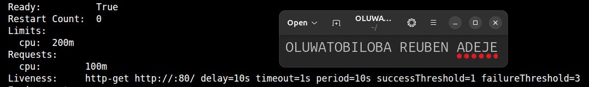

---

### Notes

**1. What path and port does the liveness probe check?**

    The liveness probe checks the configured / path on port 80 to determine whether the application is healthy.

**2. What does `initialDelaySeconds: 10` do?**

initialDelaySeconds: 10 means Kubernetes waits 10 seconds after the container starts before performing the first liveness probe.

**3. What does `failureThreshold: 3` mean?**

failureThreshold: 3 means Kubernetes restarts the container if the liveness probe fails three consecutive times.

**4. Does a successful liveness probe control whether a Pod receives traffic? Explain briefly.**

No, a successful liveness probe does not control whether a Pod receives traffic. It checks whether the application is functioning properly, while a readiness probe determines whether the Pod is ready to receive traffic.

---

# Task 4 — Trigger and Observe a Liveness Restart

## Goal

Intentionally make the liveness probe fail and observe Kubernetes restart the unhealthy container.

### Evidence

#### Screenshot 8 — `02-nginx-liveness-broken.yaml` showing `/does-not-exist`

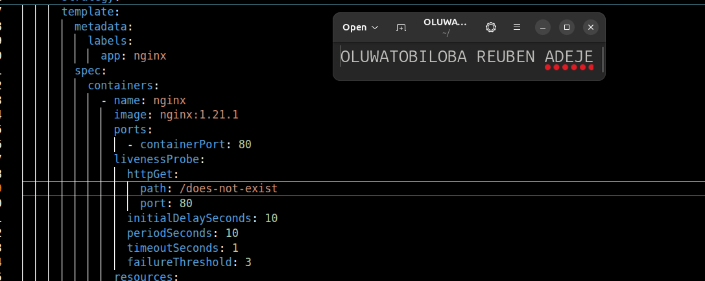

---

#### Screenshot 9 — Pod output showing an increased RESTARTS count

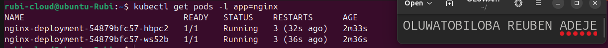

---

#### Screenshot 10 — Pod description showing liveness-probe failure events or restart details

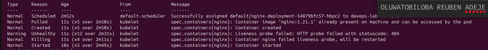

---

#### Screenshot 11 — Output showing stable running Pods after applying the fixed configuration

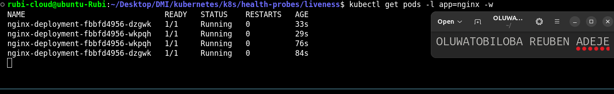

---

### Notes

**1. Why did the liveness probe fail?**

The liveness probe failed because it checked the /does-not-exist path, which was not available in the application, resulting in an HTTP error.

**2. What happened after Kubernetes detected repeated liveness-probe failures?**

After detecting repeated liveness-probe failures, Kubernetes restarted the container to recover the application.

**3. What does the RESTARTS column prove?**

The RESTARTS column shows how many times the container has restarted, confirming that Kubernetes restarted it after the liveness probe repeatedly failed.

**4. How did you restore the Deployment to a stable state?**

I restored the Deployment to a stable state by updating the liveness probe to use the correct application path and verifying that the Pod was running successfully.

---

# Task 5 — Optional: Observe a Restart Loop

## Goal

Observe why overly aggressive or incorrectly configured liveness probes can create restart loops.

Complete this section only if you attempt Task 5. Otherwise, mark it as “Not attempted.”

**Task status:** Completed / Not attempted

### Evidence

#### Optional Screenshot — Pod output showing the RESTARTS count increasing during the restart-loop observation

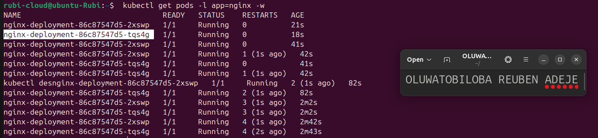

No specific restart count or CrashLoopBackOff status is required.

---

### Notes — Answer Only If Attempted

**1. What is a restart loop?**

A restart loop occurs when a container repeatedly crashes or is restarted by Kubernetes because it fails to function properly.

**2. Why can an aggressive liveness probe be harmful?**

An aggressive liveness probe can be harmful because it may restart a container before it has enough time to recover, causing unnecessary restarts and service interruptions.

**3. Why should liveness checks be lightweight and carefully tuned?**

  Liveness checks should be lightweight and carefully tuned to avoid consuming excessive resources and triggering unnecessary restarts. Properly configured liveness probes help Kubernetes detect genuine application failures without disrupting healthy applications.

Settings such as initialDelaySeconds, periodSeconds, and failureThreshold should be adjusted according to the application's needs.

This helps maintain application stability, reliability, and availability.

---

# Task 6 — Share Your Liveness-Probe Learning on LinkedIn

## Goal

Share what you learned about Kubernetes liveness probes, container restarts, and the difference between readiness and liveness.

### Evidence

#### Screenshot 12 — Published LinkedIn post

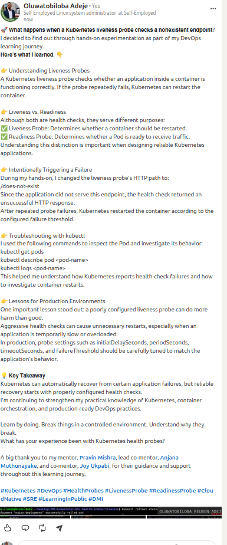

#### Linkedin post URL

https://www.linkedin.com/posts/oluwatobiloba-adeje-2572b42a6_kubernetes-devops-healthprobes-ugcPost-7522273745713909760-Y9oD/?utm_source=share&utm_medium=member_desktop&rcm=ACoAAEm6D2MBiHlTtqXxAdNL2_2Taiskof8w_Lw

---

# Submission Instructions

- Add all required screenshots numbered 1–12.
- Include the optional Task 5 screenshot only if you attempt that task.
- Ensure your full name is visible in required screenshots.
- Use clear, readable screenshots showing the relevant manifest or output.
- Include the completed baseline and liveness-probe manifests in your repository.
- Answer all Notes questions for Tasks 1–4 in your own words.
- If you attempt Task 5, complete its Notes and restore the working configuration afterward.
- Do not expose tokens, passwords, kubeconfig files, account IDs, or other sensitive information.

---

# Completion Checklist

- [x] Learning cluster confirmed and previous assignment resources removed where applicable
- [x] Liveness-probe lab directory created (Screenshot 1)
- [x] Baseline Deployment manifest completed (Screenshot 2)
- [x] Successful rollout and two baseline Pods verified (Screenshot 3)
- [x] Baseline Deployment details reviewed (Screenshot 4)
- [x] Liveness probe added successfully (Screenshot 5)
- [x] Successful liveness-probe rollout verified (Screenshot 6)
- [x] Liveness-probe details inspected (Screenshot 7)
- [x] Broken liveness configuration created (Screenshot 8)
- [x] Increased container restart count observed (Screenshot 9)
- [x] Liveness-probe failure events or restart details captured (Screenshot 10)
- [x] Working liveness configuration restored and stable Pods verified (Screenshot 11)
- [x] Optional Task 5 evidence and Notes completed, if attempted
- [x] Working configuration restored after Task 5, if attempted
- [x] LinkedIn post published (Screenshot 12)
- [x] Notes for Tasks 1–4 completed
- [x] Required manifests included
- [x] All required screenshots are clear and readable
- [x] No sensitive data exposed

---

## 📌 About DMI & CloudAdvisory

DevOps Micro Internship (DMI) is a project-based DevOps program run by Pravin Mishra (The CloudAdvisory) focused on real-world execution, systems thinking, and career readiness.

It helps learners build strong DevOps foundations with hands-on experience.

---

## 📌 Resources

- 🌐 DMI Official Website: https://dmi.pravinmishra.com?utm_source=github&utm_medium=readme  
- 🎓 University: https://university.pravinmishra.com?utm_source=github&utm_medium=readme  
- 💬 Discord Community: https://discord.pravinmishra.com?utm_source=github&utm_medium=readme  
- 📝 Blog: https://dmi.pravinmishra.com/blog?utm_source=github&utm_medium=readme  
- ▶️ YouTube Playlist: https://www.youtube.com/playlist?list=PLFeSNDtI4Cho  
- 🔗 Pravin Mishra (LinkedIn): https://www.linkedin.com/in/pravin-mishra-aws-trainer/  
- 🏢 CloudAdvisory (LinkedIn): https://www.linkedin.com/company/thecloudadvisory/

---

*This submission is part of DevOps Micro Internship (DMI) — Agentic AI Track.*
