# Assignment 7 — Kubernetes Services (ClusterIP)

Part of the DevOps Micro Internship (DMI) with Agentic AI

---

## Purpose

In this assignment, you will create and test a Kubernetes ClusterIP Service. You will connect it to a healthy NGINX Deployment, access it using DNS and its ClusterIP, break and restore its selector, and observe how readiness affects Service routing.

---

# Task 0 — Prepare the Lab Environment

## Goal

Confirm your learning-cluster context and remove previous lab resources where applicable before starting this assignment.

No screenshot or written notes are required for this pre-check.

---

# Task 1 — Set Up Your Lab Directory

## Goal

Create and enter a dedicated directory for the ClusterIP Service lab.

### Evidence

#### Screenshot 1 — Terminal showing that you are working inside `~/k8s-labs/services/clusterip`

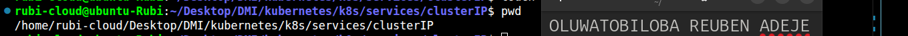

---

### Notes

**1. Why is it not reliable to communicate with an application using a Pod IP address?**

od IP addresses are temporary and can change over time. When a Pod restarts, it may receive a new IP address. Pods can also be deleted and replaced during scaling or updates. This makes it difficult to maintain direct communication with a specific Pod. Applications using Pod IP addresses may stop working when the IP address changes. Therefore, using a Kubernetes Service is more reliable for communication.

**2. What Kubernetes resource provides a stable internal address for a group of Pods?**

A Kubernetes Service provides a stable internal address for a group of Pods. It exposes the Pods through a consistent IP address and DNS name. The Service uses labels to identify and select the appropriate Pods. It automatically routes network traffic to the selected Pods. Even if Pods are replaced or their IP addresses change, the Service address remains stable

---

# Task 2 — Create a Healthy NGINX Deployment

## Goal

Create an NGINX Deployment with labels, readiness probes, and liveness probes that can act as the backend for a Service.

### Evidence

#### Screenshot 2 — Completed `00-nginx-deploy.yaml` manifest

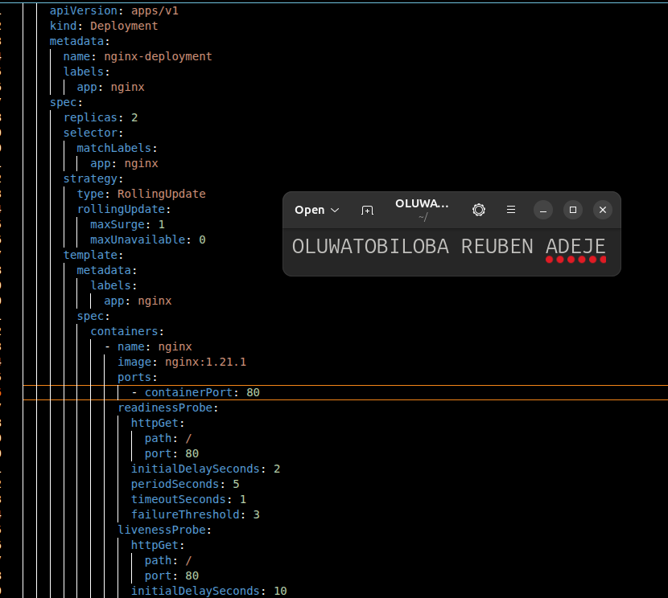

---

#### Screenshot 3 — Output showing successful rollout and two ready NGINX Pods

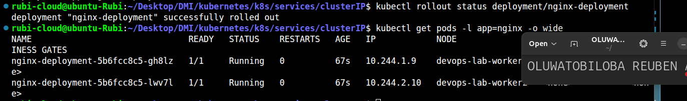

---

### Notes

**1. Which label will the Service use to find these Pods?**

The Service will use the label nginx to find the Pods. Labels help Kubernetes identify and group related Pods. The Service uses a label selector to select Pods with matching labels. Only Pods that match the selector will receive traffic from the Service. This allows the Service to communicate with the correct Pods.

**2. Why is readiness important before connecting Pods to a Service?**

Readiness is important because it ensures that a Pod is ready to handle requests before receiving traffic. Kubernetes uses readiness probes to check whether a container is ready to serve requests. If a Pod is not ready, it will not receive traffic through the Service. This prevents requests from reaching applications that are still starting or experiencing problems. Therefore, readiness helps ensure reliable communication and improves application availability.

**3. What port does the NGINX container listen on?**

The NGINX container listens on port 80 by default. This port is used to receive HTTP requests from clients. Kubernetes Services can forward traffic to this port to access the NGINX application. The container port should match the port on which NGINX is listening. This allows users and other applications to communicate with the NGINX server.

---

# Task 3 — Create a ClusterIP Service

## Goal

Create a stable internal Service that routes traffic to the NGINX Pods.

### Evidence

#### Screenshot 4 — Completed `01-nginx-svc-clusterip.yaml` manifest

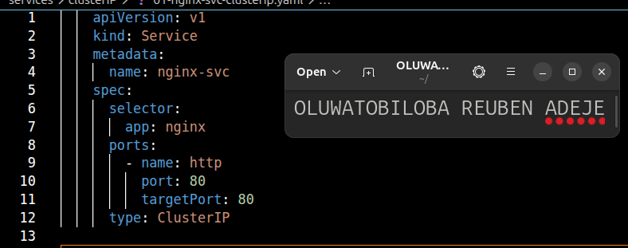

---

#### Screenshot 5 — Output showing the ClusterIP Service, endpoints, or EndpointSlices

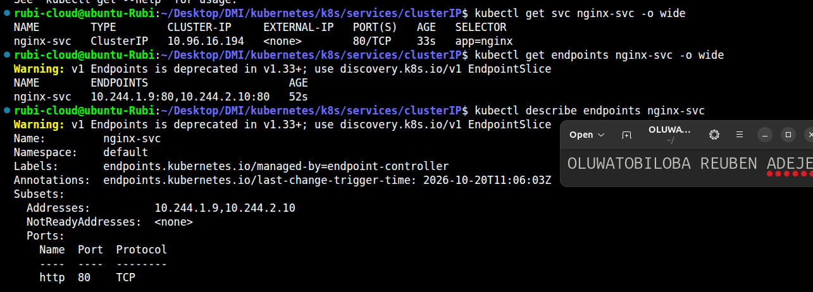

---

### Notes

**1. What is the purpose of a ClusterIP Service?**

A ClusterIP Service provides an internal IP address for accessing a group of Pods within a Kubernetes cluster. It allows applications inside the cluster to communicate with each other. The IP address remains stable even when Pods are restarted or replaced. It routes traffic to the appropriate Pods using label selectors. By default, a ClusterIP Service is not accessible directly from outside the cluster. Therefore, it is mainly used for internal communication between applications.

**2. What is the difference between `port` and `targetPort`?**

The port is the port on which the Kubernetes Service receives traffic. The targetPort is the port on which the application inside the Pod receives that traffic. For example, a Service can use port 80 and forward traffic to targetPort 8080. The Service forwards incoming requests from its port to the target port of the selected Pods. These two ports can have the same or different values. This allows the Service to expose an application through a convenient port.
**3. Why must the Service selector match the Pod labels?**

The Service selector must match the Pod labels so that Kubernetes can identify the correct Pods. Labels are used to group and organize Pods based on their applications. The Service uses its selector to find Pods that match the specified labels. If the labels do not match, the Service will not select those Pods. As a result, the Service may have no endpoints to receive traffic. Therefore, matching labels and selectors is essential for proper communication.

**4. What information do EndpointSlices contain?**

EndpointSlices contain information about the network endpoints associated with a Kubernetes Service. They include the IP addresses of the Pods that can receive traffic. They also provide information about endpoint ports and readiness conditions. Kubernetes uses this information to determine where Service traffic should be sent. EndpointSlices help manage endpoints efficiently, especially when a Service has many Pods. They allow Kubernetes to route traffic to the appropriate endpoints.

---

# Task 4 — Access the Service from Inside the Cluster

## Goal

Create a client Pod and access the NGINX Service using DNS and its ClusterIP.

### Evidence

#### Screenshot 6 — Output showing the `tester` Pod running

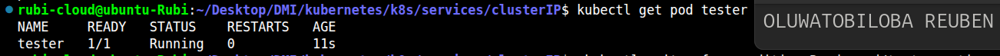

---

#### Screenshot 7 — Successful Service request using DNS name and ClusterIP

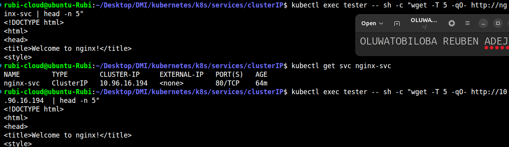

---

#### Screenshot 8 — Successful DNS lookup for the Service

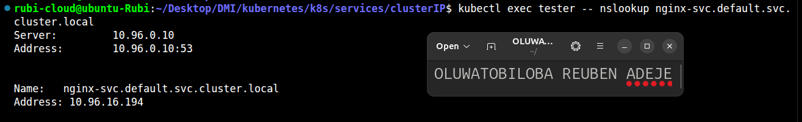

---

### Notes

**1. Why should an application use `nginx-svc` instead of a Pod IP address?**

An application should use nginx-svc because it provides a stable way to communicate with the NGINX application. Pod IP addresses can change when Pods are restarted or replaced. However, the Service name remains the same even when the backend Pods change. Kubernetes automatically routes traffic from the Service to the appropriate Pods. This makes communication more reliable and easier to manage. Therefore, using nginx-svc is better than using a Pod IP address directly.

**2. What does the DNS name `nginx-svc.default.svc.cluster.local` represent?**

The DNS name nginx-svc.default.svc.cluster.local represents the fully qualified domain name (FQDN) of a Kubernetes Service. The name nginx-svc identifies the Service. The default part represents the namespace where the Service is located. The svc indicates that the resource is a Kubernetes Service, while cluster.local is the default cluster domain. This DNS name allows applications within the cluster to locate and communicate with the Service. It provides a stable name even when the backend Pod IP addresses change.

**3. Why can the client access the Service even if the backend Pod IPs change?**

The client can access the Service because Kubernetes provides it with a stable IP address and DNS name. The Service uses label selectors to identify the appropriate backend Pods. When Pod IP addresses change, Kubernetes updates the Service's associated endpoints. The Service then directs incoming traffic to the available Pods. The client does not need to know the individual Pod IP addresses. Therefore, communication continues without requiring changes to the client's configuration.

---

# Task 5 — Break and Restore the Label-Selector Contract

## Goal

Break the Service selector, observe that usable endpoints disappear, and then restore the correct selector.

### Evidence

#### Screenshot 9 — `02-nginx-svc-selector-broken.yaml` showing the incorrect selector

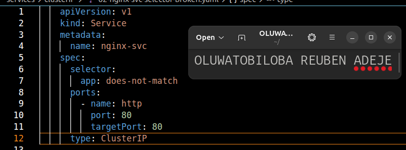

---

#### Screenshot 10 — Empty endpoints or EndpointSlice output after applying the broken selector

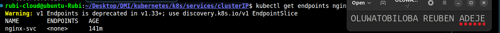

---

#### Screenshot 11 — Failed request output from the `tester` Pod

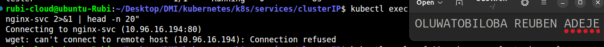

---

#### Screenshot 12 — Restored endpoints and successful Service request

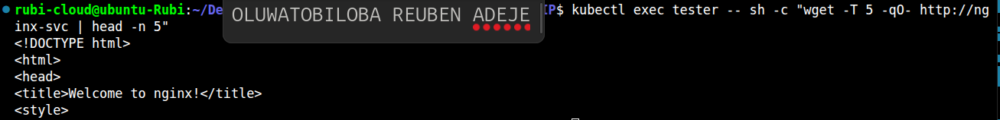

---

### Notes

**1. Why did the Service endpoints become empty?**

The Service endpoints became empty because the Service selector was changed to a label that did not match the NGINX Pod labels. Kubernetes uses selectors to identify the Pods that belong to a Service. Since no Pods matched the updated selector, the Service could not find any backend Pods. As a result, the Service had no endpoints to receive traffic. This prevented the Service from forwarding requests to the NGINX Pods.

**2. What caused the request from the client Pod to fail?**

The request from the client Pod failed because the Service had no available endpoints. The Service selector did not match the labels on the NGINX Pods. Therefore, Kubernetes could not route the request to any backend Pod. Although the Service still existed, it had no Pods to handle incoming traffic. As a result, the client could not receive a response from the NGINX application.

**3. How did you restore connectivity to the NGINX Pods?**

I restored connectivity by correcting the Service selector to match the labels on the NGINX Pods. Kubernetes then identified the matching Pods and updated the Service endpoints. Once the endpoints were available, the Service could forward traffic to the NGINX Pods. I tested the connection again from the client Pod to confirm that requests were successful. This restored communication between the client and the NGINX application.

---

# Task 6 — Observe How Readiness Affects Service Routing

## Goal

Observe how a new Pod that fails readiness is excluded from ready Service backends while the existing healthy Pod continues serving traffic.

### Evidence

#### Screenshot 13 — Output showing the Deployment scaled to one ready Pod

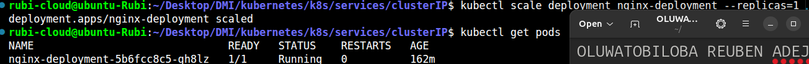

---

#### Screenshot 14 — Completed `03-readiness-broken.yaml` patch file

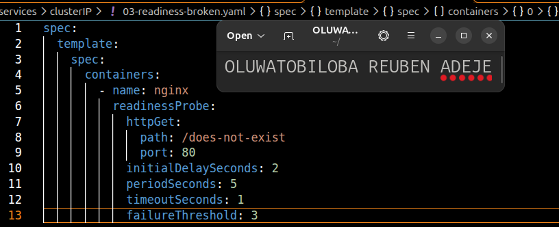

---

#### Screenshot 15 — Output showing the expected incomplete rollout or NotReady Pod

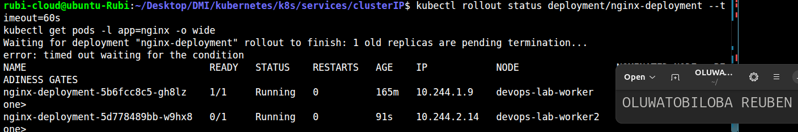

---

#### Screenshot 16 — EndpointSlice output showing the healthy Pod with `ready: true` and the new NotReady Pod with `ready: false`

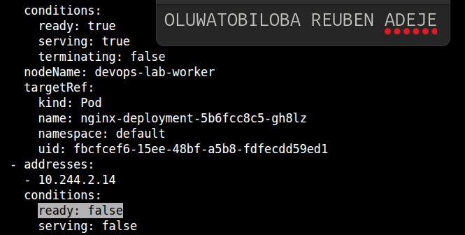

---

#### Screenshot 17 — Service EndpointSlice output showing ready backends after restoring the Deployment

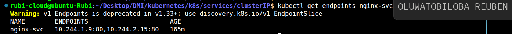

---

### Notes

**1. Why was the new NotReady Pod excluded from ready Service backends?**

The new Pod was excluded because it was not ready to handle incoming requests. Kubernetes uses readiness probes to check whether a Pod is ready to serve traffic. Since the Pod was marked as NotReady, it was not included among the Service's ready backends. This prevents traffic from being sent to an application that is still starting or not functioning properly. Once the Pod becomes ready, Kubernetes can include it in the Service endpoints.

**2. What is the relationship between readiness probes and Service routing?**

Readiness probes check whether a container is ready to handle requests. Kubernetes uses the readiness status to determine whether a Pod should receive traffic through a Service. If a Pod is NotReady, it is excluded from the ready Service backends. When the Pod becomes Ready, it can receive traffic through the Service. This helps Kubernetes route requests only to Pods that are ready to serve them.

**3. Why does this behavior protect users from unhealthy application instances?**

This behavior protects users by preventing requests from reaching Pods that are not ready to handle them. An unhealthy or starting application may fail to process requests correctly. Readiness probes help Kubernetes identify such Pods and exclude them from normal Service traffic. This reduces failed requests and improves application availability. As a result, users are more likely to receive successful responses from healthy application instances.

---

# Task 7 — Share Your ClusterIP Service Learning on LinkedIn

## Goal

Share what you learned about ClusterIP Services, Kubernetes DNS, selectors, and readiness-aware Service routing.

### Evidence

#### Screenshot 18 — Published LinkedIn post

Add your screenshot here.

#### Linkedin post link

Paste your link here

---

# Submission Instructions

- Add all required screenshots numbered 1–18.
- Ensure your full name is visible in required screenshots.
- Use clear, readable screenshots showing the relevant manifest or output.
- Include the completed NGINX Deployment and ClusterIP Service manifests in your repository.
- Answer all Notes questions for Tasks 1–6 in your own words.
- Include evidence of the intentional failures and successful recovery.
- Do not expose tokens, passwords, kubeconfig files, account IDs, or other sensitive information.

---

# Completion Checklist

- [ ] Learning-cluster context confirmed and previous lab resources removed where applicable
- [ ] ClusterIP lab directory created (Screenshot 1)
- [ ] Healthy NGINX Deployment manifest completed (Screenshot 2)
- [ ] Successful rollout and two ready NGINX Pods verified (Screenshot 3)
- [ ] ClusterIP Service manifest completed (Screenshot 4)
- [ ] Service and backend endpoints or EndpointSlices verified (Screenshot 5)
- [ ] Client Pod created and running (Screenshot 6)
- [ ] Service accessed using DNS name and ClusterIP (Screenshot 7)
- [ ] Service DNS resolution verified (Screenshot 8)
- [ ] Broken selector manifest created (Screenshot 9)
- [ ] Empty endpoints observed (Screenshot 10)
- [ ] Failed Service request captured (Screenshot 11)
- [ ] Original selector restored and connectivity verified (Screenshot 12)
- [ ] Deployment scaled to one ready Pod (Screenshot 13)
- [ ] Broken readiness patch created (Screenshot 14)
- [ ] Incomplete rollout or NotReady Pod observed (Screenshot 15)
- [ ] Readiness effect on Service backends verified (Screenshot 16)
- [ ] Deployment restored and ready Service backends verified (Screenshot 17)
- [ ] LinkedIn post published (Screenshot 18)
- [ ] Notes for Tasks 1–6 completed
- [ ] Required manifests included
- [ ] All required screenshots are clear and readable
- [ ] No sensitive data exposed

---

## 📌 About DMI & CloudAdvisory

DevOps Micro Internship (DMI) is a project-based DevOps program run by Pravin Mishra (The CloudAdvisory) focused on real-world execution, systems thinking, and career readiness.

It helps learners build strong DevOps foundations with hands-on experience.

---

## 📌 Resources

- 🌐 DMI Official Website: https://dmi.pravinmishra.com?utm_source=github&utm_medium=readme  
- 🎓 University: https://university.pravinmishra.com?utm_source=github&utm_medium=readme  
- 💬 Discord Community: https://discord.pravinmishra.com?utm_source=github&utm_medium=readme  
- 📝 Blog: https://dmi.pravinmishra.com/blog?utm_source=github&utm_medium=readme  
- ▶️ YouTube Playlist: https://www.youtube.com/playlist?list=PLFeSNDtI4Cho  
- 🔗 Pravin Mishra (LinkedIn): https://www.linkedin.com/in/pravin-mishra-aws-trainer/  
- 🏢 CloudAdvisory (LinkedIn): https://www.linkedin.com/company/thecloudadvisory/

---

*This submission is part of DevOps Micro Internship (DMI) — Agentic AI Track.*
