# Assignment 10 — Capstone: Deploy the Book Review App to Kubernetes

Part of the DevOps Micro Internship (DMI) with Agentic AI

---

## Purpose

Deploy the Book Review App as a production-style three-tier application using Kubernetes manifests or Helm charts, with an accessible frontend, an internal backend, and a managed or persistent MySQL database.

---

## Submission Details

**Full Name:** Add your full name here.

**Kubernetes Platform:** Add your platform here.

**Namespace:** book-review

**Frontend URL or IP:** Add the working endpoint here.

**Access Method:** Public LoadBalancer, Ingress, or documented local access.

**GitHub Manifests or Helm Chart URL:** Add your repository link here.

**Architecture Diagram:** Add your diagram or link here.

---

# Task 1 — Prepare the Kubernetes Cluster and Project

## Goal

Prepare the cluster, application source, container images, and tooling needed for the deployment.

### Evidence

#### Screenshot 1 — Active Kubernetes context and Ready nodes

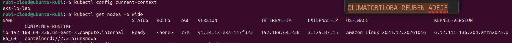

---

#### Screenshot 2 — If using Helm: Output of `helm version`

Required only if you choose Helm. Skip this screenshot if using YAML manifests.

Add your screenshot here, or write “Not applicable — using YAML manifests.”

NOT APPLICABLE- Using YAML manifest
---

# Task 2 — Design the Three-Tier Kubernetes Architecture

## Goal

Document the workloads, networking, configuration, storage, and permitted communication paths before deployment.

### Evidence

#### Screenshot 3 — Completed Kubernetes architecture diagram

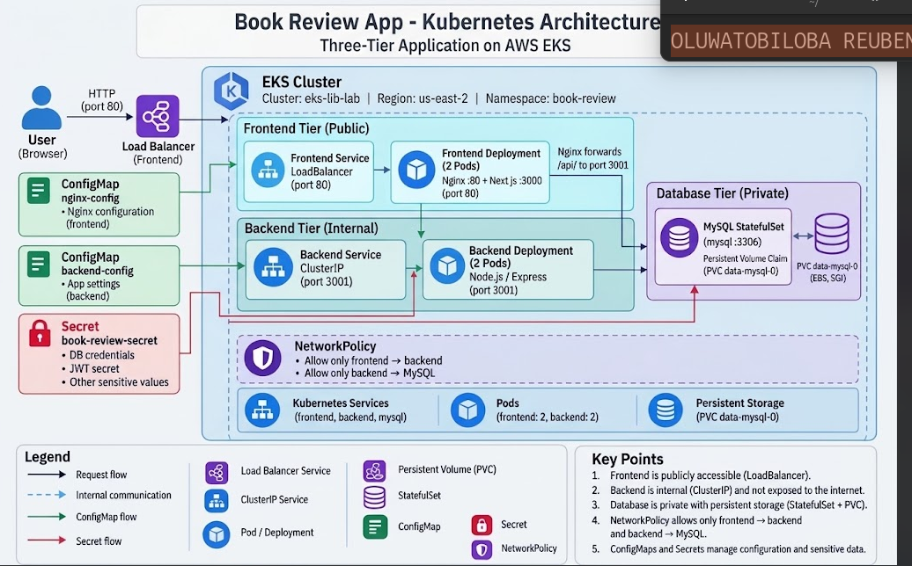

---

# Task 3 — Create ConfigMaps and Secrets

## Goal

Provide application configuration and credentials without embedding sensitive values in images or committing them to Git.

### Evidence

#### Screenshot 4 — ConfigMap configuration or describe output showing non-sensitive values

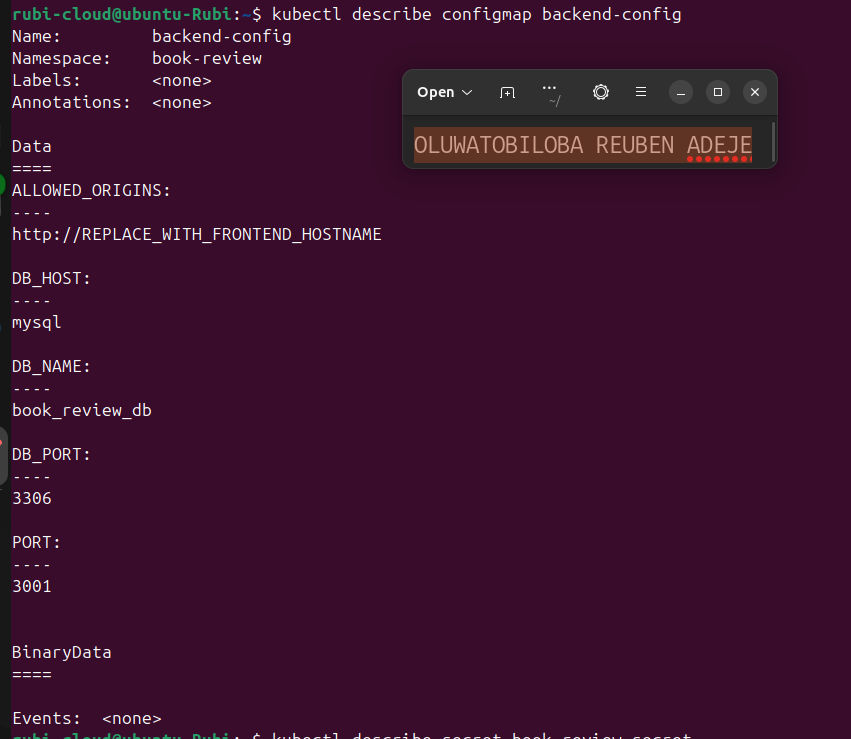

---

#### Screenshot 5 — Secret references or describe output showing names and keys without sensitive values

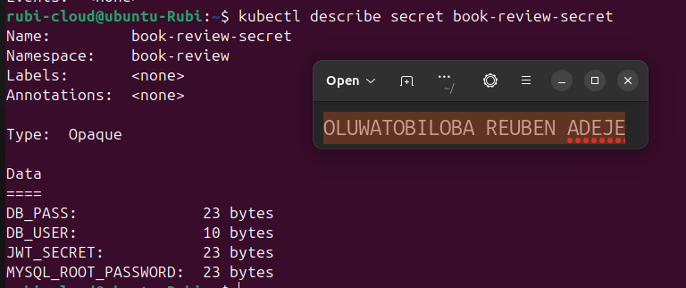

---

# Task 4 — Deploy and Configure the MySQL Data Tier

## Goal

Provide persistent MySQL storage and allow the backend to connect without exposing the database publicly.

### Evidence

#### Screenshot 6 — Managed MySQL status or MySQL StatefulSet and PVC status

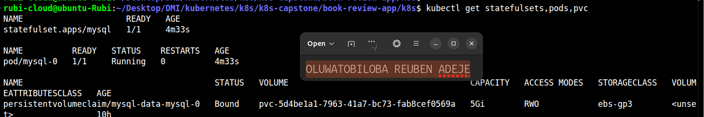

---

#### Screenshot 7 — Successful database connectivity or schema verification with credentials hidden

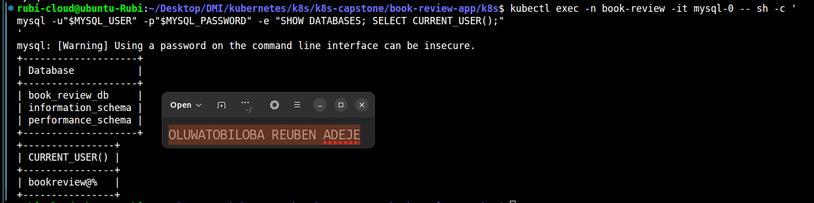

---

# Task 5 — Deploy the Backend Application Tier

## Goal

Run one or two Node.js/Express backend replicas on port 3001 and expose them through an internal ClusterIP Service.

### Evidence

#### Screenshot 8 — Backend Deployment, ready Pods, and internal Service

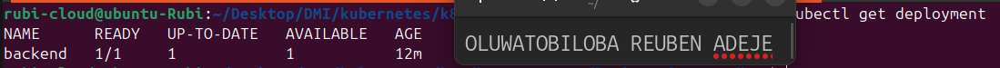

---

#### Screenshot 9 — Backend startup logs and database connectivity evidence

If the application does not log successful database connections, provide a successful database-backed request alongside the startup logs.

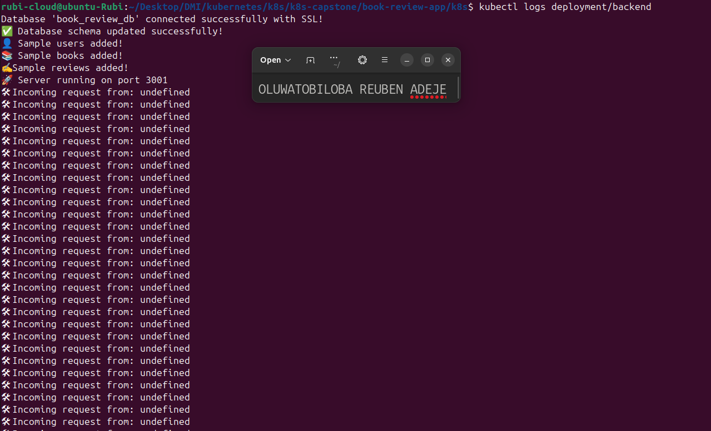

---

# Task 6 — Deploy the Frontend and Configure Nginx

## Goal

Run the Next.js frontend behind Nginx on port 80 and proxy API requests to the internal backend Service.

### Evidence

#### Screenshot 10 — Frontend Deployment and Ready Pods

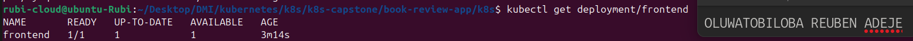

---

#### Screenshot 11 — Nginx reverse-proxy configuration showing the internal backend Service name and port 3001

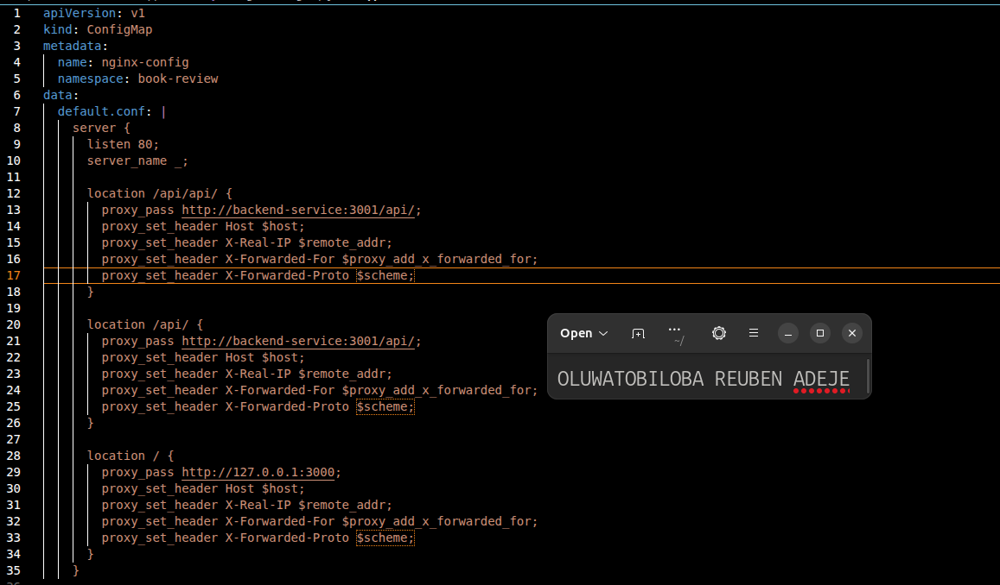

---

# Task 7 — Configure External and Internal Networking

## Goal

Expose the frontend and enforce the intended communication path between application tiers.

### Evidence

#### Screenshot 12 — Frontend LoadBalancer or Ingress configuration and assigned endpoint, or documented local access method

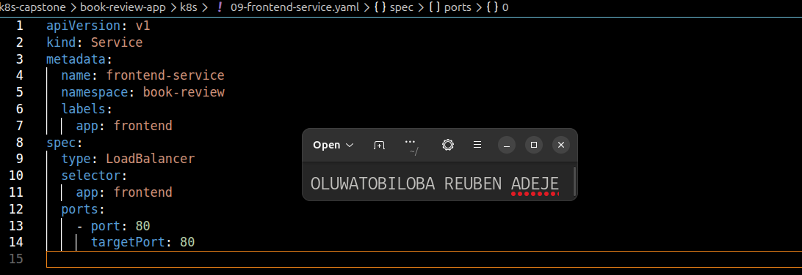

---

#### Screenshot 13 — Internal backend Service and NetworkPolicy or equivalent restriction, with access-test evidence

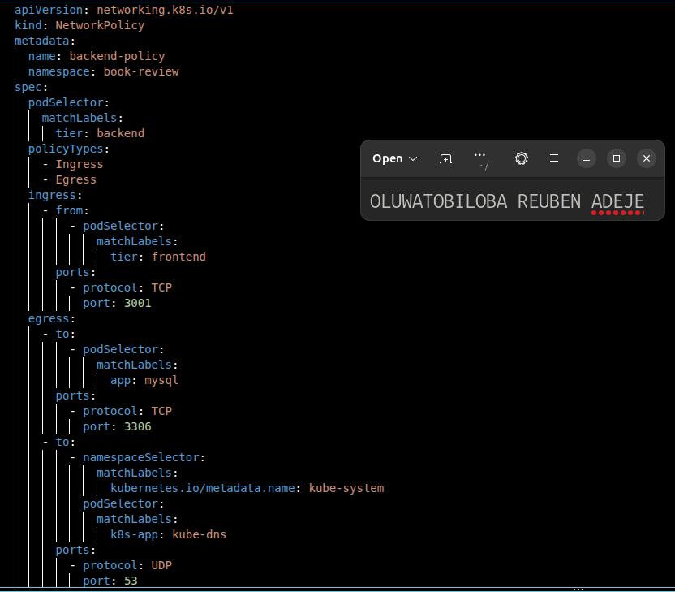

---

# Task 8 — Validate the Application End to End

## Goal

Prove that the frontend, backend, and MySQL database work together and collect operational evidence.

### Evidence

#### Screenshot 14 — `kubectl get all` output for the book-review namespace

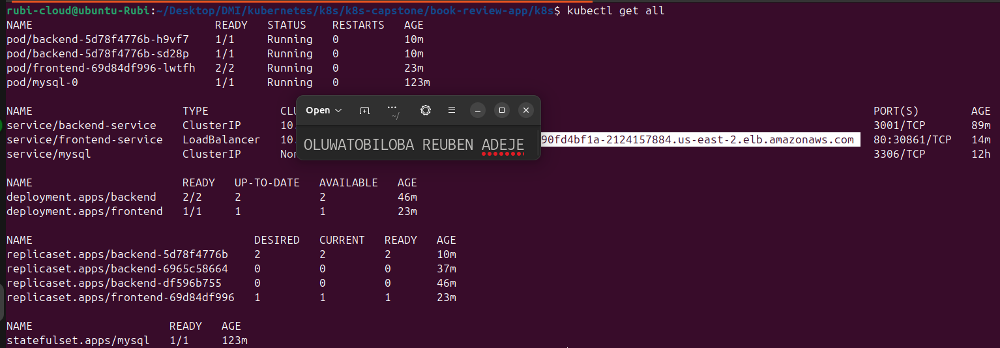

---

#### Screenshot 15 — Functional Book Review App in the browser with the URL visible, including evidence of a successful user flow

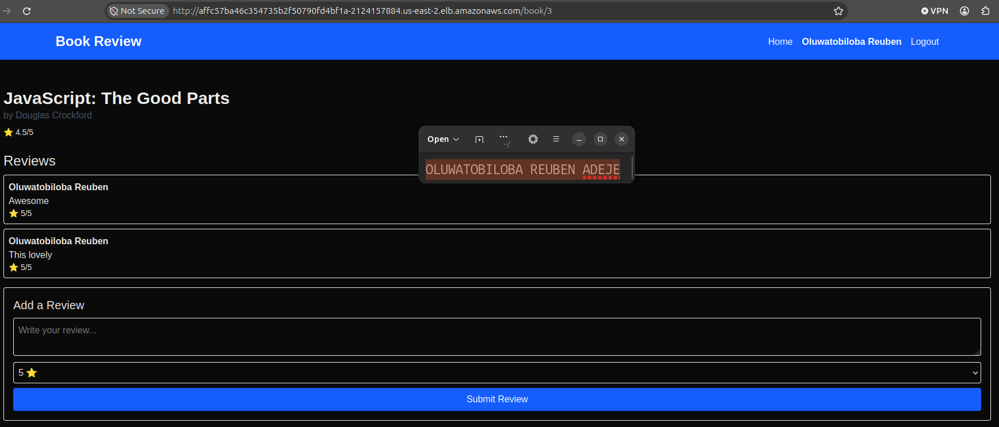

---

#### Screenshot 16 — Frontend or Nginx container logs

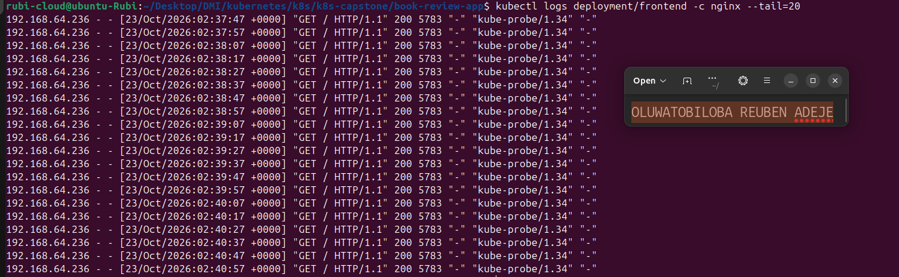

---

#### Screenshot 17 — Backend logs and evidence of a successful database-backed operation

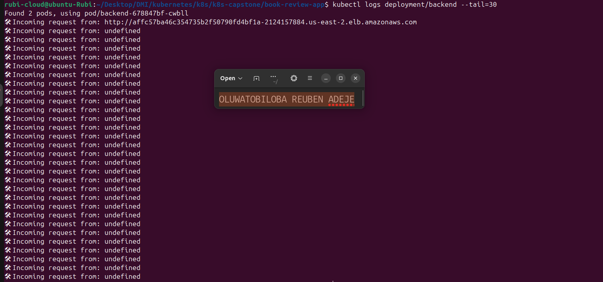

---

#### Screenshot 18 — Optional: Kubernetes dashboard

Add your screenshot here, or write “Not attempted.”

NOT ATTEMPTED

Multiple images may be included under a screenshot number when needed to demonstrate the complete user flow.

---

# Task 9 — Optional: Implement Production Improvements

## Goal

Add selected improvements without breaking the required three-tier architecture.

### Evidence

#### Screenshot 19 — Optional: Evidence of selected Helm, HPA, probe, or TLS improvements

Add your screenshot here, or write “Not attempted.”

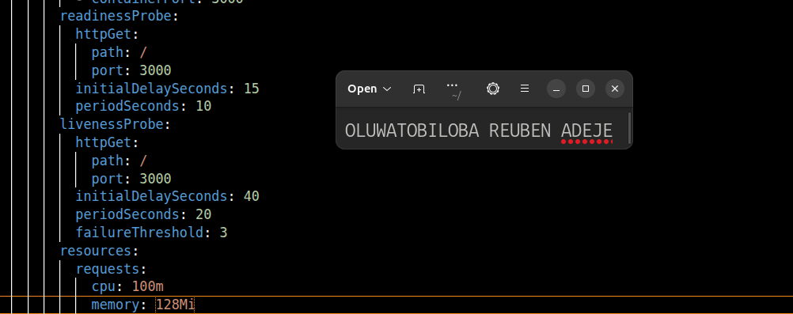

---

# Task 10 — Publish Your Book Review App Deployment on LinkedIn

## Goal

Explain your three-tier architecture, demonstrate the working application, and share what you learned.

### Evidence

#### Screenshot 20 — Published LinkedIn post about your Book Review App deployment on Kubernetes

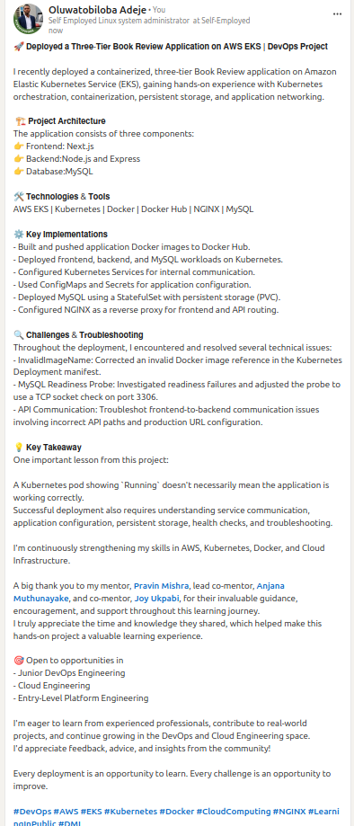

### LinkedIn Post URL

https://www.linkedin.com/posts/oluwatobiloba-adeje-2572b42a6_devops-aws-eks-ugcPost-7522955466285621250-Qb-B/?utm_source=share&utm_medium=member_desktop&rcm=ACoAAEm6D2MBiHlTtqXxAdNL2_2Taiskof8w_Lw

---

# Final Summary

## What Worked

Successfully deployed the three-tier Book Review application on an AWS EKS Kubernetes cluster.

The application consists of:

- **Frontend:** Next.js application served behind NGINX.
- **Backend:** Node.js and Express API.
- **Database:** MySQL deployed using a Kubernetes StatefulSet.

The following components were configured:
- Kubernetes Deployments and Services for application components.
- A dedicated `book-review` namespace.
- Docker images built and pushed to Docker Hub.
- MySQL persistent storage using a PersistentVolumeClaim (PVC).
- ConfigMaps and Secrets for application configuration.
- NGINX reverse proxy configuration for frontend and backend API routing.

MySQL successfully reached the `Running` state, and its readiness probe was adjusted to check TCP connectivity on port 3306.

## Issues and Fixes

Several technical challenges were encountered during deployment and troubleshooting:

**1. Invalid Docker Image Reference**
- **Cause:** A placeholder environment variable was used directly in the Kubernetes image reference.
- **Fix:** Replaced the placeholder with the actual Docker Hub username and image reference.

**2. MySQL Readiness Probe Failure**
- **Cause:** The initial readiness probe did not correctly establish database readiness.
- **Fix:** Updated the readiness probe to use a TCP socket check on port 3306.

**3. Frontend-to-Backend API Communication**
- **Cause:** Incorrect API URL configuration resulted in duplicated `/api` paths and requests targeting `localhost` in the production environment.
- **Fix:** Investigated the frontend API configuration and NGINX reverse proxy routing to correct the API endpoint configuration.

These issues provided practical experience in debugging Kubernetes manifests, container configuration, database health checks, and application networking.

## Tools and Sources Used

**Tools and Technologies:**
- Amazon Web Services (AWS)
- Amazon Elastic Kubernetes Service (EKS)
- Kubernetes and `kubectl`
- Docker and Docker Hub
- NGINX
- Next.js
- Node.js and Express
- MySQL
- Kubernetes ConfigMaps, Secrets, StatefulSets, Services, and PersistentVolumeClaims

**Troubleshooting and Deployment Tools:**
- Kubernetes commands for inspecting pods, services, and deployments.
- Kubernetes logs and events for troubleshooting.
- Browser Developer Tools for investigating frontend API requests and network errors.
- YAML manifests for defining Kubernetes resources.

## Optional Improvements

**Not attempted.**

Potential future improvements include:
- Implementing a CI/CD pipeline for automated builds and deployments.
- Using Terraform for infrastructure provisioning.
- Configuring Kubernetes monitoring and centralized logging.
- Implementing resource requests, limits, and horizontal pod autoscaling.
- Improving application security and ingress configuration.

## Cleanup or Reuse Plan

After completing the project and deployment activities, all AWS and Kubernetes resources provisioned for the assignment were cleaned up and decommissioned.

This included the EKS environment and associated application resources to prevent unnecessary resource consumption and ongoing AWS charges.

The project configurations, Kubernetes manifests, and deployment files were retained for future reference, learning, and potential redeployment.

---

# Submission Instructions

- Include your Kubernetes manifests or Helm chart in the linked repository.
- Submit Secret examples containing placeholders only.
- Include Screenshot 1, Screenshots 3–17, and Screenshot 20.
- Include Screenshot 2 only if using Helm.
- Screenshots 18–19 are optional.
- Keep screenshot numbering consistent with the guidelines.
- Use clear, readable screenshots showing relevant configuration, commands, and outputs.
- Make your full name visible in required screenshots.
- Complete the submission details and Final Summary.
- Include your published LinkedIn post URL.
- Capture required evidence before cleanup.
- Do not expose passwords, tokens, JWT secrets, actual Secret values, kubeconfig contents, cloud credentials, or confidential account information.

---

# Completion Checklist

- [x] Selected and configured a supported Kubernetes platform
- [x] Confirmed the context and Ready nodes (Screenshot 1)
- [x] Created and selected the book-review namespace
- [x] Inspected the application repository
- [x] Prepared images accessible to the cluster
- [x] Confirmed Helm if using charts (Screenshot 2, conditional)
- [x] Created the architecture diagram (Screenshot 3)
- [x] Created ConfigMaps and Secrets (Screenshots 4–5)
- [x] Excluded actual Secret values from Git and screenshots
- [x] Provisioned private managed MySQL or persistent Kubernetes MySQL (Screenshot 6)
- [x] Initialized the required database and schema
- [x] Verified database connectivity or schema (Screenshot 7)
- [x] Deployed one or two backend replicas listening on port 3001
- [x] Created the backend ClusterIP Service (Screenshot 8)
- [x] Verified backend-to-database connectivity (Screenshot 9)
- [x] Deployed one or two frontend replicas behind Nginx (Screenshot 10)
- [x] Configured API proxying through the internal backend Service (Screenshot 11)
- [x] Configured and documented frontend access (Screenshot 12)
- [x] Enforced backend access restrictions (Screenshot 13)
- [x] Confirmed that the backend and database are not publicly exposed
- [x] Captured resource status for book-review (Screenshot 14)
- [x] Tested application functionality and database writes (Screenshots 15 and 17)
- [x] Verified saved data after application restart
- [x] Captured frontend and backend logs (Screenshots 16–17)
- [x] Included optional dashboard or improvement evidence if attempted (Screenshots 18–19)
- [x] Published the LinkedIn post (Screenshot 20)
- [x] Included the LinkedIn post URL
- [x] Documented issues, fixes, and useful sources
- [x] Recorded cleanup status or reuse plans
- [x] No sensitive data exposed

---

## 📌 About DMI & CloudAdvisory

DevOps Micro Internship (DMI) is a project-based DevOps program run by Pravin Mishra (The CloudAdvisory) focused on real-world execution, systems thinking, and career readiness.

It helps learners build strong DevOps foundations with hands-on experience.

---

## 📌 Resources

- 🌐 DMI Official Website: https://dmi.pravinmishra.com?utm_source=github&utm_medium=readme  
- 🎓 University: https://university.pravinmishra.com?utm_source=github&utm_medium=readme  
- 💬 Discord Community: https://discord.pravinmishra.com?utm_source=github&utm_medium=readme  
- 📝 Blog: https://dmi.pravinmishra.com/blog?utm_source=github&utm_medium=readme  
- ▶️ YouTube Playlist: https://www.youtube.com/playlist?list=PLFeSNDtI4Cho  
- 🔗 Pravin Mishra (LinkedIn): https://www.linkedin.com/in/pravin-mishra-aws-trainer/  
- 🏢 CloudAdvisory (LinkedIn): https://www.linkedin.com/company/thecloudadvisory/

---

*This submission is part of DevOps Micro Internship (DMI) — Agentic AI Track.*
