# Assignment 11 — AI-Assisted Kubernetes Incident Triage

Part of the DevOps Micro Internship (DMI) with Agentic AI

---

## Purpose

Configure a read-only Bash triage script for your Book Review App, connect it to Claude Code through `/k8s-triage`, simulate one controlled failure, recover the application manually, and verify recovery.

**Workflow: Gather → Analyze → Human Act → Verify**

---

## Submission Details

**Full Name:** OLUWATOBILOBA REUBEN ADEJE

**Kubernetes Platform:** AMAZON EKS

**Selected Workload:** Backend.

**Namespace:** Add the Book-Review.

**GitHub Repository URL:** Add your project repository URL here.

**Simulated Incident:** Invalid image .

**Baseline Status:** HEALTHY .

**Recovery Status:** HEALTHY with no FAIL.

---

# Task 1 — Discover the Application and Capture a Healthy Baseline

## Goal

Identify the actual application configuration and prove that the selected workload is healthy before incident simulation.

### Evidence

#### Screenshot 1 — Healthy Pods and ready Service backends

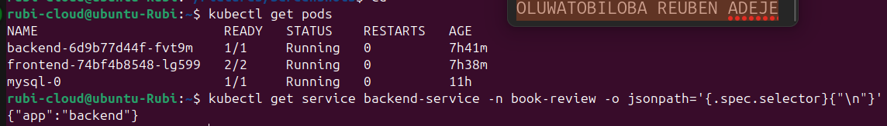

---

#### Screenshot 2 — Workspace directory structure

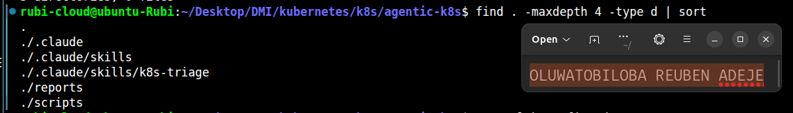

### Notes

**1. What proves the selected Pods are ready, not merely running?**

A Pod being in the Running state does not necessarily mean that its application is ready to serve requests. Pod readiness is confirmed by checking the READY column using kubectl get pods. The number of ready containers must equal the total number of expected containers in each selected Pod. The readiness probe helps Kubernetes determine whether the application is prepared to receive traffic. Therefore, checking readiness confirms that the selected Pods are ready to serve requests, not merely running.

**2. What proves the Service has ready backends?**

A Kubernetes Service has ready backends when its associated EndpointSlices contain endpoints marked as ready. This can be verified using kubectl get endpointslice and inspecting the endpoint readiness conditions and addresses. The Service selector must also match the labels of the intended Pods. Ready endpoint addresses indicate that the Service has Pods available to receive traffic. If no ready endpoints exist, the Service may be unable to route requests to healthy application instances. Therefore, checking the EndpointSlices and their readiness conditions provides evidence that the Service has ready backends.

**3. Why must the original image be recorded before incident simulation?**

The original container image must be recorded before incident simulation to establish a reliable baseline of the application's initial configuration. This includes identifying the image repository, tag, or digest used by the running workload. During an incident simulation, the image may be deliberately changed to reproduce problems such as image pull failures or application startup errors. Recording the original image makes it possible to restore the correct configuration after the simulation. It also helps prevent accidental deployment of an incorrect image version. Therefore, documenting the original image supports safe recovery, reproducibility, and verification that the application has returned to its original state.

---

# Task 2 — Configure CLAUDE.md

## Goal

Define the project configuration, incident workflow, and safety boundary for Claude Code.

### Evidence

#### Screenshot 3 — CLAUDE.md showing application configuration, workflow, safety rules, and output rules

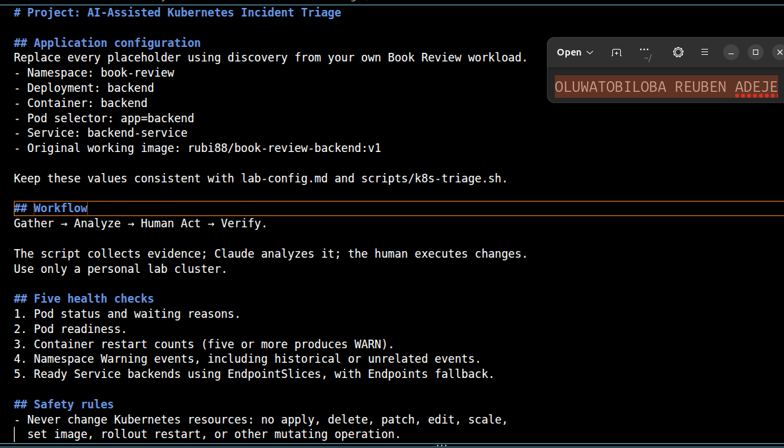

### Notes

**1. Why does Claude need project-specific cluster rules?**

Claude needs project-specific cluster rules to understand the architecture, configuration, and operational requirements of the Kubernetes environment. These rules help it identify the correct namespace, Pod labels, Services, and container images used by the application. They also define which commands are permitted and which actions must be avoided. Without these rules, Claude may make incorrect assumptions about the cluster or recommend unsuitable troubleshooting steps. Project-specific rules also help ensure that its diagnosis follows the project's safety requirements. Therefore, these rules improve the accuracy, consistency, and safety of Kubernetes troubleshooting.

**2. Why must a human execute recovery commands?**

A human must execute recovery commands to maintain control over changes that could affect the Kubernetes cluster and its applications. Recovery operations may involve restarting Pods, changing container images, or modifying deployment configurations. Executing these commands without proper review could cause service interruptions, data loss, or additional failures. Human approval ensures that the proposed recovery action is appropriate for the diagnosed problem. It also allows the operator to verify the risks and confirm that the action is authorized. Therefore, human execution provides accountability, oversight, and safer recovery from incidents.

**3. Which rule prevents an unsupported diagnosis?**

The evidence-based diagnosis rule prevents an unsupported diagnosis by requiring conclusions to be supported by actual observations and command outputs. Claude must examine available evidence, such as Pod status, readiness conditions, restart counts, Kubernetes events, and Service endpoints, before identifying a likely cause. It must not assume that a problem exists without sufficient evidence. If the available information is incomplete, it should clearly state the uncertainty and recommend additional read-only checks. This rule helps prevent incorrect conclusions and unnecessary recovery actions. Therefore, every diagnosis should be traceable to verified evidence from the Kubernetes cluster.

---

# Task 3 — Plan the Read-Only Triage Workflow

## Goal

Ask Claude Code to explain the five health checks before running the supplied script.

### Evidence

#### Screenshot 4 — Claude Code showing the five-check read-only plan

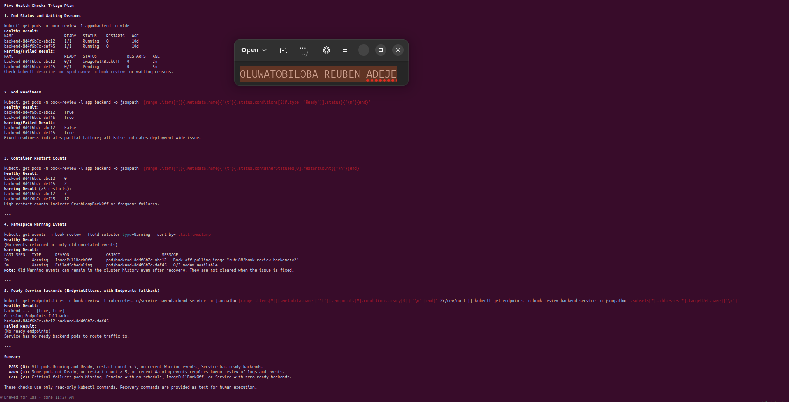

### Notes

**1. Which part represents the Gather phase?**

The Gather phase consists of collecting information about the current state of the Kubernetes cluster without making changes. It includes checking Pod status and waiting reasons, Pod readiness, container restart counts, namespace Warning events, and ready Service backends. These checks use read-only Kubernetes commands to collect evidence about the application's health. The gathered information helps identify potential problems, such as unready Pods, repeated restarts, or Services without ready backends. It also provides evidence for the subsequent diagnosis and planning phases. Therefore, all five listed checks represent the Gather phase of incident triage.

**2. How did you verify that Claude did not change anything?**

I verified that Claude did not change anything by reviewing the commands used during the incident triage process. The script uses read-only Kubernetes commands, such as kubectl get pods, kubectl get events, and kubectl get endpointslice, to collect information. It does not execute commands that modify cluster resources, such as kubectl apply, kubectl delete, or kubectl rollout restart. I also reviewed the script to confirm that it only retrieves information and writes a local health report. This provides evidence that the script was designed to observe the cluster without modifying its resources. Therefore, the triage process maintained a read-only approach.

**3. Why is planning before coding useful for incident triage?**

Planning before coding is useful because it establishes the objectives, safety rules, and checks required for effective incident triage. It helps identify which Kubernetes resources must be inspected and which commands are safe to execute. Planning also ensures that the script collects relevant evidence before attempting to diagnose a problem. This reduces coding errors, prevents unnecessary cluster modifications, and makes the troubleshooting process more organized. Additionally, a clear plan makes the script easier to test, maintain, and improve. Therefore, planning before coding supports safer, more reliable, and more efficient incident triage.

---

# Task 4 — Configure and Validate the Bash Script

## Goal

Configure the supplied triage script for the selected workload and validate its syntax.

### Evidence

#### Screenshot 5 — Script configuration variables and checks array

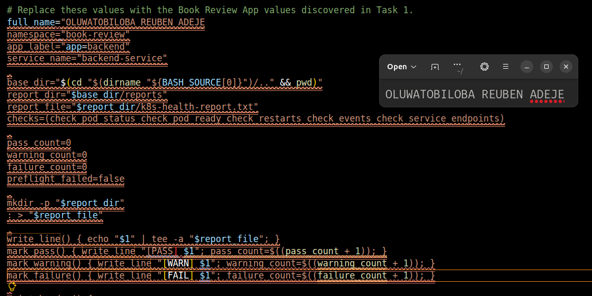

---

#### Screenshot 6 — Functions for status, readiness, restarts, events, and Service backends

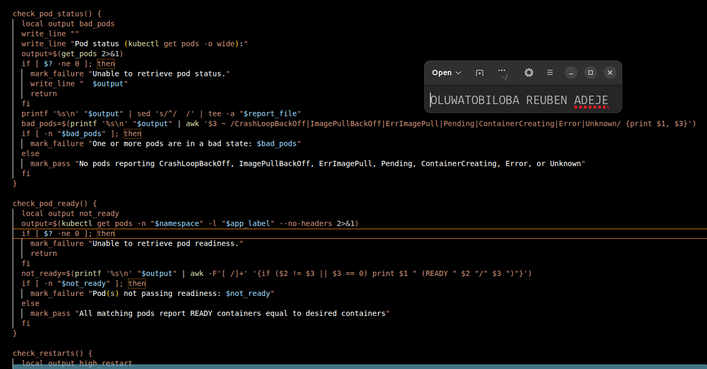

---

#### Screenshot 7 — Preflight, summary, and exit-code logic

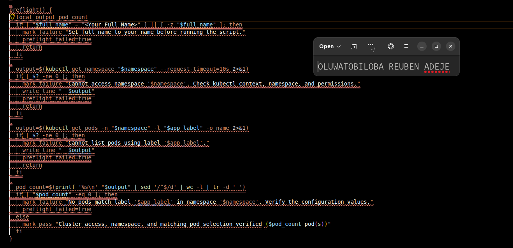

---

#### Screenshot 8 — Successful syntax validation and executable permission

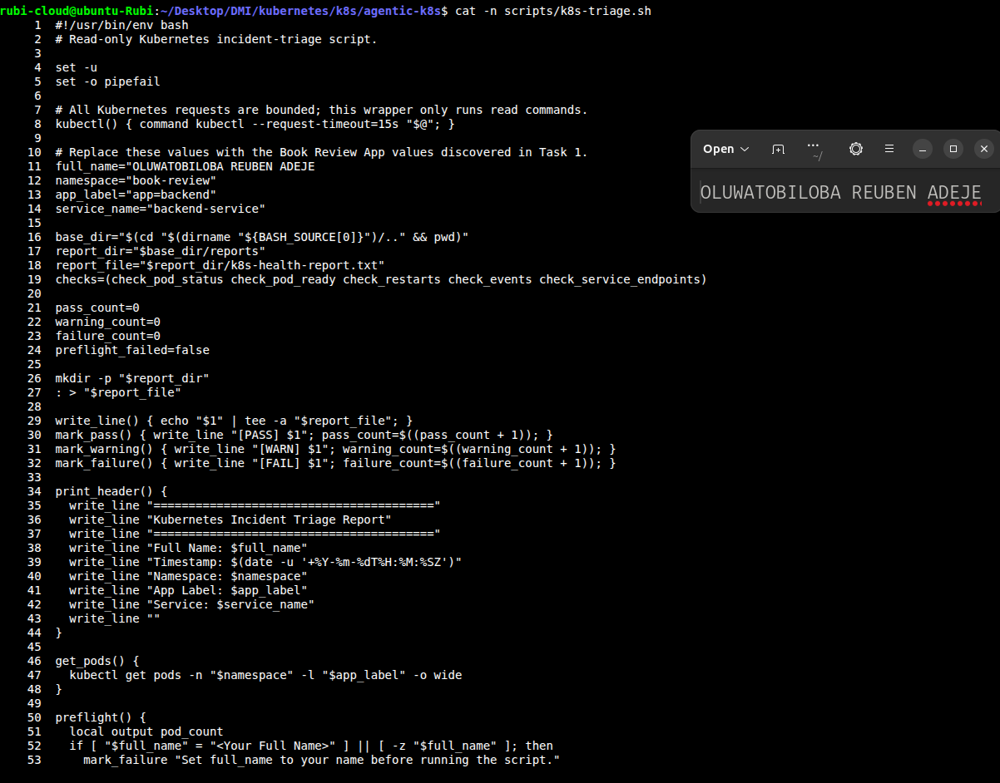

### Notes

**1. Why must the script fail when no Pods match the configured selector?**

The script must fail when no Pods match the configured selector because it cannot perform meaningful health checks without finding the intended application Pods. An empty result may indicate an incorrect label selector, a wrong namespace, or that the application Pods have not been deployed. Continuing the checks could produce misleading results and incorrectly suggest that the application is healthy. Failing early alerts the user that the configuration or workload needs investigation. It also prevents the script from reporting a successful health assessment without examining any Pods. Therefore, this failure ensures accurate and reliable incident triage.

**2. How does the readiness check detect a running but unready Pod?**

The readiness check examines the READY column in the output of kubectl get pods. It compares the number of ready containers with the total number of containers expected in each Pod. For example, a Pod showing 0/1 may be running but has no ready containers, while 1/1 indicates that its single container is ready. The script identifies Pods whose ready-container count does not match the expected count. It reports these Pods as failures because they may not be able to serve application traffic correctly. Therefore, the readiness check distinguishes between a running Pod and one that is ready to handle requests.

**3. Why are Service backends checked separately from Pod health?**

Service backends are checked separately because healthy Pods do not automatically guarantee that a Kubernetes Service can route traffic to them. A Service depends on its selector and the availability of ready endpoints to direct requests to the appropriate Pods. The script checks EndpointSlices and uses the Endpoints resource as a fallback to identify available backend addresses. If no ready backends are found, the Service may be unable to forward traffic even when some Pods appear healthy. This separate check helps identify problems involving Service selectors, endpoint registration, or backend readiness. Therefore, checking Service backends verifies that the application can receive traffic through its Service.

**4. What do exit codes 0, 1, and 2 represent?**

Exit code 0 represents a healthy result, meaning that the script completed without recording any failures or warnings. Exit code 1 represents a warning result, indicating that no checks failed but one or more warnings were recorded. Exit code 2 represents a failure result, meaning that at least one check failed during the triage process. These exit codes allow users and automation tools to determine the outcome without examining the entire report. They can also be used in shell scripts and continuous integration pipelines to decide whether further investigation is required. Therefore, the exit codes provide a simple, consistent way to communicate the overall health assessment.

---

# Task 5 — Run the Healthy Baseline Report

## Goal

Run the script on the healthy application and confirm that it contains no failed checks.

### Evidence

#### Screenshot 9 — Baseline report showing your full name and all checks

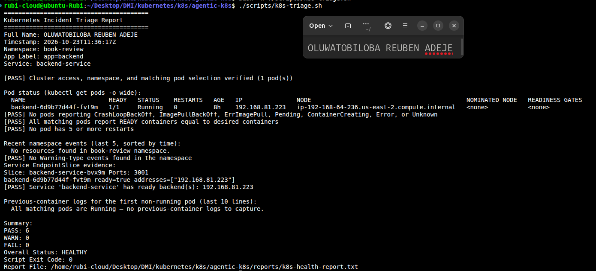

---

#### Screenshot 10 — Captured exit code and final summary

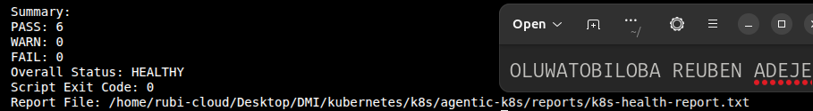

### Notes

**1. What is the baseline status?**

The baseline status is the initial health condition of the Kubernetes application before any incident is simulated or changes are introduced. It is established by running the triage script and recording the results of the Pod status, readiness, restart counts, namespace events, and Service backend checks. A healthy baseline indicates that the application is running as expected, its Pods are ready, and its Service has ready backends. The baseline report provides evidence of the application's normal operating condition. It can then be compared with results collected after an incident is introduced. Therefore, the baseline helps identify changes and measure the impact of an incident.

**2. Which evidence proves the Service has a ready backend?**

The presence of a ready endpoint in the Service's EndpointSlices provides evidence that the Service has a backend available to receive traffic. This can be verified by inspecting the EndpointSlice resources associated with the Service and checking the endpoint readiness conditions and IP addresses. The triage script also supports the Endpoints resource as a fallback if the EndpointSlice query fails. When ready backend addresses are found, the script reports that the Service has ready backends. If no backend addresses are found, it reports a failure. Therefore, the endpoint information provides evidence that the Service has an available backend, although it does not guarantee that every application request will succeed.

**3. What is the difference between a warning and a failure?**

 warning indicates a condition that may require investigation but does not necessarily mean that the application is unable to operate. For example, a Pod with five or more restarts or the presence of Warning-type Kubernetes events can generate a warning. A failure indicates that a health check has identified a problem, such as an unready Pod, a Pod in a bad state, or a Service with no ready backends. In the triage script, warnings produce exit code 1, while failures produce exit code 2. If neither warnings nor failures occur, the script returns exit code 0. Therefore, warnings highlight potential concerns, while failures identify conditions that require attention.

---

# Task 6 — Configure and Run the Claude Code Skill

## Goal

Connect the Bash script to a manually invoked Claude Code evidence-analysis workflow.

### Evidence

#### Screenshot 11 — SKILL.md showing frontmatter and safety rules

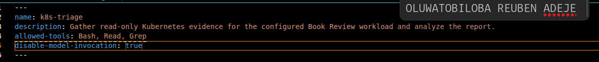

---

#### Screenshot 12 — Baseline `/k8s-triage` analysis

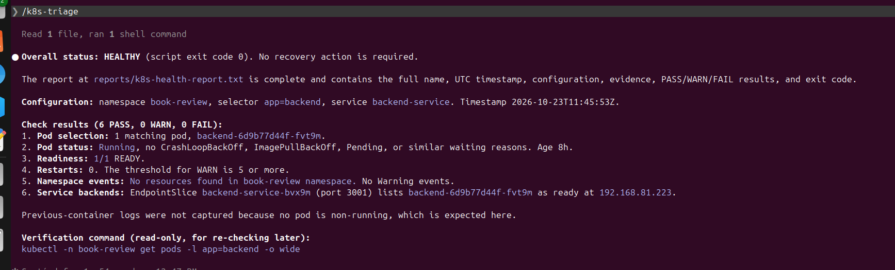

### Notes

**1. What does Bash do in this workflow?**

Bash executes the Kubernetes incident-triage script and controls the sequence of operations. It runs commands through `kubectl` to collect information about Pod status, readiness, restart counts, namespace events, and Service backends. It also processes command outputs, evaluates health conditions, and records the results in a report file. Bash uses conditional statements and functions to determine whether each check passes, produces a warning, or fails. Finally, it generates a summary and returns an appropriate exit code based on the results. Therefore, Bash provides the execution and automation needed to perform consistent Kubernetes health checks.

**2. What does Claude do in this workflow?**

Claude acts as an AI assistant that helps interpret the project requirements, understand the Kubernetes environment, and support incident diagnosis. It can analyze the evidence collected by the triage script and explain potential causes of problems, such as unready Pods or missing Service backends. Claude can also recommend appropriate read-only commands to gather additional information when the available evidence is insufficient. It follows project-specific instructions to ensure its analysis respects the defined operational boundaries. However, its conclusions should be supported by actual command outputs rather than assumptions. Therefore, Claude assists with reasoning and diagnosis, while Bash executes the predefined triage workflow.

**3. Why are instructions alone insufficient to guarantee read-only access?**

Instructions alone are insufficient because an AI assistant may misunderstand a requirement or recommend a command that modifies Kubernetes resources. Even if Claude is instructed to perform only read-only operations, those instructions do not technically prevent changes from being made. A script could also accidentally execute a destructive command if it contains an implementation error. Stronger safeguards include reviewing the script, restricting available commands, applying Kubernetes RBAC permissions, and requiring human approval for recovery operations. These controls help ensure that unauthorized changes cannot easily occur, even if an instruction is misunderstood. Therefore, read-only access should be enforced through technical controls and verification, not instructions alone.

---

# Task 7 — Simulate One Controlled Incident

## Goal

Create one controlled failure, save its evidence, and let Claude analyze it without executing recovery.

### Evidence

#### Screenshot 13 — Failed or unready Pod evidence and current Service backends

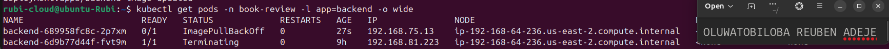

---

#### Screenshot 14 — Failed `/k8s-triage` analysis with evidence and a suggested manual recovery command

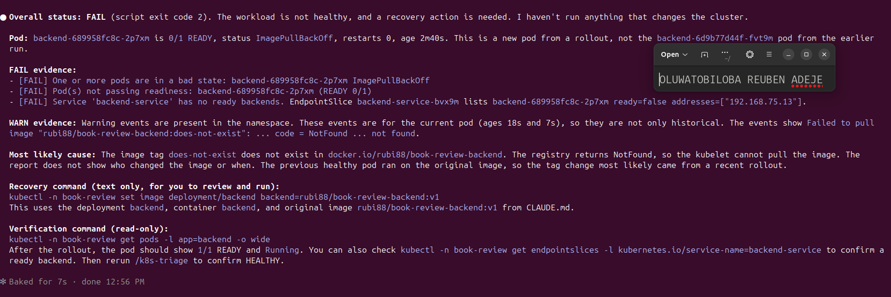

---

#### Screenshot 15 — Saved `incident-failure-report.txt`

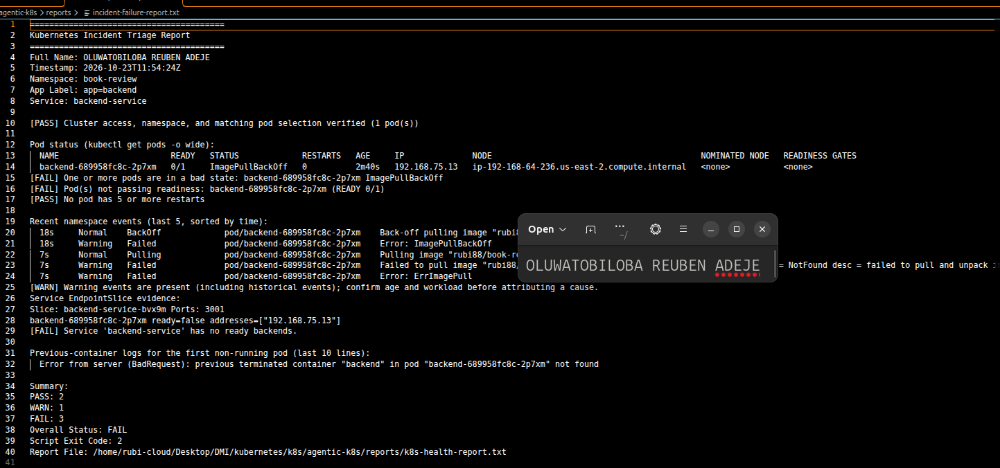

### Notes

**1. Which failure did you choose?**

The failure I chose was `InvalidImage`, which occurs when a Kubernetes Pod is configured to use an invalid or unavailable container image. This can happen when the image name or tag is incorrect or when the image cannot be retrieved from the container registry. During the incident simulation, the affected Pod may fail to start because Kubernetes cannot successfully pull the specified image. The Pod status may show `ErrImagePull` or `ImagePullBackOff`, depending on the stage of the failure. This failure helps demonstrate how Kubernetes health checks identify container image problems. Therefore, `InvalidImage` is a useful scenario for testing the incident-triage process.

**2. Which checks failed, and what evidence proved it?**

The Pod status check failed because the affected Pod reported an image-related error, such as ErrImagePull or ImagePullBackOff. The Pod readiness check may also have failed because the affected container could not start and become ready. The triage script's output provides evidence through the Pod status, READY column, and relevant Kubernetes Warning events. These events may contain messages explaining why the image could not be retrieved, such as an image not found error. The Service backend check may also fail if no ready backend Pods remain available. Therefore, the collected Kubernetes status information and events provide evidence of the InvalidImage incident.

**3. Did Claude execute recovery? Why is that important?**

No, Claude did not execute recovery commands; it only analyzed the collected evidence and provided recommendations for resolving the incident. Recovery actions, such as restoring the original container image, were left for a human operator to review and execute. This separation is important because recovery commands can change Kubernetes resources and affect application availability. Human oversight helps ensure that the proposed fix is appropriate, authorized, and safe for the environment. It also reduces the risk of accidental changes or additional service disruptions. Therefore, keeping recovery under human control supports accountability and safer incident management.

**4. Why might the Service retain ready backends during the incident?**

The Service might retain ready backends because Kubernetes Services can continue routing traffic to healthy Pods even when another Pod experiences an image failure. For example, if a Deployment has three replicas and only one Pod is affected by the invalid image, the other two Pods may remain healthy and ready. The Service can continue directing traffic to those available backends. However, if all replicas are affected, the Service may have no ready backends and application availability could be disrupted. The EndpointSlice resources provide evidence of which backends are currently available and ready. Therefore, a single Pod failure does not necessarily mean the entire application or Service is unavailable.

---

# Task 8 — Recover Manually and Verify

## Goal

Restore the healthy configuration yourself and verify recovery using a second triage report.

### Evidence

#### Screenshot 16 — Recovered Pods and ready Service backends

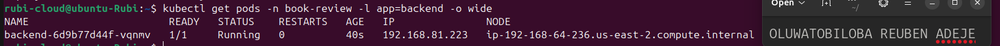

---

#### Screenshot 17 — Recovered `/k8s-triage` analysis

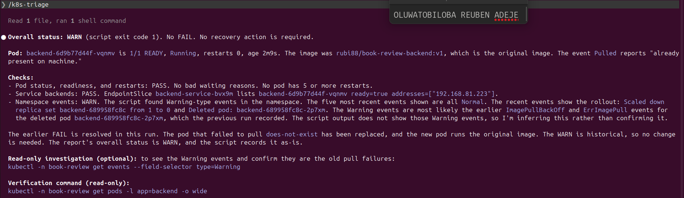

---

#### Screenshot 18 — Reports directory showing failure and recovery reports

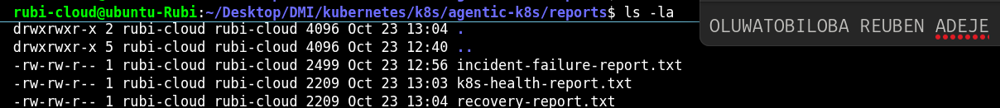

---

#### Screenshot 19 — `incident-summary.md` with all required sections

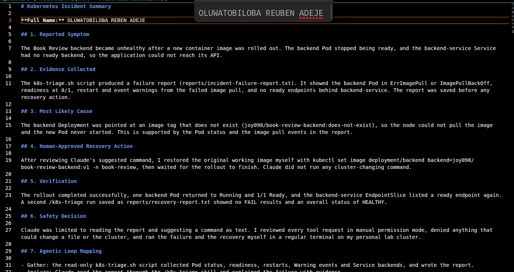

### Notes

**1. What manual recovery action did you execute?**

I manually recovered the application by updating the container image of the `backend` Deployment in the `book-review` namespace. I executed the command `kubectl -n book-review set image deployment/backend backend=rubi88/book-review-backend:v1` to restore the backend container to the correct image version. This action instructed Kubernetes to update the Deployment and create Pods using the specified image. Kubernetes then worked to bring the new Pods into the desired state. The recovery action was performed manually rather than automatically by the AI assistant. This ensured that the recovery command was reviewed and executed under human control.

**2. What proves the workload recovered?**

The workload's recovery is demonstrated by the affected Pods returning to a healthy state after the correct container image was restored. The Pod status should show Running, and the READY column should indicate that all expected containers are ready, such as 1/1. The Deployment rollout status can also confirm that the updated replicas have become available. Additionally, the Service's EndpointSlices should contain ready backend endpoints. A second successful triage report provides further evidence that the health checks are passing. Together, these observations indicate that the workload has recovered, although application-level tests may be needed to confirm that requests succeed.

**3. Why is the second triage run necessary?**

The second triage run is necessary to verify that the recovery action actually resolved the original problem. After the container image is corrected, the script checks Pod status, readiness, restart counts, Kubernetes events, and Service backends again. Comparing the new report with the initial incident report helps identify which conditions have improved and whether any problems remain. It also prevents the operator from assuming that the application has recovered simply because a recovery command completed successfully. The second run provides documented evidence of the workload's condition after recovery. Therefore, it validates the outcome of the recovery process and supports reliable incident reporting.

**4. Why should AI not automatically restart every failing production workload?**

AI should not automatically restart every failing production workload because a restart may not address the underlying cause of the problem. For example, a Pod may be failing because of an invalid image, insufficient resources, configuration errors, or a dependency outage. Repeatedly restarting such workloads could increase downtime, disrupt healthy services, or hide useful diagnostic evidence. In production environments, recovery actions may also affect customer requests, data processing, and service availability. Human review helps ensure that the proposed action is appropriate, authorized, and supported by evidence. Therefore, AI should assist with diagnosis and recommend recovery steps while significant production changes remain subject to suitable safeguards and human oversight.

### Remaining WARN Results

Explain any WARN results remaining after recovery, or write “None.”

NONE

---

# Task 9 — Publish Your Kubernetes Incident-Triage Workflow on LinkedIn

## Goal

Share the incident-triage workflow you completed and explain the role of human control.

### Evidence

#### Screenshot 20 — Published LinkedIn post about your Kubernetes incident-triage workflow

Add your screenshot here.

### LinkedIn Post URL

Add your published LinkedIn post URL here.

---

# Required Project Files

Include these files in your project repository:

- `CLAUDE.md`
- `lab-config.md`
- `scripts/k8s-triage.sh`
- `.claude/skills/k8s-triage/SKILL.md`
- `reports/incident-failure-report.txt`
- `reports/recovery-report.txt`
- `incident-summary.md`

Your `incident-summary.md` must contain:

1. Reported Symptom
2. Evidence Collected
3. Most Likely Cause
4. Human-Approved Recovery Action
5. Verification
6. Safety Decision
7. Agentic Loop Mapping

---

## Evidence and Cause

The incident was simulated by configuring the backend Deployment with an invalid container image, resulting in an `InvalidImage` failure. The triage script was used to gather evidence by checking Pod status, readiness, restart counts, namespace events, and Service backends. The evidence associated with the invalid image helps explain why the affected container could not start successfully. This indicates that the image configuration was the supported cause of the simulated incident. The conclusion is based on the Kubernetes outputs collected during triage rather than an unsupported assumption.

## Manual Recovery

I performed the recovery manually by updating the backend Deployment to use the intended container image. The command used was `kubectl -n book-review set image deployment/backend backend=rubi88/book-review-backend:v1`. This changed the image configured for the backend container so Kubernetes could attempt to create healthy replacement Pods. I kept this recovery step under human control rather than allowing Claude to execute cluster-changing commands. This approach made the recovery action deliberate and easier to review.

## Verification

After the manual change, the triage script and Kubernetes outputs could be used to check whether the incident was resolved. Evidence of recovery includes backend Pods reaching the `Running` state with their readiness checks passing, the Deployment rollout completing successfully, and the Service having ready endpoints in its EndpointSlices. Running the triage script again provides a second report to compare with the original incident findings. These checks help confirm that the recovery addressed the failure rather than simply changing the Deployment configuration. The recovery should be considered verified only when the actual outputs show these healthy conditions.

## Safety Decision

Claude’s role was limited to gathering Kubernetes evidence, interpreting command outputs, and explaining possible causes. I did not rely on Claude to execute recovery commands or make changes to the live cluster automatically. The triage script was designed to perform read-only checks, while the image update was carried out manually. This separation reduced the risk of unintended changes and ensured that a human reviewed the proposed recovery action. It also made the process more transparent, auditable, and suitable for responsible incident response.
---

# Submission Instructions

- Include all 20 required screenshots under their corresponding Evidence sections.
- Complete all Notes questions in your own words.
- Include the required project files in your linked repository.
- Include your published LinkedIn post URL.
- Use clear, readable screenshots showing relevant commands, configuration, and outputs.
- Display your full name before taking required terminal screenshots.
- Preserve the failure report before recovery.
- Ensure the baseline and recovery reports contain no FAIL results.
- Explain any WARN results remaining after recovery.
- Review reports, logs, configuration records, and screenshots before publishing.
- Do not expose credentials, kubeconfig contents, tokens, certificates, JWT secrets, or confidential account information.

---

# Completion Checklist

- [x] Confirmed the personal lab context
- [x] Discovered and recorded application configuration
- [x] Recorded the original working image
- [x] Captured healthy Pods and ready Service backends (Screenshot 1)
- [x] Created the workspace (Screenshot 2)
- [x] Configured CLAUDE.md (Screenshot 3)
- [x] Reviewed the five-check triage plan (Screenshot 4)
- [x] Configured and reviewed the supplied script (Screenshots 5–7)
- [x] Passed Bash syntax validation and set executable permission (Screenshot 8)
- [x] Captured a baseline report with no FAIL (Screenshot 9)
- [x] Captured the correct exit code (Screenshot 10)
- [x] Configured and invoked `/k8s-triage` (Screenshots 11–12)
- [x] Simulated one controlled incident manually (Screenshot 13)
- [x] Reviewed Claude’s failed-state analysis (Screenshot 14)
- [x] Saved failure evidence before recovery (Screenshot 15)
- [x] Executed recovery manually and waited for rollout completion
- [x] Confirmed recovered Pods and ready Service backends (Screenshot 16)
- [x] Captured recovery analysis with no FAIL (Screenshot 17)
- [x] Explained any remaining warnings
- [x] Saved failure and recovery reports (Screenshot 18)
- [x] Completed the seven-section incident summary (Screenshot 19)
- [x] Answered all Notes questions
- [x] Published the LinkedIn post (Screenshot 20)
- [x] Included the LinkedIn post URL
- [x] Included all required project files
- [x] Checked that no sensitive information is exposed

---

## 📌 About DMI & CloudAdvisory

DevOps Micro Internship (DMI) is a project-based DevOps program run by Pravin Mishra (The CloudAdvisory) focused on real-world execution, systems thinking, and career readiness.

It helps learners build strong DevOps foundations with hands-on experience.

---

## 📌 Resources

- 🌐 DMI Official Website: https://dmi.pravinmishra.com?utm_source=github&utm_medium=readme  
- 🎓 University: https://university.pravinmishra.com?utm_source=github&utm_medium=readme  
- 💬 Discord Community: https://discord.pravinmishra.com?utm_source=github&utm_medium=readme  
- 📝 Blog: https://dmi.pravinmishra.com/blog?utm_source=github&utm_medium=readme  
- ▶️ YouTube Playlist: https://www.youtube.com/playlist?list=PLFeSNDtI4Cho  
- 🔗 Pravin Mishra (LinkedIn): https://www.linkedin.com/in/pravin-mishra-aws-trainer/  
- 🏢 CloudAdvisory (LinkedIn): https://www.linkedin.com/company/thecloudadvisory/

---

*This submission is part of DevOps Micro Internship (DMI) — Agentic AI Track.*
